# 现代食品安全检测技术

本篇文章汇总本门课程各个章节知识点、内容小结、题目和解析；小一号字体为编者个人理解，仅供参考；各章节知识点内容根据个人理解重新排版、删减，仅供参考；仅汇总重点，仅供参考；正式学习请阅览教材与课件，或者听老师讲课，这门课还是很有意思的。

快捷键CTRL+F，可以页面内查找

尝试用自己的话解释重要概念。尽量把所有概念的英文记下来，至少英文缩写要认识。看不完的话可以先看最后面的题，先把题过几遍在说。

绪论：

仪器分析的特点:

灵敏度高、选择性高、简便速度快、样本用量少、适应性强

相对误差大、设备昂贵、不适用于常量分析、分析成本高

常用样品处理的方法:溶解、分离、富集

仪器分析方法主要评价指标：精密度（用偏差衡量）、灵敏度（标准曲线的斜率）、准确度（用误差衡量）、选择性、标准曲线、检出限

样本采集的基本原则:典型、代表、适时性

样本保存基本原则:不损失、不污染、不变质

仪器分析方法可分为：光学分析法（原子光谱法和分子光谱法）、分离分析法（气相色谱法、液相色谱法、电色谱法、薄层色谱法）、电化学分析法（电位分析法、电导分析法、电泳分析法）、其他分析法（质谱分析法、热分析法、分析仪器联用技术）

• 基于物质光化学性质而建立起来的分析方法称之为光化学分析法。 分为：光谱分析法和非光谱分析法。

• 光谱分析法是指在光（或其它能量）的作用下，通过测量物质产生的发射光、

吸收光或散射光的波长和强度来进行分析的方法。按物质粒子类型分为：原子

光谱法和分子光谱法。

仪器分析与化学分析相比，下列说法正确的是

A仪器分析灵敏度高

B仪器分析样本用量少

C仪器分析相对误差小

D仪器分析选择性好

答案：ABD

A仪器分析的检测下限远低于化学分析，可检测至痕量甚至超痕量级别（如10⁻¹²g甚至更低），而化学分析通常在毫克级，无法有效检测微量成分。

B仪器分析所需样品量通常为微升、微克级，而化学分析需毫升或毫克级，仪器分析更适合微量或珍贵样品。

C错误。仪器分析的相对误差通常为1%~10%，而化学分析误差可控制在千分之几，因此仪器分析相对误差更大，更适合微量分析，不适用于常量高含量成分的精确测定。

D仪器分析选择性好正确。通过调节仪器参数或联用技术，可有效分离并测定复杂混合物中的特定组分，避免共存组分干扰。

简答题：2.准确度的评价方法 （食品农残的价方法）

食品中农药残留分析—准确度评价方法

1. 加标回收实验

在空白样品中加入已知量农药标准品，按方法测定，计算回收率，反映结果准确程度。

2. 标准物质对照法

采用有证标准物质（CRM）进行测定，将测定值与标准值比较，评价准确度。

3. 方法比对实验

用国标方法或权威方法与待测方法同时测定同一样品，比较结果一致性。

4. 实验室间验证

多个实验室对同一样品协同测定，统计结果偏差，评价方法整体准确度与可靠性。

光谱分析法导论

一、本章学习要求

（1）掌握电磁波的本质

（2）掌握光谱分析的基本原理和常见分类方法

（3）了解光谱仪、色散元件及检测器

电磁辐射的基本性质

Basic properties of electromagnetic radiation

① 以接近光速(真空中为光速)传播的能量:

② 能量非均匀连续分布,集中于辐射产生的微粒。

电磁辐射具有波动性和微粒性（波粒二象性） 波动性公式：c（光速） = λ（波长）ν（频率） = ν/σ（波速，波长λ的倒数，即σ=1/λ）

此公式描述了电磁波作为“波”的传播特性，三者之间相互关联。

粒子性公式：E（光子能量） = hν = hc/λ（h是普朗克常数（约为 6.6262×10⁻³⁴ J·s））

此公式揭示了电磁波作为“粒子”（光子）的能量特性，能量与频率成正比，与波长成反比。

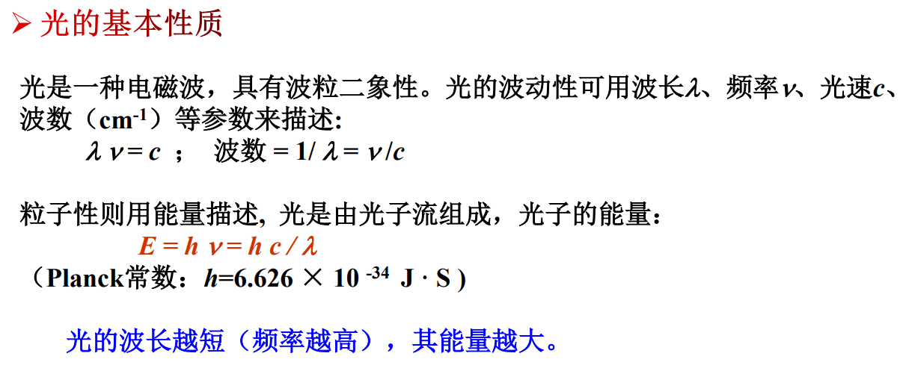

光谱分析法Spectrometric Analysis（英文，考过名词解释）：基于能量作用于物质后产生电磁辐射信号或电磁辐射与物质相互作用后产生辐射信号的变化而建立起来的一类分

析方法。 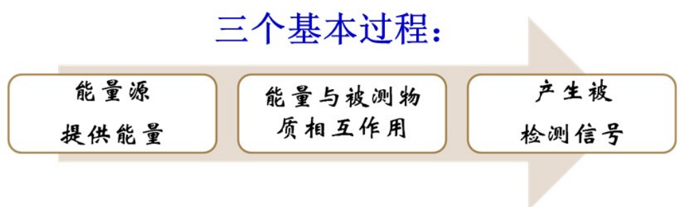

对上图的理解：

当电磁辐射作用于被测物质时,若其能量正好等于物质某两个能级之间的能量差时,电磁辐射就可能被物质所吸收。

那么，我们可以根据被测物质的“什么成分”吸收了这个能量，来进行分类：（下面就是吸收光谱）

1原子：电磁辐射(电磁波)作用于原子,其能量刚好与原子电子能级之差相符,被其吸收,发生能级跃迁。这个就是原子光谱。

基于原子外层电子跃迁：原子吸收光谱

基于原子内层电子跃迁：X射线吸收光谱

电子吸收能量，然后跃迁，这就是一条线状光谱。 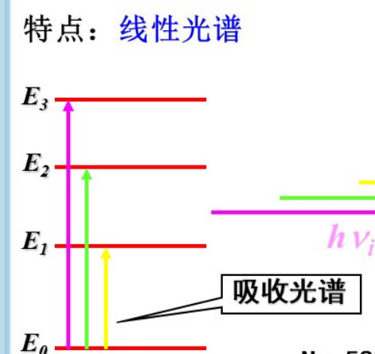

2分子：电磁辐射(电磁波)作用于分子,其能量刚好被分子吸收,发生能级跃迁。这就是分子光谱。

基于分子外层电子跃迁：紫外吸收光谱

基于振-转能级跃迁：红外吸收光谱 电子吸收能量，然后跃迁，这里和原子光谱一样，但不同的是同时分子中除了电子能级外还有振动能级和转动能级，这两个能级能量小，能量差也小，之间的差距很小，在图像上看就显得黏连在一起，像“带状”一样。其实是无数小“线状”连在一起排成“带状”

3磁场诱导吸收：在外磁场的作用下,某些原子与磁场相互作用而裂分为能量不同的核磁能级,吸收射频辐射后产生能级跃迁。 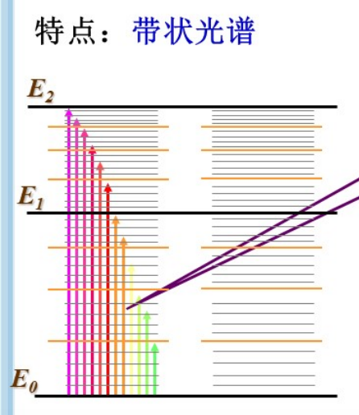

给微观粒子加个磁场，它们就会分层；再给点能量，它们就会能级跃迁。通过观察它们怎么能级跃迁来进行分析。（看它们吸收了什么特定辐射）

基于原子核的自旋能级跃迁：核磁共振波谱 (NMR);

基于电子的自旋能级跃迁：电子自旋共振波谱 (ESR)

上面讨论了原子/分子吸收了能量的光谱，通过分析它们吸收了哪些能量而定性定量；吸收之后要释放，所以接下来讨论发射光谱：

当处于较高能态的微粒返回到较低能态时,其多余的能量将以光子形式释放,从而产生电

磁辐射。回到低能态的过程叫弛豫。

研究原子发射出来的的光谱：原子发射光谱法

研究分子发射出来的光谱：荧光光谱、磷光光谱法和化学发光法 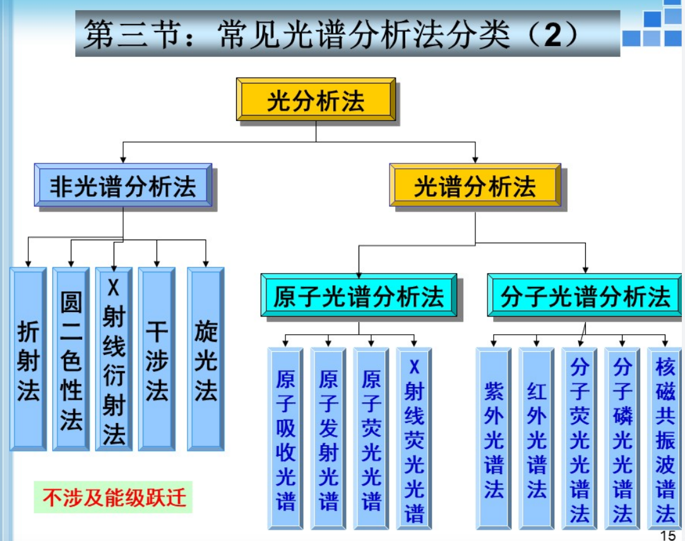

这张图主要了解光分析法分为两种，除了上面提到的研究原子/分子吸收或发射能量的“光谱分析法”外，还有非光谱分析法，这种方法不涉及能级跃迁，所以也没有光谱，即非光谱。 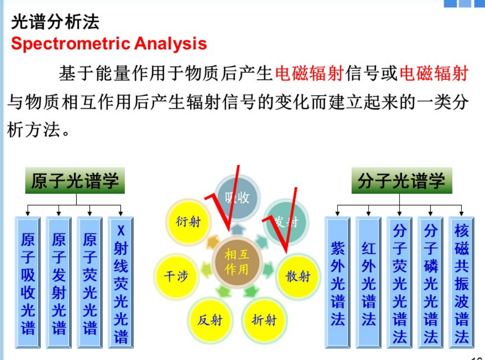

上面我们讨论了光谱分析法是通过研究原子/分子吸收或发射了什么能量，从而“定性”这个物质是什么的。那么接下来我们讨论光谱分析法如何“定量”：

光谱法定量依据：朗伯一比尔定律:在一定条件下,物质的吸光度与溶液的浓度和液层厚度的乘积成正比。A=lg(I0​/It​)=εbc 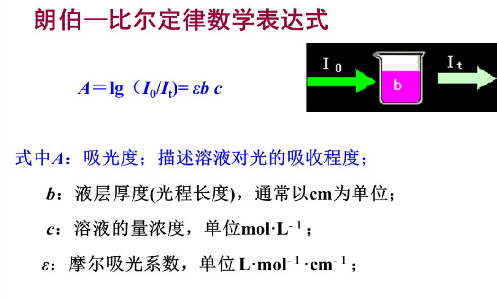

溶液颜色越深（浓度c越高）或者容器越厚（光程b越长），光线透过时被吸收得就越多，测得的吸光度A也就越大。

什么是摩尔吸光系数 ε：吸收物质在一定波长和溶剂条件下的特征常数;不随浓度和光程长度的改变而改变。在温度和波长等条件一定时,仅与吸收物质本身的性质有关,与待测物浓

度无关，所以可作为定性鉴定的参数;

但是！ε在不同波长下的值是不同的。在最大吸收波长处的摩尔吸光系数,以εmax表示。εmax表明了该物质最大限度的吸光能力,也反映了光度法测定该物质可能达到的最大灵敏度。 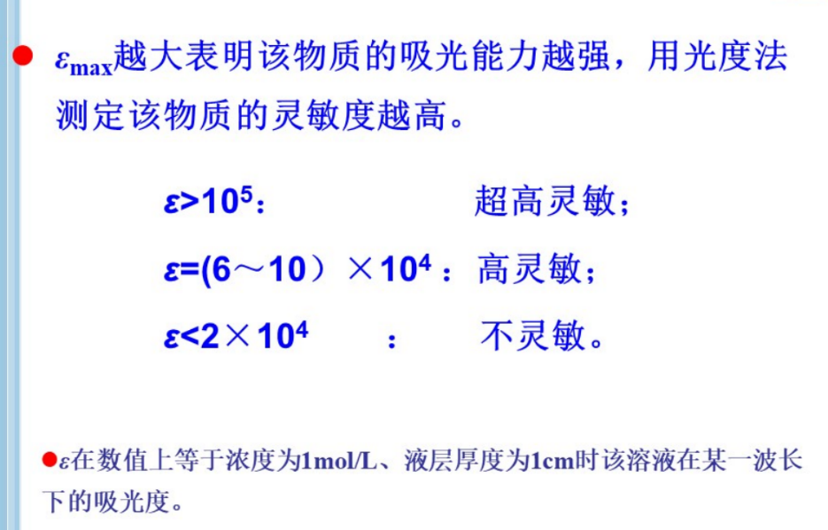

（有关朗伯比尔定律和摩尔吸光系数，后面的紫外可见吸收光谱法也会再讲一遍；也由此可见这个概念的重要性）

1频率可以用下面哪种方式可以表示( )

A .c / σ

B .σ · c

C .1 /λ

D .σ/ c

正确答案是：σ · c （c = λν= ν/σ，E= hν = hc/λ）

2下列分析法是基于成键电子能级跃迁开发出来的是( )

a.核磁共振波谱法

b.质谱法

c.紫外分光光度法

d.Raman光谱法

正确答案是：紫外分光光度法（当物质吸收紫外或可见光时，其分子中的成键电子（如σ电子、π电子）或孤对电子（n电子）会从基态跃迁至激发态，这种跃迁所需的能量对应于紫外-可见光区的波长范围。）

核磁共振波谱法是基于原子核在磁场中对射频辐射的吸收，反映的是核自旋能级的跃迁，与电子能级无关。

质谱法是基于分子或原子在电场和磁场中的质荷比（m/z）分离，不涉及电子能级跃迁。

Raman光谱法是基于光的散射现象，反映的是分子振动或转动能级的变化，不是电子能级跃迁。

3下列分析法是基于光的散射现象开发出来的是( )

a. Raman光谱法

b. 化学发光分析法

c. 红外光谱法

d. 核磁共振波谱法

正确答案是：Raman光谱法

4光量子的能量反比于辐射的( )

a. 波长

b. 传播速度

c. 波数

d. 频率

正确答案是：波长（E = hν = hc / λ）

红外光谱属于线状光谱

选择一项：

对

错

正确答案是“错”。

下列属于线状光谱的是

A红外光谱

B紫外光谱

C原子吸收光谱

D质谱

答案：C （AB是分子吸收光谱，D不是光谱）

名词解释：1.Spectrometric Analysis（光谱分析法）

Spectrometric Analysis（光谱分析法）

指基于物质与电磁辐射（光）相互作用产生的特征光谱，对物质进行定性、定量及结构分析的一类仪器分析方法。通过测量光谱的波长、强度等参数，确定物质的组成、含量及分子/原子结构。

红外光谱法(Infrared Spectrum )：IR 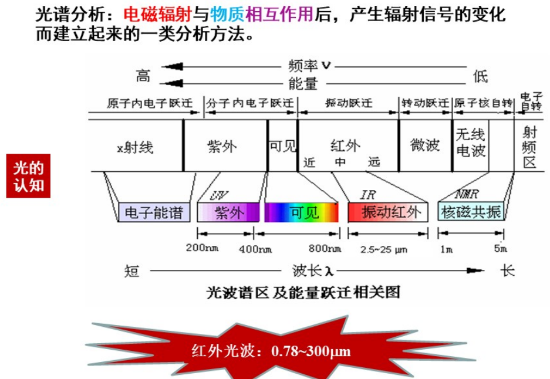

学习重点

（1）红外光谱的定义；

（2）红外光谱产生条件；

（3）红外光谱图三要素、影响因素；

（4）常见基团红外吸收带；

（5）实验基本注意事项；

红外光谱的定义:样品受到频率连续变化的红外光照射时,分子吸收其中一些频率的辐射,分子振动或转动引起偶极矩的净变化,使振-转能级从基态跃迁到激发态,相应于这些区域的透射光强减弱,记录百分透过率T%对波数或波长的曲线。

一般的红外吸收光谱主要指中红外范围而言,在400~4000cm

它的频率和能量只能使分子发生振动及转动能级的变化。（与之相对的是紫外-可见光谱，这部分光能量更高，能让分子发生电子跃迁）

红外光谱产生条件:

1:红外辐射的能量应与振动跃迁所需能量一致; （红外辐射的频率等于分子某个基团的振动频率，分子和辐射匹配上了，才可以进行下一步）（ ν红外=ν振这解释了为什么红外光谱是“指纹区”，因为不同的化学键（如C-H, C=O, O-H）有不同的固有振动频率，它们只会吸收特定频率的红外光。）

2:分子振动偶极矩必须发生变化。（偶极矩μ可以理解为衡量分子极性大小的物理量，极性可以理解为对称性，偶极矩μ≠0也就是分子“不对称”；单单分子振动而偶极矩不变，比如H2,O2,N2，也不会产生红外光谱）

描述红外光谱的三要素:峰位、峰数与峰强

峰位 —— 决定峰出现在哪里（横坐标），与力常数 K 呈正比，与原子折合质量数呈反比。

峰位对应的是吸收频率（或波数），它告诉我们是什么化学键在振动。这遵循胡克定律的物理模型。你可以把化学键想象成一根弹簧，连接着两个原子（小球），力常数 K （弹簧的硬度）：化学键越强（比如三键 &gt; 双键 &gt; 单键），相当于弹簧越硬，振动频率就越快，峰位就出现在高波数区（高频区）。所以 K 越大，频率越高（正比）。

折合质量（小球的质量）：连接的原子越轻（比如 H 原子），振动起来越灵活，频率就越快；原子越重，振动越慢。所以质量越大，频率越低（反比）。

也就是说峰在哪里，取决于键有多强（ K ）和原子有多重（质量）。

峰数 —— 决定有多少个峰，与振动自由度有关。

峰数对应的是分子有多少种不同的振动方式。

振动自由度是指分子在空间中独立的运动方式数量。对于一个由 N 个原子组成的分子：

非线性分子的自由度通常是 3N-6 。

线性分子的自由度通常是 3N-5 。

理论上有多少个自由度，就可能有多少个峰。但实际上，有些振动不产生偶极矩变化（红外非活性），有些峰频率太近重叠了，或者有些峰太弱看不见，所以实际看到的峰数往往少于理论计算值。

也就是说分子越大、原子越多，振动花样越多，潜在的峰也就越多

峰强 —— 决定峰有多高（纵坐标），跃迁概率，与偶极矩的变化有关。

峰强对应的是吸光度的大小，也就是吸收了多少光。

偶极矩的变化：这是最关键的因素。

振动时，偶极矩变化越剧烈，吸收的光子就越多，峰就越强。

极性强的键（如 C=O, O-H）在振动时电荷分布变化很大，所以它们的峰通常非常强（尖锐且深）。

极性弱的键（如 C=C）或对称性好的键，振动时电荷变化小，峰就比较弱。

跃迁概率：指分子从基态跃迁到激发态的可能性大小。可能性越大，吸收越强。

也就是说峰有多高，取决于这个振动是不是“极性很强”或者“动静很大”。变化越剧烈，信号越强。

总结：想知道这是什么键？看峰位（由键强和原子质量决定）。

想知道分子有多复杂？看峰数（由自由度决定）。

想知道这个基团极性大不大？看峰强（由偶极矩变化决定）。

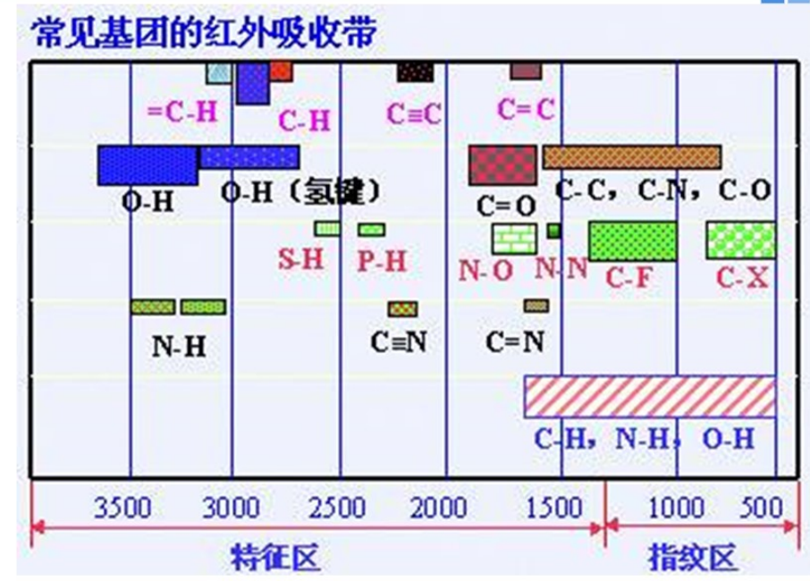

横坐标：波数

底部的数字（3500, 3000, ..., 500）代表波数，单位是 cm-1 。

左边（高波数区）：对应高频振动，通常涉及轻原子（如氢原子）的伸缩振动。

右边（低波数区）：对应低频振动，通常涉及重原子或弯曲振动。

两个核心区域

这张图被一条竖线分成了左右两半，这是红外光谱最重要的概念划分：

特征区（左侧，4000 ~ 1300 cm-1 ）

这是定性分析的主要区域。这里的峰通常比较稀疏，容易辨认，每个峰都对应着特定的官能团。

指纹区（右侧，1300 ~ 400 cm-1 ）

这是分子结构确认的区域。

这里的峰非常密集，就像人的指纹一样复杂。

用途：虽然很难一个个去认这些峰，但如果两个样品的指纹区完全重合，那它们就是同一种物质。

总结这张图的规律（结合之前的理论）峰位 —— 决定峰出现在哪里（横坐标），与力常数 K 呈正比，与原子折合质量数呈反比。

看质量：凡是带 H 的键（O-H, N-H, C-H），因为氢最轻（折合质量最小），所以都在最左边（高频区 &gt; 3000）。

看键强：三键（ K 最大， C≡C,C≡N ）在2000出头，双键（ K 次之，C=O,C=C）在1600-1800，单键（ K 最小）都在右边的指纹区。

接下来是常见有机物基团特征频率，涉及官能团、不饱和度计算等内容，因难度较大，高中没学过化学或已经忘光的同学请酌情学习。

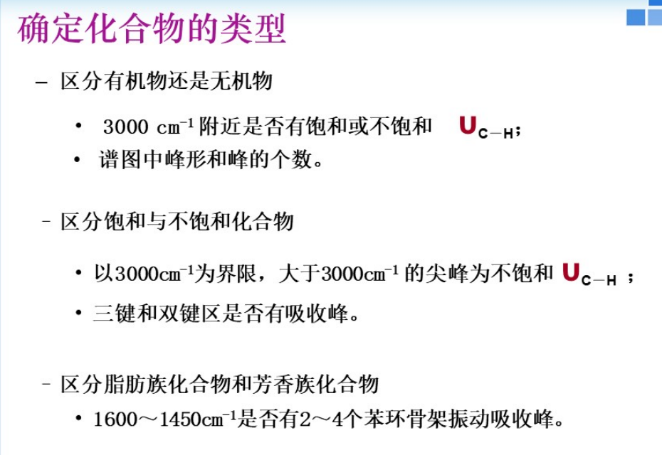

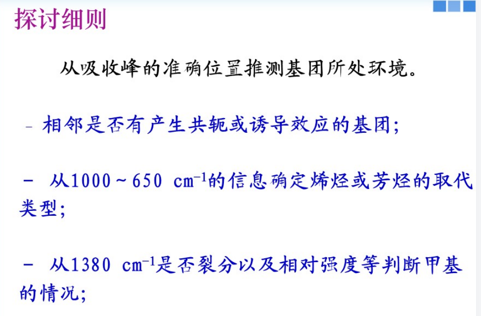 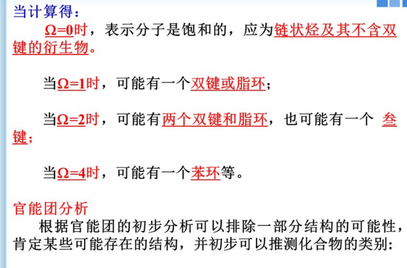 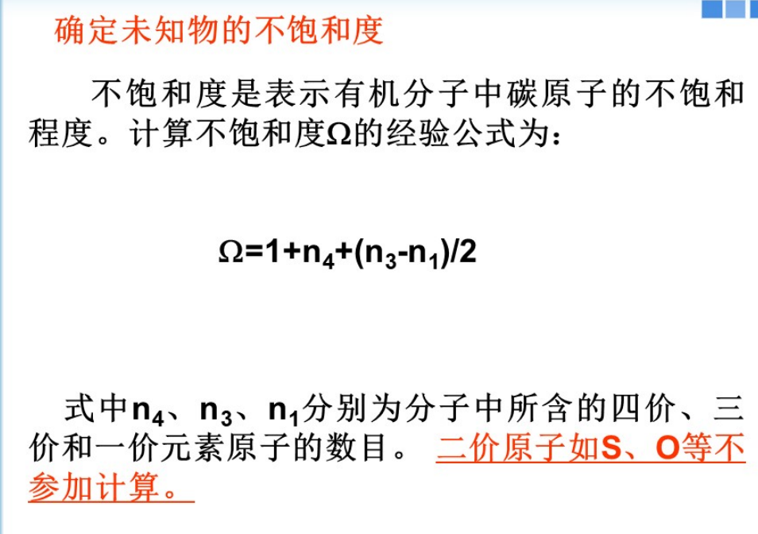

红外光谱仪：目前主要有两类红外光谱仪:色散型红外光谱仪 ，Fourier (傅立叶)变换

仪器包含光源、吸收池、单色器、检测器、记录系统五个部分。光源有Nernst灯（用氧化锆、氧化钇和氧化钍烧结而成，工作温度约为1700℃，要预热）和硅碳棒（由碳化硅烧结而成，1200-1500℃）；红外吸收池常用可透过红外光的NaCI、KBr、KRS-5等制成窗片，固体试样常与纯KBr混匀压片。

注意事项：试样应该是单一组分的纯物质,纯度应&gt;98%,便于与纯化合物的标准进行对照。)试样中不应含有游离水。水本身有红外吸收,会严重干扰样品谱,而且还会侵蚀吸收池的盐窗。

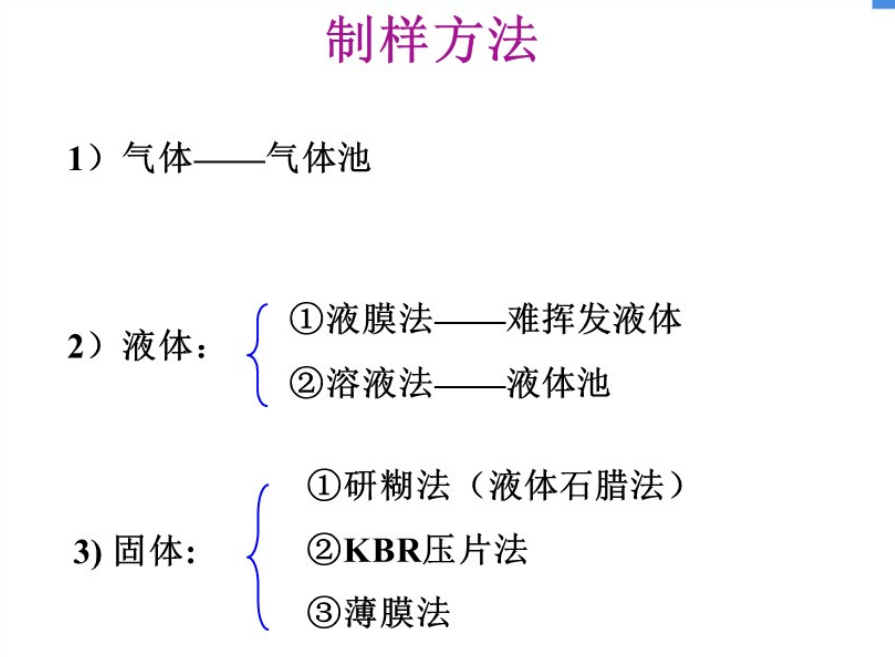

下列不可以观测到红外信号的是( )

a.水分子的不对称伸缩振动

b.二氧化碳不对称伸缩振动

c.二氧化碳的对称伸缩振动

d.水分子的对称伸缩振动

正确答案是：二氧化碳的对称伸缩振动。（红外吸收光谱的产生需满足两个基本条件：一是入射光频率与分子基团振动频率匹配；二是分子振动过程中必须伴随偶极矩的变化。若振动模式不引起偶极矩变化，则该振动是红外非活性的，无法在红外光谱中观测到吸收峰。

H20是非对称结构，伸缩振动偶极矩必然变化；CO2为对称结构，对称伸缩振动时偶极矩无变化）

下列化合物中羰基伸缩振动能级跃迁需要能量最高的是( )

a. 甲醛

b. 甲酸

c. 甲酰氯

d. 甲酰胺

正确答案是：甲酰氯

（这四个分子都含有羰基（C=O），但它们的结构式各不相同，以下是它们的详细结构式：

1. 甲醛（HCHO）

结构式：H—C(=O)—H

结构特点：最简单的醛，羰基碳连接两个氢原子，呈平面三角形结构。

2. 甲酸（HCOOH）

结构式：H—C(=O)—O—H

结构特点：最简单的羧酸，羰基碳连接一个氢原子和一个羟基（—OH），同时含有醛基和羧基的特性。

3. 甲酰氯（HCOCl）

结构式：H—C(=O)—Cl

结构特点：酰卤类化合物，羰基碳连接一个氢原子和一个氯原子，氯原子的强吸电子效应使羰基键能增强。

4. 甲酰胺（HCONH₂）

结构式：H—C(=O)—NH₂

结构特点：酰胺类化合物，羰基碳连接一个氢原子和一个氨基（—NH₂），氮原子的孤对电子与羰基形成共轭，削弱了C=O双键特性。

甲酰氯 (HCOCl) - 能量最高，氯原子（Cl）的强吸电子诱导效应（-I）占主导地位，使得羰基碳上的电子云密度降低，C=O双键的极性增强，键的强度增加，力常数最大。甲酰胺 (HCONH₂) - 能量最低，氨基（-NH₂）的氮原子给电子共轭效应（+M）非常显著，远强于其微弱的吸电子诱导效应（-I）。强烈的电子离域作用极大地削弱了C=O双键的强度，使其最接近单键，因此所需能量最低。）

下列不可以观测到红外信号的是( )

a. 二氧化碳分子的面内摇摆振动

b. 二氧化碳分子的面内剪切振动

c. 二氧化碳分子的对称伸缩振动

d. 二氧化碳分子的不对称伸缩振动

正确答案是：二氧化碳分子的对称伸缩振动

中红外光谱仪常用下列哪种材质的样本池

a.玻璃

b.溴化钾

c.氧化铝

d.石英

正确答案是：溴化钾（红外光谱仪的样品池窗片材质需满足在红外光区（通常范围为4000–400 cm⁻¹）内无吸收，以确保红外光能透过样品池而不被窗片本身吸收。

玻璃：在红外区有强烈吸收。

石英：适用于紫外-可见光区，在红外区有吸收，不适合用于中红外光谱仪的样品池窗片。

氧化铝：不具备在红外区透明且无吸收的特性，不用于红外样品池。

溴化钾（KBr）：是红外光谱分析中最常用的样品池窗片材料，因其晶体在4000–400 cm⁻¹范围内无红外吸收，且透光性好、机械性能适中，可制成透明薄片用于液体池或压片法固体样品测定。

）

红外光谱常用光源

a.卤灯

b.硅碳棒

c.激光

d.钨灯

正确答案是：硅碳棒

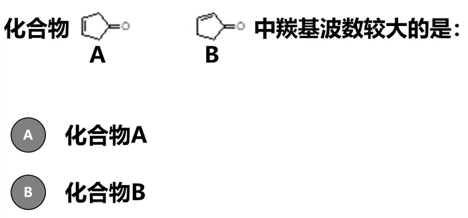

NH3的振动自由度()

A 9

B 8

C 7

D 6

选D 6

振动自由度是指分子在空间中独立的运动方式数量。对于一个由 N 个原子组成的分子：

非线性分子的自由度通常是 3N-6 。

线性分子的自由度通常是 3N-5 。

简答题：

7.已知频率2993，求力常数

在简谐振动中，频率 f 与力常数 k 和质量 m 的关系由以下公式给出：

f=12πkm

由此可以推导出力常数 k 的表达式：

k=(2πf)2⋅m

5.给出两个有机物（CnHnOn...）（同分异构体） ，如何用红外光谱进行区分

以乙酸（CH₃COOH）和甲酸甲酯（HCOOCH₃）（同分异构体，分子式均为C₂H₄O₂）为例：

1. 乙酸：存在O-H 羧基宽峰（3200~2500 cm⁻¹），可据此判断羧基。

2. 甲酸甲酯：无O-H宽峰，但存在酯羰基（1740~1720 cm⁻¹）及醛基C-H特征峰。

通过羟基吸收峰、羰基位置、官能团特征峰差异，即可红外区分同分异构体。

第五章 紫外-可见吸收光谱法

学习重点

1. 紫外可见吸收光谱法的基本概念； （重点；掌握光的吸收定律，最大摩尔吸光系数，分子光谱特征等）

2. 紫外-可见吸收光谱法的定量基础——朗伯-比耳定理；

3. 紫外可见分光光度计的基本构造；

4. 重要概念：生色团 (chromophore)，助色团 (auxochrome)，红移（red shift），蓝移

（hypsochromic shift or blue shift)，朗伯—比尔定律（Lambbert beer law）

什么是紫外-可见吸收光谱法?

(ultravilet and visible spectrophotometry UV-Vis)：定义：利用物质的分子对紫外光（200-400nm）和可见光（400-760nm）的选择性吸收，来进行定性、定量分析以及分子结构推断的一种光谱分析方法。

特点：灵敏度高（10⁻⁷ ~ 10⁻⁴ g·mL⁻¹）、准确度较高（相对误差一般在1%~5%之内）、仪器价格较低、操作简便、快速、应用范围广。 紫外光区 (UV)波长 200-400nm，能量较高，主要引起分子中价电子的跃迁。

可见光区 (Vis)波长 400-760nm，能量较低，涵盖了我们能感知的各种颜色光。

颜色成因：物质呈现颜色是由于其分子选择性地吸收了可见光区的某些波长的光，而反射或

透射了其余波长的光。

什么是分光光度法：我们可以把这个词拆解开来，从字面意思到深层原理一步步理解：

1. 什么是“分光”？（光的分离）

“分光”指的是把复合光（比如白光）分解成单色光（单一颜色/波长的光）的过程。

生活中的例子：雨后天空出现的彩虹就是自然界最完美的“分光”现象。阳光（复合光）经过空中的水滴折射和反射，被分解成了红、橙、黄、绿、蓝、靛、紫七种不同颜色的光。

仪器中的实现：在分光光度计里，我们通常使用棱镜或光栅来代替水滴，将光源发出的光“切分”成不同波长的光，以便我们挑选出特定波长的光来进行测量。

2. 什么是“光度法”？（光的测量）

“光度法”指的是测量光的强度（强弱）变化的方法。

核心原理：它基于物质对光的吸收特性。当光穿过某种溶液时，溶液中的物质会“吃掉”（吸收）一部分光。

测量逻辑：仪器会测量光穿过溶液前和后的强度差异。如果光变暗了（强度减弱了），说明溶液吸收了光。吸收得越多，通常说明溶液里这种物质的浓度越高。

3. 合起来：什么是“分光光度法”？

把上面两部分结合起来，分光光度法就是：

利用特定波长的光（分光得到的），通过测量光被物质吸收的程度（光度法测量的），来定性或定量分析物质成分和浓度的一种方法。

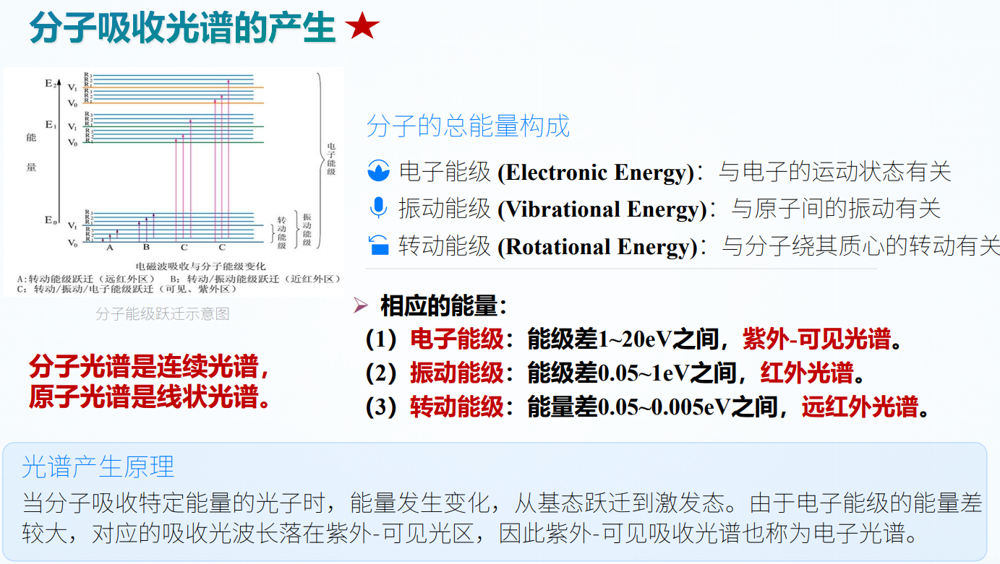

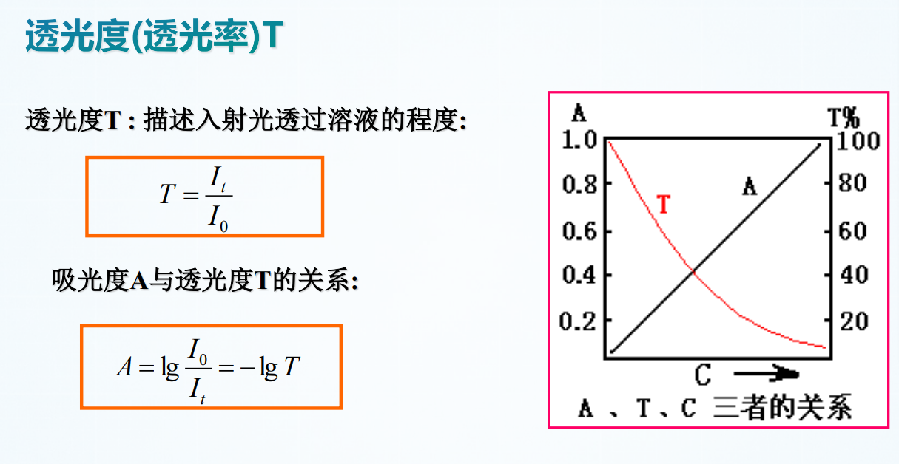

浓度 (C) 增加 → 溶液阻挡光线的能力变强。

因此，透光度 (T) 下降（光穿过去的少了）。

同时，吸光度 (A) 上升（光被吸收的多了）。

在实际化学分析中，通常利用 A 与 C 的线性关系（直线）来测定未知溶液的浓度，而不是使用非线性的 T。

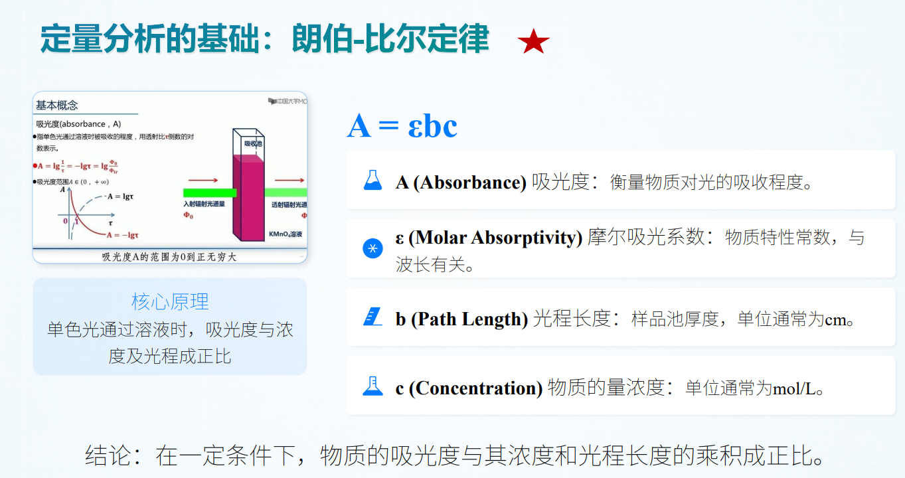

摩尔吸光系数讨论：

吸收物质在一定波长和溶剂条件下的特征常数;

不随浓度c和光程长度b的改变而改变。在温度和波长等条件一定时,仅与吸收物质本身的性质有关,与待测物浓度无关；

可作为定性鉴定的参数；

同一吸收物质在不同波长下的ε值是不同的。在最大吸收波长λmax处的 摩尔吸光系数，以εmax表示。

εmax表明了该物质最大限度的吸光能力，也反映了光度法测定该物质可能达到的最大灵敏度。 εmax越大表明该物质的吸光能力越强，用光度法测定该物质的灵敏度 越高。

ε&gt;105 时，该方法被视为具有超高灵敏度。

ε 在 (6∼10)×104 范围内时，该方法属于高灵敏度。

ε&lt;2×104 时，该方法的灵敏度较低。

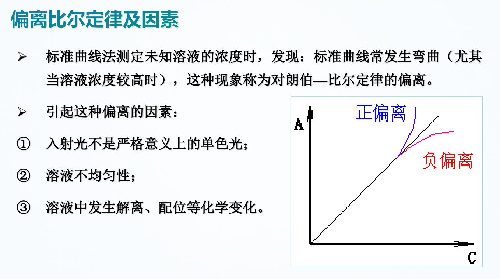

偏离比尔定律

在使用标准曲线法测定未知溶液浓度时，理想情况下，吸光度（A）与浓度（C）应呈线性关系，即符合朗伯-比尔定律（A = εbc）。但在实际操作中，尤其是在溶液浓度较高时，标准曲线常发生弯曲，不再保持直线，这种现象就被称为“偏离比尔定律”。

引起偏离的三大主要因素

入射光非单色光：比尔定律成立的前提是使用严格意义上的单色光。但实际仪器提供的光源往往包含一定波长范围的光，这会导致吸光度与浓度关系偏离线性。(选择合适波长范围，尽量使用单色性好的光源)

溶液不均匀性：如果溶液中存在悬浮颗粒、胶体或发生散射，会使部分光被散射而非吸收，从而导致吸光度测量值偏低，产生负偏离。(确保溶液澄清、均匀，避免浑浊或沉淀)

溶液中发生化学变化：如溶质发生解离、缔合、配位或与溶剂反应等，导致吸光物质的形态或浓度发生变化，从而破坏A与C的线性关系。(控制溶液pH、离子强度等条件，防止发生副反应)

常用术语：生色团（发色团）(Chromophore)：指含有不饱和键（提供π轨道），能吸收紫外-可见光产生π→π* 或 n→π* 跃迁的不饱和基团，是分子在紫外-可见光区产生吸收的根本原因。 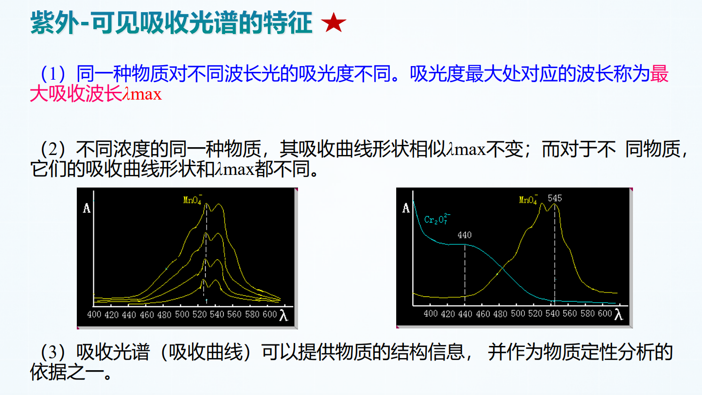

助色团：含有未成键n电子，本身不产生吸收，但与生色团相连时，能使 吸收峰向长波方向移动（红移）并增强吸收强度的 基团。

常见类型： 羟基(-OH)、氨基(-NH₂)、烷氧基(-OR)、卤素(-X)

助色团通过共轭作用改变生色团的电子结构，从而影响其光谱性质

红移、蓝移与紫移：如图所示，吸收峰位置向长/短波方向的移动

增色效应减色效应：如图所示，吸收强度εmax增大或减小的效应

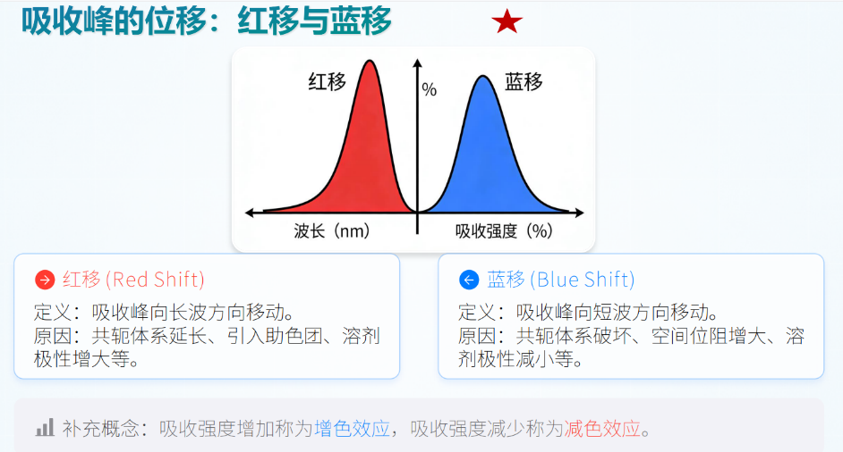 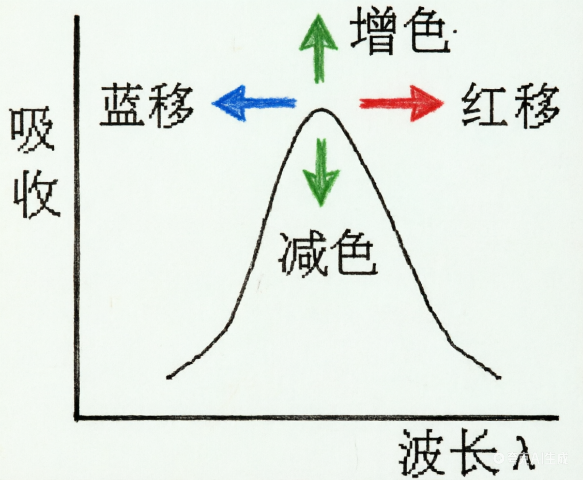

分子结构对吸收光谱的影响：

共轭效应：影响最显著的因素，共轭双键数目越多、链越长 ，π→π*跃迁能量越低，吸收峰红移，强度增大。

空间效应：影响共轭体系共平面性。 空间位阻导致共轭体系无法 共平面时，吸收峰向短波移 动（蓝移），强度降低。

超共轭效应：σ电子与π电子的弱作用。 烷基等基团的C-H键σ电子与π 体系相互作用，通常使吸收峰 发生轻微红移。

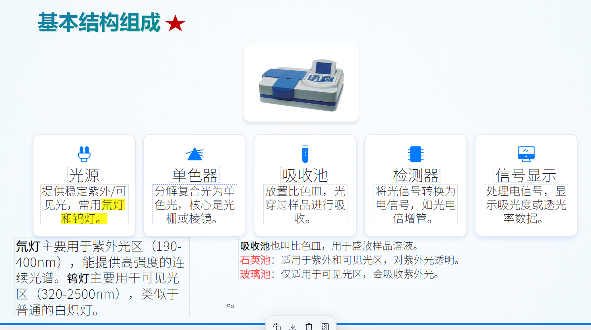

下列关于标准曲线偏离朗伯-比尔定律的叙述，不正确的是

a.溶液介质不均匀，会造成标准曲线偏离朗伯-比尔定律。

b.吸光物质浓度较低，会造成标准曲线偏离朗伯-比尔定律。

c.溶液本身的化学反应，会造成标准曲线偏离朗伯-比尔定律。

d.入射光不是单色光，会造成标准曲线偏离朗伯-比尔定律。

正确答案是：吸光物质浓度较低，会造成标准曲线偏离朗伯-比尔定律。

吸光物质浓度较低时，朗伯-比尔定律通常更适用。

为什么浓度低时更适用？

朗伯-比尔定律成立的一个重要前提是：吸光质点之间没有相互作用。

在低浓度（稀溶液）时：吸光物质的分子或离子彼此距离较远，互不干扰，就像独自在操场上跑步的人，互不影响。此时，吸光度与浓度呈完美的线性关系，定律非常适用。

在高浓度时：吸光质点彼此靠得很近，相互作用增强（如静电作用、缔合、解离等），这会改变它们对光的吸收能力。这就好比操场上挤满了人，大家的行动会互相影响。这种相互作用会导致吸光度与浓度的关系偏离线性，从而造成标准曲线弯曲，偏离朗伯-比尔定律。

因此，为了保证测量的准确性，分光光度法通常要求待测溶液为稀溶液。

分光光度法中，测量波长的选择原则是“最大吸收原则”和“吸收最大、干扰最小原则”。

a.错误

b.正确

正确答案是：正确

（在分光光度法中，测量波长的选择遵循两个核心原则：最大吸收原则和吸收最大、干扰最小原则。

最大吸收原则：通常选择被测物质吸收光谱中吸收最强的波长（即最大吸收波长，λmax）进行测定。这是因为在最大吸收波长处，物质的吸光度最大，从而获得最高的检测灵敏度，有利于低浓度组分的准确测定。

吸收最大、干扰最小原则：在满足最大吸收的前提下，应优先选择共存组分干扰最小的波长。即使该波长不是最大吸收波长，只要被测组分有足够吸收且干扰可忽略，也应优先选择，以保证测定的选择性和准确性。）

分光光度法在紫外光区进行测定时，必须使用石英比色皿（吸收池），不能使用玻璃比色皿（吸收池）。

a.错误

b.正确

正确答案是：正确

吸光度（浓度）的测量相对误差随吸光度值的大小不同而变化，为保证测量的相对误差较小，应使待测溶液的吸光度在

a.0.8~1.0 之间

b.0~0.2 之间

c.&amp;gt; 1.0

d.0.2~0.8 之间

正确答案是：0.2~0.8 之间

朗伯-比尔定律适用于任何均匀、非散射的固体、液体或气体介质。

a.正确

b.错误

正确答案是：正确

溶液的吸光度 A 与溶液中吸光物质的性质、浓度及液层厚度（光程）有关，而与入射光波长无关。

a.正确

b.错误

正确答案是：错误

溶液的吸光度 A 与溶液中吸光物质的性质、浓度及液层厚度（光程）有关，同时与入射光的波长密切相关。根据朗伯-比尔定律 A = εbc，其中 ε 为摩尔吸光系数，它与入射光的波长和吸光物质本身的性质有关；b 为液层厚度（光程）；c 为溶液浓度。因此，吸光度 A 是波长、浓度和光程三者的函数。

题干称“吸光度 A 与入射光波长无关”，这是错误的。因为不同波长的光被物质吸收的程度不同，吸光度随波长变化，这也是分光光度法中选择最大吸收波长进行测定的原因。

符合朗伯-比尔定律的溶液，当浓度为 c 时，透射比为 T，若浓度增大一倍，则吸光度 A 等于

a.-(lgT)/2

b.2lgT

c.(lgT)/2

d.-2lgT

正确答案是：-2lgT

A=lg(I0​/It​)=εbc

A=-lgT

下列关于分光光度计光源的叙述，正确的是

a.分光光度计在可见光区的光源是氢灯或氘灯，在紫外光区的光源是钨灯或碘钨灯。

b.分光光度计在可见光区的光源是钨灯或碘钨灯，在紫外光区的光源是氢灯或氘灯。

c.分光光度计在紫外和可见光区的光源都是氢灯或氘灯。

d.分光光度计在紫外和可见光区的光源都是钨灯或碘钨灯。

正确答案是：分光光度计在可见光区的光源是钨灯或碘钨灯，在紫外光区的光源是氢灯或氘灯。

可见光用的家里的钨灯

符合朗伯-比尔定律的溶液，用 1 cm 吸收池，测得透射比为 80%，若用 5 cm 吸收池，则其透射比为

a.16%

b.67%

c.40%

d.33%

正确答案是：33%

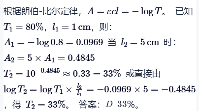

透射比 T 与溶液的浓度成正比。

a.错误

b.正确

正确答案是：错误

透射比 T 与溶液浓度之间不是正比关系，而是负相关关系。

以下不是朗伯比尔定律的前提条件

A 单色光

B 平行

C 液层厚度一定

D 稀溶液

答案：C

关于分子光谱和原子光谱的区别，以下正确的是

A 分子光谱是线状光谱

B 原子光谱是线状光谱

C 分子光谱是非连续光谱

D 原子光谱是连续光谱

答案：B

发色团的π电子共轭形成大π键，使得（ ）

A 无法判断

B 吸收强度减弱

C 吸收强度增大

D 吸收不变

答案：C 共轭效应导致π→π*跃迁所需的能量降低，从而吸收波长向长波方向移动（即发生红移）。更重要的是，共轭体系的扩展增强了电子跃迁的概率，表现为吸收强度增大。

某物质吸收350nm特定波长光，采用分光光度计检测，用什么材 质作为吸收池？

玻璃

石英

树脂

答案：石英 （在紫外-可见分光光度法中，吸收池的材质选择取决于所测定的波长范围。石英吸收池适用于从紫外区到可见光区的波长范围（约180 nm至2500 nm），而光学玻璃吸收池仅适用于可见光区（通常波长大于350 nm）。）（不知道选什么就选石英比较保险）

13.紫外—可见分光光度法（UV-Vis）

基于物质分子对紫外-可见光区电磁辐射的选择性吸收，根据吸收光谱及吸光度进行定性、定量及结构分析的方法。

第十章 电化学分析法

1.能斯特方等；

2. pH玻璃电极电位产生原理、不对称电位等；

3. 直接电位法中的标准曲线法、标准加入法和比较法；

4. 重要概念：标准氢电极（standard hydrogen electrode）、离子选择性电极（ion-selective electrodes，ISE）、指示电极（indicator electrode）、参比电极（reference electrode）、pH玻璃电极(pH Glass electrode)等

重点；掌握电化学电池、电极、电极反应、电极电位、能斯特方程；重点；掌握电位分析法基本原理、离子选择性电极尤其是pH玻璃电极电位产生原理、不对称电位等概念

电化学分析（electrochemical analysis）也叫电分析化学（electroanalytical chemistry）：

利用物质的电学及电化学性质来进行分析的方法。

电化学电池：电化学电池是由一对电极（阴极、阳极）、电解液以及连接电路组成的装置。它能够通过测量电池的某些电化学参量（如电导、电位、电流等），来测定物质的组成及含量。

它主要分为两大类：原电池和电解池。原电池是自发地将化学能转化为电能的装置（如干电池），而电解池则是利用电能引发化学反应的装置（如电解水）（非自发，要外接电源）。

下图图1图2都是原电池，，图3是电解池

图1：不带盐桥的原电池 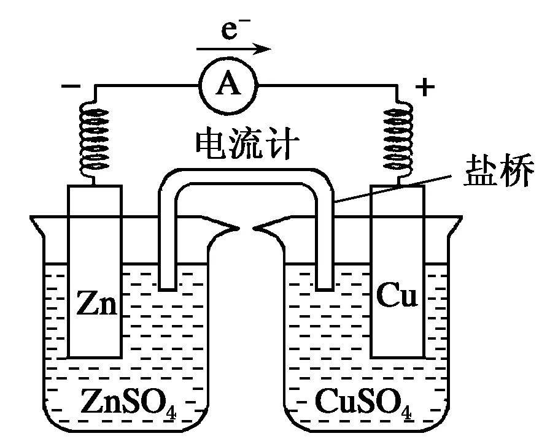 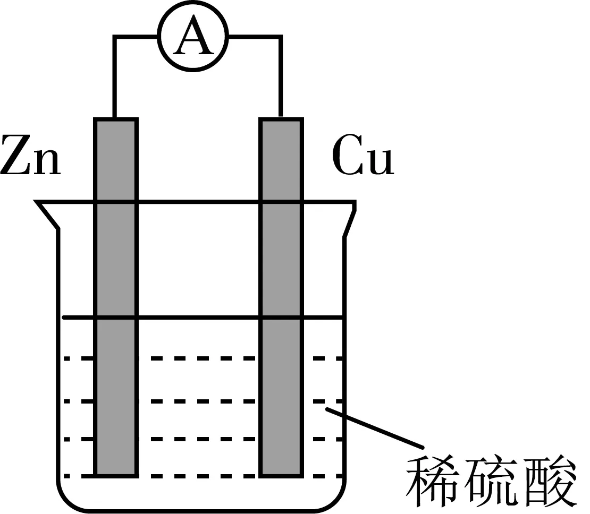

图2：带盐桥的原电池 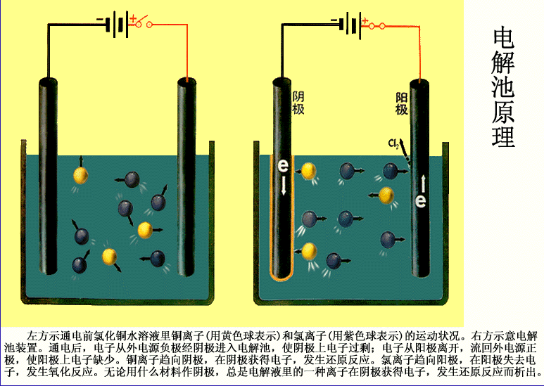

液体接界电位（liquid junction potential）：在两个组成或浓度不同的电解质溶液相接 触的界面间所存在的一个微小的电位差， 称为液接电位。

液接电位是由于各种离子具有不同的迁移速率而引起。

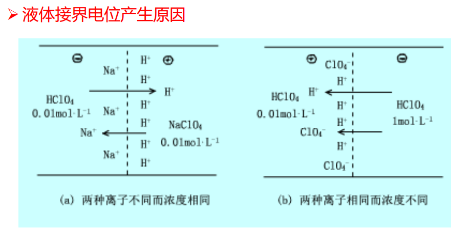

在电化学分析中，由于经常使用有液接界面的电极，所以液体接界电位是一个普遍存在的现象。实际的液体接界电位往往是难于准确测量的，为了减小液体接界电位的影响，在实际工作中通常在两个溶液之间用盐桥连接（即用盐桥分隔原来的液接界面），使液接电位降低或接近于消除。上图中图1不带盐桥，图2带盐桥。

盐桥：盐桥是连接两个半电池（两种不同溶液）的装置，通常是一个倒置的U型管，里面装满了高浓度的电解质溶液（如KCl、KNO₃），并用琼脂固定成凝胶状防止混合。

盐桥的作用：

（1）构成原电池的通路

在图1中没有盐桥，里面存在液体接界电位，为了避免液体接界电位，图2把阴阳极分开了，分成了两个烧杯，但这样也让整个电路断开了。盐桥能把他们连接起来形成回路。

（2）维持溶液的电中性

这是盐桥能保持电流持续流动的关键原因。如果不加盐桥，反应很快就会停止，原因如下：

左边烧杯（负极）：Zn失去电子变成Zn2+（ Zn-2e-→Zn2+ ）进入溶液。随着反应进行，溶液里正电荷（ Zn2+ ）越来越多，会排斥后续Zn2+ 的生成，阻碍反应。

右边烧杯（正极）：溶液里的Cu2+得到电子析出Cu（ Cu2++2e-→Cu ）。随着反应进行，溶液里正电荷（ Cu2+ ）减少，负电荷（ SO42- ）相对过剩，会吸引Cu2+，阻碍反应。 盐桥里通常装有高浓度的电解质（如KCl或KNO₃）。

阴离子移动：盐桥里的阴离子（如 Cl- ）会移向左边烧杯，中和过剩的正电荷（ Zn2+ ）。

阳离子移动：盐桥里的阳离子（如 K+ ）会移向右边烧杯，补充流失的正电荷（ Cu2+ ）。 这样，两边的溶液始终保持电中性，反应就能源源不断地进行下去。

（3）消除液体接界电位，降至1~2mV。

如果直接把两种溶液倒在一起接触，由于不同离子跑得快慢不同，界面处会产生一个干扰电压（液体接界电位）。

盐桥里的高浓度电解质（K⁺和Cl⁻的迁移速率非常接近）主导了离子迁移，从而将这个干扰电压降到最低（通常忽略不计），保证了电池电动势的稳定和准确。

在图2中，左边烧杯Zn失去电子变成Zn2+，价态升高（从0到2+），发生了氧化反应，是阳极，另一边Cu2+得到电子变成Cu价态降低（从2+到0），是阴极，发生了还原反应。（升失氧化还原剂，降得还原氧化剂）（升价态 ，失电子，发生了氧化反应，是还原剂；下一句反过来）（学过化学的同学也可以分享自己的口诀）

如果高中没学过化学或者已经忘光的同学看不明白也不要紧，只需要理解，左右两个烧杯发生了不同的反应，一个是氧化反应一个是还原反应，一个是阳极一个是阴极，这是两个不同的电极，那么就可以继续往下捋了。

左右各一个电极，而通用的电极反应式是： 氧化态(Ox) + ne⁻ → 还原态(Red)

氧化态在左边，得电子；还原态在右边

我们把上面的例子代进来。对于左边的烧杯，是Zn-2e-→Zn2+，写成电极反应式就是 Zn2++2e-→Zn ，就能看明白，Zn2+是氧化态，Zn是还原态；

同样的，对于右边的烧杯，Cu2++2e-→Cu，Cu2+是氧化态，Cu是还原态。

能够分辨氧化态和还原态后，就可以学习下一个知识点，能斯特方程了：

φ=φθ+RTnFln⁡aoxaRed

这个公式描述了电极电位（ φ ）与反应物浓度（活度）、温度之间的定量关系。

掌握这个公式，才能通过测量电动势来测定浓度（活度）。这个公式也可以这样看：

E=Eθ+RTnFln⁡a氧化态a还原态 主要是注意氧化态在上面，还原态在下面。

注意到，在RTF 中，R是气体常数，T是绝对温度，F是法拉第常数，25°C 条件下，这个公式可以简化成

E=Eθ+0.059nlg⁡a氧化态a还原态

这个简化式在电化学分析中非常常用，特别是在计算 pH值、离子浓度 以及 电池电动势 时，可以大大减少计算量，无需每次都进行复杂的指数运算。文档中后续提到的 pH玻璃电极 响应公式（ φ=K±0.059pH ）也是基于此简化式推导出来的。

学会了能斯特方程之后，接下来就可以很容易地理解如何分类本节各种分析方法了。

在电化学里，凡是能与电解质溶液发生电子交换的地方，都叫电极。测这个电极上的电动势就是电极电位（Electrode Potential），是上面能斯特方程的φ或E，我们通常的目的是求未知溶液的浓度（活度），根据能斯特方程，只要我们能得到电极电位就能得到浓度。

根据电极的原理不同，可以分成金属基电极和膜电极两种电极。金属基电极可以理解成“化学反应”，就像上面的原电池图2，金属插进溶液里发生了化学反应，有了电子的转移，生成了新物质；膜电极可以理解为“物理反应”。

膜电极：由特殊材料的固态或液态敏感膜构成对溶液中特定离子有选择性响应的电极。主要指的是离子选择性电极（ion-selective electrodes，ISE）。

以下以pH玻璃电极为例展开解释： 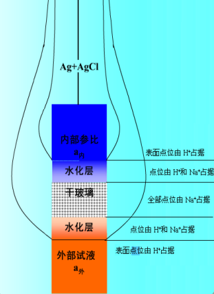

为了让你看得更清楚，我们可以把整个电极结构从外到内切开来看：（下面的结构和上面这张图是倒过来的，图片里的外部试液是在最下面）

玻璃电极在使用前，必须在水溶液中浸泡，表面的Na+与水中的H+交换。这个过程形成两个水化层。

第一层：外部试液（我们要测的 pH）

⬇️ 在这里产生 φ外 （外侧相界电位）

第二层：玻璃膜外侧水化层

第三层：玻璃膜干层（中间夹心，不产生相界电位，只传导离子）

第四层：玻璃膜内侧水化层

⬇️ 在这里产生 φ内 （内侧相界电位）

第五层：内部缓冲溶液（固定 pH 值）

⬇️ 在这里产生 φAg-AgCl （内参比电极电位）

第六层：Ag-AgCl 内参比电极丝（导线）

可以看出来，在这个离子交换过程中，我们就得到一个差值，叫做膜电位， φM=φ外-φ内 指的就是第1层和第2层之间的电位，减去第4层和第5层之间的电位。膜电位φM再加上内参比电位φAg-AgCl 就是整个玻璃电极电位：φ玻璃​=φM​+φAg-AgCl​=（在 25∘C 时）：K&#x27;-0.059 pH试液

这是基于能斯特方程推导出的简化公式。

K&#x27; ：是一个常数，包含了内参比电极电位以及玻璃膜的一些固有特性常数。

0.059 ：这是在 25∘C 时的能斯特斜率系数（ 2.303RTF 的值）。

含义：这个公式表明，在 25∘C 时，玻璃电极的电位与溶液的pH值呈线性关系。随着pH值每增加1个单位，电极电位会下降 0.059V （即 59mV ）。这是pH计能够测量酸碱度的理论基础。

简单来说，这个玻璃电极能测电位差，然后通过上面的公式就能算出酸碱度，这就是pH计的原理。

不对称电位The asymmetry potential：我们刚刚提到膜电位是两个相界电位相减，两个水化层，外面的水化层和待测液有一个电位，里面的水化层和内部缓冲溶液有一个电位。那如果待测液和内部缓冲溶液的pH一样，理论上这两个相界电位就一样了，φ外=φ内，φM=φ外-φ内=0 。但实际上φM≠0，这就叫做不对称电位。

不对称电位产生原因：制造工艺、使用磨损等，使玻璃膜内外表面吸水形 成硅胶层的能力并不完全相同，Na+和H+的交换结果也不完全相同。（也就是内外两个水化层不一样）

上面根据电极反应不同将电极分为了金属基电极和膜电极；下面根据电极用途不同，将电极分为工作电极、参比电极、辅助电极三种。

工作电极：（指示电极indicator electrode：）电极电位随待测液离子活度（浓度）的变化而变化。比如刚刚的pH玻璃电极的膜电极，他的电位随氢离子浓度变化。

参比电极reference electrode：在指定温度下、压力下，电位已知，并且不随待测溶 液的组成改变而改变的电极。比如刚刚的pH玻璃电极里有个内参比电极：Ag-AgCl电极，他不会变。工作电极膜电位φM再加上内参比电位φAg-AgCl 就是整个玻璃电极电位：φ玻璃​=φM​+φAg-AgCl

辅助电极assistant electrode：不参与氧化还原反应，参与构成回路，一般为惰性贵 金属材料，如Hg、Pt等。

学会了电极，我们可以学习电化学分析法中的一个重要方法：电位分析法（Potentiometry）：它是一种通过测量原电池的电动势（电压）来测定离子活度或浓度的分析方法。

​电位分析法主要分为以下两种应用方式：

① 直接电位法 (Direct Potentiometry)：

原理： 通过测量原电池的电动势来测定浓度。

应用： 最常见的例子还是上面的用pH计测酸碱度，或者使用离子选择性电极测氟离子、钠离子等。

方法： 包括标准曲线法、标准加入法和比较法（如pH的实用定义）。

② 电位滴定法 (Potentiometric Titration)：

原理： 在滴定过程中，通过监测电位的突变来确定滴定终点，而不是使用肉眼观察指示剂变色。

优势： 对于深色溶液、浑浊溶液或缺乏合适指示剂的反应，肉眼不好观察，通过分析电位可以知道什么时候到滴定终点。

电位分析法的测量体系需要两个电极：指示电极indicator electrode和参比电极reference electrode。

指示电极作用：它的电位会随着待测溶液中离子浓度的变化而变化（像一个“传感器”）。

参比电极作用：提供一个稳定、已知且不变化的基准电位（像一把“尺子”）。

总结

电位分析法就是利用“电位差”来分析物质含量的方法。它分为直接测浓度（如pH计）和测滴定终点两种模式，核心在于使用指示电极感知浓度变化，并用参比电极作为稳定的电压基准。

我们接下来展开学习直接加入法中的标准曲线法、标准加入法和比较法：

直接电位法 (Direct Potentiometry)核心逻辑： 测量电池的电动势（电压），直接换算成离子浓度或pH。指示电极（如pH玻璃电极）接触溶液时，会产生一个与溶液中特定离子活度（浓度）呈线性关系的电位差。

| 方法名称 | 原理简述 | 优缺点 |
| --- | --- | --- |
| 比较法 | 测量待测液与标准缓冲液的电位差，通过相减消除常数项 K 。 | 仅限于pH值的测定。 测ph快，但也只能测ph |
| 标准曲线法 | 用一系列标准溶液画出 E-lg⁡c 的直线，再查出未知样的浓度。 | 大量样品、基质简单的游离离子测定。 要画标曲，麻烦，但也只要画一次标曲，如果有很多很多样品，就也显得不麻烦了。 |
| 标准加入法 | 在未知样品中直接加入标准溶液，通过信号变化量反推原浓度。 就像乌鸦喝水里丢石头进水瓶，通过丢石头进去之后看水位变化了多少，反推瓶子里有多少水。 | 用于测定总离子浓度（如金属离子总量），无需绘制完整曲线。 如果只有一个样品，相对标准曲线法要简单，不用做标曲，只要丢一次石头；但如果有很多很多样品，就很麻烦，每个样品都要丢一次石头，丢吧你就一丢一个不吱声 |

关于电池： 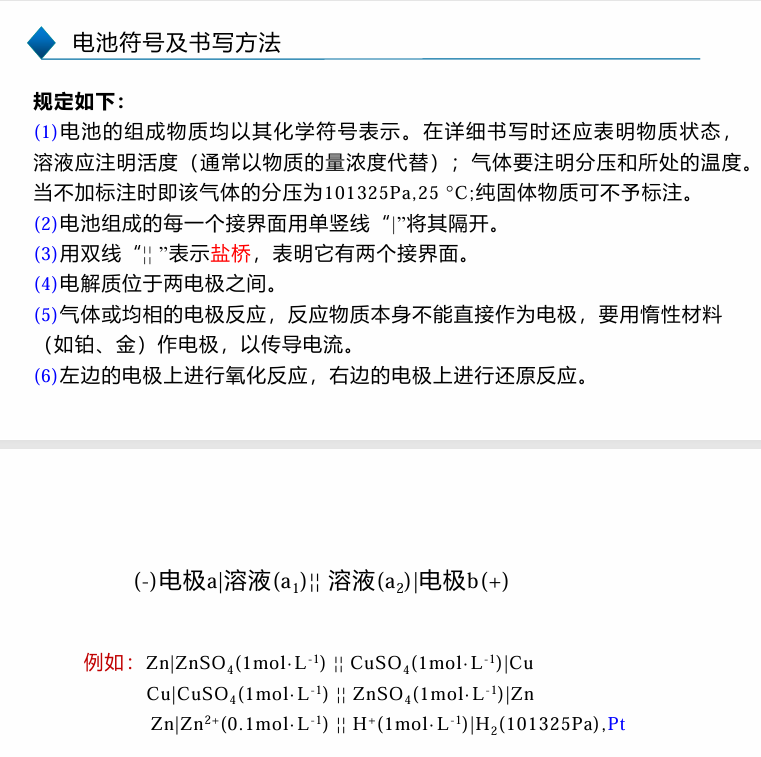

负极写在左边。负极失电子（失负），可以理解为电子从左跑到右。

原电池中，活动性强的金属作为正极，得到电子，发生还原反应。

选择一项:

对

错

正确答案是“错”。

升失氧化还原剂，降得还原氧化剂。活动性强的金属通常作为负极，失去电子（价态升高），发生氧化反应。

电池书写中，通常把负极写在左边。

选择一项:

对

错

正确答案是“对”。

温度一定时，甘汞电极的电极电位只与电极( )有关

a. 外部H⁺活度

b. 外部Cl⁻活度

c. 内部Cl⁻活度

d. 内部H⁺活度

正确答案是内部Cl⁻活度

甘汞电极的电极电位主要由其内部参比溶液中氯离子（Cl⁻）的活度决定。其电极反应为：

Hg₂Cl₂ + 2e⁻ ⇌ 2Hg + 2Cl⁻

根据能斯特方程，电极电位表达式为：

φ = φ° - (0.0592 V) · lg a(Cl⁻) （在25°C时）

由此可见，在温度恒定的前提下，甘汞电极的电位仅取决于其内部Cl⁻的活度，而与外部溶液的H⁺或Cl⁻活度无关。这是因为在甘汞电极结构中，内部参比溶液（通常是KCl溶液）与电极反应直接相关，外部溶液通过盐桥与内部溶液隔离，其离子浓度不影响电极电位本身，仅影响液接电位（通常可忽略或补偿）。

测定溶液pH值时，通常是以pH玻璃膜电极作为指示电极、饱和甘汞电极或饱和氯化银电极作为参比电极构成电解池。

选择一项:

对

错

正确答案是“错”。

构成的应该是原电池。

一般把电解池中发生还原反应的电极称为阳极。

选择一项:

对

错。

正确答案是“错”。

（失阳氧，虱痒痒）

根据电极反应机理不同，电极可分为()两大类

a.金属基电极和参比电极

b.金属基电极和膜电极

c.金属基和非金属基电极

正确答案是:金属基电极和膜电极

参比电极的电极电位与待测离子浓度或活度呈能斯特响应。

选择一项:

对

错

正确答案是“错”

参比电极的核心特性是其电极电位在测量过程中保持恒定不变，它不随溶液中待测离子的浓度或活度变化而发生响应。这是其作为“参考基准”的根本原因。

而能斯特响应是指示电极（如离子选择性电极）的特征，其电极电位与待测离子的活度（或浓度）的对数呈线性关系，符合能斯特方程。参比电极的电位值是已知且稳定的，它与指示电极共同构成原电池，通过测量电池的电动势，结合能斯特方程，从而计算出待测离子的活度或浓度。

总离子强度调节缓冲液是为了使标准液和待测液中()不变。

a.离子浓度

b.离子强度

C. 离子活度

正确答案是:离子强度

离子选择性电极是指对溶液中特定()有选择性响应能力的电极。

a.分子

b.电子

C.离子

正确答案是:离子

pH玻璃膜电极的膜电位只包括内水化层与内参比溶液的相接电位。

选择一项:

对

错

正确答案是“错”。

名词解释：

液体接界电位？界面电位？

液体接界电位（液接电位）

两种组成或浓度不同的电解质溶液接触时，因离子扩散速率不同，在界面形成的电位差，属于不可逆电位，会影响电位测定准确性。

界面电位

一般指两相界面（固-液、液-液、金属-溶液等）因电荷分布不均、离子吸附或偶极取向产生的电位差，范围更广，液接电位是其中一种。

原子吸收光谱法

一、带着以下问题进行学习，学习过程中，在教材（或爱课上电子扫描版教材）或ppt标注相关内容及思考答案。

（1）解释概念：谱线半宽度、积分吸收、峰值吸收、锐线光源、特征浓度、贫燃。

（2）原子吸收光谱法中背景吸收对测定有什么影响？如何消除背景吸收？

（3）原子吸收光谱仪主要由哪几部分组成？简要说明各部分的作用。与紫外光谱仪相比，二者在仪器结构上有何区别？

（4）影响原子吸收谱线宽度的因素有哪些？对原子吸收测量有什影响？

（5）简述空心阴极灯的工作原理及特点。

（6）原子吸收光谱有几种干扰？怎样产生的？如何消除？

（7）石墨炉原子化的工作原理是什么？与火焰原子化相比，石墨炉原子化法有什么特点？

（8）说明原子吸收光谱法常用的定量方法以及各种方法的特点。

（9）火焰原子吸收法测定矿泉水中镁的含量为0.00255 μg/mL，测得其吸光度为0.150，计算镁的特征浓度。

（10）石墨炉原子吸收法测定糙米中镉含量，分别取2份1.00 g样品消解处理，向2份试液分别加入0.00、0.0500 μg标准镉溶液，定容到25 mL，测定吸光度分别为0.240、0.400，求糙米中镉的含量。

我们先来总结一下我们前面学了什么：学完绪论之后学光谱分析法导论，知道了光谱分析法分为原子光谱法和分子光谱法，然后我们学习了分子光谱法当中的红外光谱法（IR）和紫外可见吸收光谱法（UV-Vis）。他们是用连续光源照射目标物质，看物质吸收了什么光。红外光谱法的能量低，不能让电子跃迁，但能让分子化学键振动和分子转动，因此用来鉴定结构，每种化合物的红外光谱都像人的指纹一样独一无二，适合用来鉴定未知物是什么、含有什么官能团；紫外可见光能量高，能让分子中的价电子（特别是共轭双键上的电子）跃迁，所以可以判断共轭结构和苯环，根据朗伯比尔定律，吸收了多少与浓度存在线性关系，所以能定量。学完了光谱分析法里的分子光谱法里的IR和UV-Vis之后我们又跑去学了电化学分析法，通过测量电化学性质（如电位等）来确定物质组成和含量。学完之后，现在我们要学什么呢？

光谱分析法里的原子光谱法里的原子吸收光谱法。

请跟我一起吐槽这个神秘排课逻辑，吐槽完之后就能明白仪器分析的框架了。

原子吸收光谱法：是一种基于待测基态原子对特征谱线的吸收而建立的一种分析方法。称为原子吸收光谱法，或原子吸收分光光度法（atomic absorption spectrophotometry,AAS）

这里的原子吸收分光光度法与之前的紫外分光光度法要区别开。同时也注意到，他们都是分光光度法，原理都是分出特定波长的光去射那个物质，看它吃了什么吃了多少来定性定量。定量依据都是传说中的朗伯比尔定律A=Kbc (A=K’ c)，吸光度A与浓度C呈线性关系。 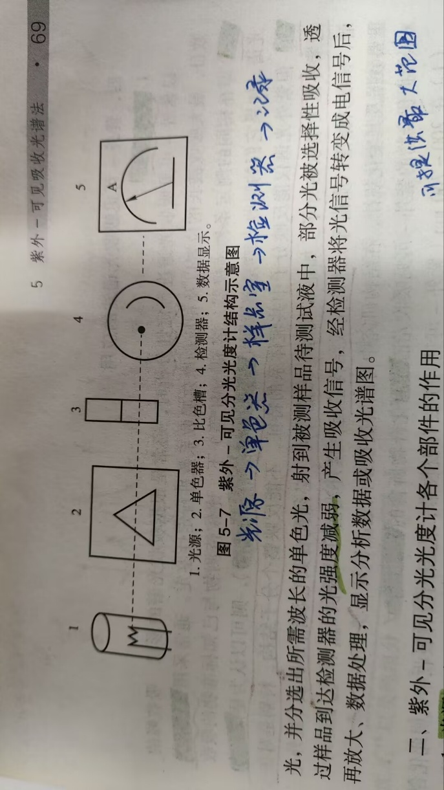

我们来看看紫外可见分光光度计和原子吸收分光光度法仪器结构的区别

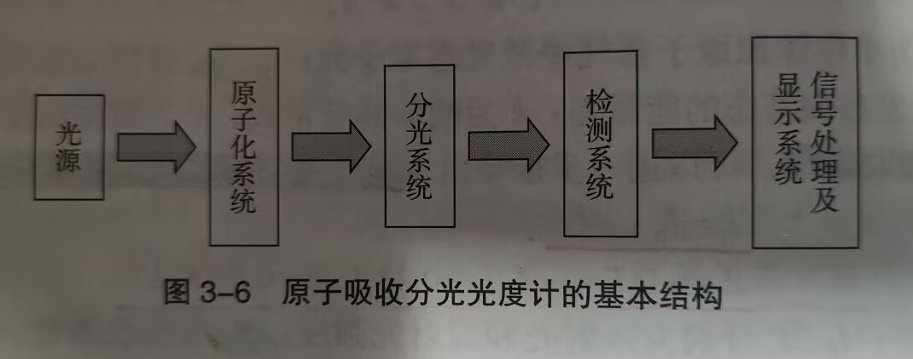

紫外分光光度计：光源发光，单色器选出特定的光，再射到待测物上，再检测。

原子吸收分光光度计：光源发光，先经过样品（原子化系统），再分光，再检测。

为什么要先经过原子化系统再分光？因为和紫外分光光度计不同，在UV-Vis中，样品配成溶液倒入比色皿，光直接穿过溶液即可。而AAS中样品不能直接测，必须先变成气态原子，通过火焰原子化器或石墨炉把样品烧成气态原子，而这个过程会发光发热，就像噪音一样，啥都看不见了，这时候再上分光系统，才能过滤出想要的光。

了解了AAS的基本结构，我们来详细展开各部分：

光源：UV-Vis用的是连续光源，钨灯（可见光区）、氘灯（紫外光区），“宽”是它的特点，因为你要在200-760nm里“试”出你的样品喜欢吃哪个nm的光。

AAS用的是锐线光源，空心阴极灯，“窄”是它的特点，因为它是先画靶再射箭，你知道你要找谁，就选这个元素的光射它看看它吃不吃，吸收了就有不吸收就没有。

AAS要窄，越窄越好，因为你目标明确，你只需要看那一个nm的光。可不可以宽，可以但没必要，会导致灵敏度低，就像拍照一样，拍重点就好，你把其他没用的东西都拍进来，干扰太多，分辨率低，画质太差。（就像写这个汇总，我一开始以为很快的，把重点摘下来就好，结果发现全是重点，又臭又长）

空心阴极灯是什么：利用惰性气体放电产生的离子撞击阴极，使待测元素原子化并激发，从而发射出该元素特有的锐线光谱。

空心阴极灯特点：发射锐线：这是它最大的优点。它发射的谱线宽度极窄。寿命长，稳定性好；

但多元素测定不便：这是它最大的痛点。每测定一种元素，必须更换相应的灯。如果要测多种元素，就需要配备多个灯，并频繁更换；需要一定的预热时间（通常5-15分钟）让光强稳定；灯电流敏感：灯电流的选择非常关键。

研究完光源，我们研究原子化系统。

原子化器的作用:将试样蒸发,并使待测定元素转化 为基态原子蒸气。

为什么要原子化器？（核心逻辑）

原子吸收光谱法的测量原理是：基态原子蒸气对特征谱线的吸收。

现实困境：我们手中的样品通常是液体（如溶液）或固体（如食品、土壤），其中的待测元素以分子、离子或化合物的形式存在，它们无法直接吸收特征光。

解决方案：必须通过“原子化器”这个装置，利用高温或化学手段，将样品中的化合态元素转化为游离态的基态原子蒸气。

结论：没有原子化器，就没有基态原子，也就无法产生原子吸收信号

类型：

火焰原子化法:操作简单,分析时间短,对大多数元素有较高的灵敏度,应用广泛 。

主要由雾化器、雾化室、燃烧器和火焰组成。

化学计量火焰（中性）：燃助比1:4，温度高、干扰少、稳定，适用于大多数元素。

富燃火焰（还原性）：燃助比1：3，燃烧不完全，温度稍低，但具有还原性，适用于测定易形成难熔氧化物的元素（如 Al, Cr, Mo）。（富燃：富，燃料多，烧不完，碳烧不干净就会生成一氧化碳，还原性）

贫燃火焰（氧化性）：燃助比1:6，温度较低，氧化性气氛，适用于测定易电离的碱金属（如 K, Na）。因为碱金属电离就不是原子了，电离变成离子，“原子”吸收光谱法就测不来了。

缺点：雾化效率低,原子化效率低，原子蒸气在火焰中被大量气体稀释。

非火焰原子化法:石墨炉（电热原子化法）：原子化效率要远远高于火焰原子化法，接近百分百（火焰法大部分都给你烧没了）,灵敏度很高,但仪器装置复杂、昂贵,分析速度较慢。

原理：将样品（几微升）放入石墨管中，通过大电流直接加热石墨管（最高可达3000K），使样品经历干燥-灰化-原子化-除残四个程序阶段，瞬间产生基态原子。

如果你需要快速、简单地测定常量元素，选火焰。

如果你需要超高灵敏度、测定痕量/超痕量元素、或者样品极其珍贵（量少），选石墨炉。

这里面提到灵敏度和检出限。

灵敏度 (Sensitivity)：它指的是产生 1% 净吸收（即吸光度 A=0.0044）时所对应的元素浓度或质量。

通俗理解：就像是秤的“分度值”。特征浓度越小，说明仪器越灵敏，只需要很少的量就能引起明显的信号变化。

特征浓度：定义:在火焰原子吸收法中,把能产生1%吸收或0.0044 吸光度时所对应的被测定元素的质量浓度定义为元素的 特征浓度

特征质量：定义:在石墨炉原子吸收法中,把能产生1%吸收或 0.0044吸光度时所对应的被测定元素的质量定义为元 素的特征质量

检出限 (Detection Limit, DL)：检出限是指仪器能够可靠检测出的待测元素的最低浓度（或最小质量）。它不仅考虑了灵敏度，还考虑了仪器的噪声水平。

通俗理解：这是仪器的“视力极限”。低于这个浓度，信号就会淹没在噪声（背景杂音）里，分不清是样品信号还是仪器本身的干扰。

研究完原子化系统，我们研究分光系统：

目的：

提高选择性：避免其他波长的光干扰测定，比如空心阴极灯阴极材料的不纯，及惰性气体本身也有辐射。

消除背景：阻挡火焰或石墨炉产生的连续背景发射光

单色器位置:置于原子化器后面,目的是防止原子化时产生的辐射干扰进入检测器,避免强烈辐射引起光电倍增管疲劳。

光电倍增管是什么，是接下来检测系统的一个部分：

光电倍增管是原子吸收光谱仪中的“眼睛”。它的核心作用是将经过原子化器吸收后、极其微弱的光信号（光子）转换并放大为可测量的电信号（电流）。

结构学会了，接下来我们要实战测量了。我们测到了一个数据，如下图所示。我们前面提到，原子光谱法是线性光谱，分子光谱法是带状光谱。但其实，原子吸收光谱肉眼看是一条线，但如果把它放大之后，其实是一座峰。为什么？

1. 根据海森堡不确定性原理，吸收峰具有自然宽度；

2.多普勒变宽：由于原子在空间作相对热运动引起的谱线变宽,又称热 变宽, 热变宽宽度一般为104-10-3 nm,是谱线变宽的主要因素。

3.碰撞变宽：由于同种辐射原子间或辐射原子与其它粒子间相互碰撞 而产生的

那么我们要怎么算这个峰的面积？

积分吸收测量法：定义:测量气态基态原子吸收共振线的总能量的方法。 吸收线轮廓内的总面积即吸收系数对频率的积分称为积分吸收。

积分吸收与原子密度成正比,如果能求得积分 吸收,便可求得待测元素的浓度。

当然，这很难（主要是我不会积分），于是1955年,澳大利亚物理学家沃尔什提出采用锐线光源,测量吸收线的峰值吸收。他认为在一定的条件下,峰值吸收同被测 元素原子密度也成线性关系,因此,解决了原 子吸收光谱分析法的实际测量问题。

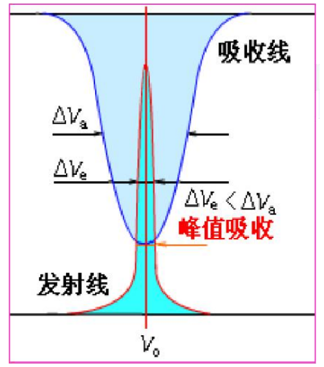

什么是峰值吸收？

定义：峰值吸收是指在使用锐线光源（如空心阴极灯）时，测量原子吸收谱线中心频率（ ν0 ）处的最大吸收系数（ K0 ），也就是测量吸收峰的“高度”，而不是测量整个峰的“面积”。

符号表示：通常用 K0 表示峰值吸收系数。

通俗理解：想象你要测量一座山的高度。理论上应该测量山的“体积”（积分吸收），但因为测量体积太难，我们转而测量山的“海拔最高点”（峰值吸收）。

只要测定吸收前后发射线强度的变化,就可以求出被测元素的含量。

锐线光源

是什么：一种发射线宽度极窄（比吸收线还窄）的光源。

比喻：就像一根极细的针（光源），去刺一个稍微粗一点的管子（吸收线）。

作用：只有这种光源，才能让我们通过测量“峰值吸收”来代替“积分吸收”，从而简化仪器设计。空心阴极灯就是最典型的锐线光源。

原子吸收光谱有几种干扰？怎样产生的？如何消除？

在实际测量中，事情往往比理想模型复杂。干扰主要分为四类，我们可以按“物理”、“化学”、“电离”、“光谱”的逻辑来记忆。

1. 物理干扰

怎么产生的：样品的物理性质（如粘度、表面张力）与标准溶液不同，导致进样量或雾化效率发生变化。

如何消除：最常用的方法是标准加入法（后面会讲到），或者通过稀释样品来减小差异。

2. 化学干扰

怎么产生的：待测元素与样品中的其他成分（如磷酸根、硅酸根、铝盐）发生化学反应，生成了难解离的化合物（如难熔氧化物），导致原子化效率降低。

例子：磷酸盐会严重干扰钙的测定，因为生成了 Ca2P6O7 。

如何消除：

加入释放剂：加入一种元素，它与干扰物的结合力更强。例如测钙时加入镧盐（ LaCl3 ），镧与磷酸根结合，把钙“释放”出来。

加入保护剂：如加入 EDTA，与钙形成可溶性络合物，防止其与磷酸根作用。

提高火焰温度：使用 N2O-C2H2 （氧化亚氮-乙炔）火焰，温度更高，能分解难熔氧化物。

3. 电离干扰

怎么产生的：在高温火焰中，原子容易失去电子变成离子（ M→M+ ）。离子不产生原子吸收，导致信号下降。

如何消除：加入消电离剂（这名字真简单粗暴）：加入易电离的元素（如铯盐、钾盐），产生大量自由电子，抑制待测元素的电离（勒夏特列原理）。

降低火焰温度：对于易电离的元素（如K、Na），选用温度较低的火焰。

4. 光谱干扰（包含背景吸收）

怎么产生的：

背景干扰：这是光谱干扰中最主要的部分。指原子化过程中产生的分子吸收（如火焰中的 CH 、 CN 、 OH 基团）和光散射（固体微粒对光的散射）。它们不是原子吸收，但会被仪器误认为是信号。

如何消除：背景校正技术：氘灯连续光谱背景校正：利用氘灯（连续光源）测量背景吸收，锐线光源测量总吸收，两者相减得到净吸收

氘灯（连续光源）：用于测量背景吸收。因为氘灯的光谱带宽较宽，待测原子的吸收相对于整个带宽来说可以忽略不计，测得的主要是背景吸收值。

锐线光源（如空心阴极灯）：用于测量总吸收（原子吸收 + 背景吸收）。

计算：通过数学减法，即 总吸收 - 背景吸收 = 净吸收（即真实的原子吸收信号）。

最后，我们来到数据处理环节。如何根据吸光度算出样品里到底有多少元素？

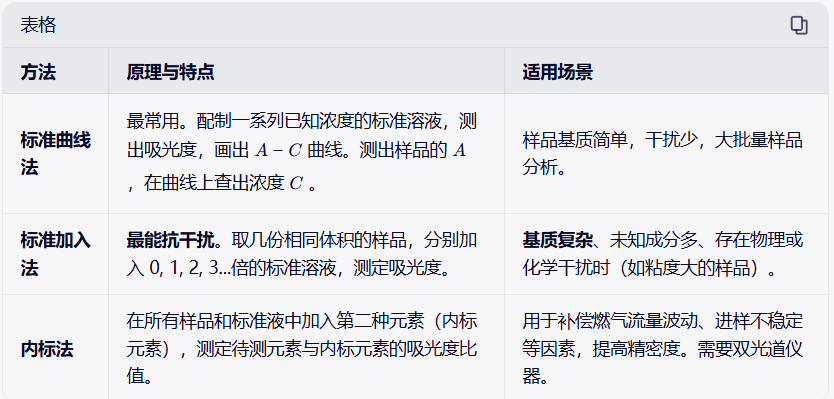

在原子吸收分析的理论中，用峰值吸收代替积分吸收的基本条件之一是()

a.单色器能分辨出发射谱线，即单色器必须有很高的分辨率

b.光源发射线的半宽度要比吸收线的半宽度小得多

c.光源发射线的半宽度要与吸收线的半宽度想当

d.吸收线的半宽度要比光源发射线的半宽度小得多

正确答案是:光源发射线的半宽度要比吸收线的半宽度小得多

在原子吸收法中，原子化不一定都要在高温下才能进行。()

选择一项:

对

错

正确答案是“对”。

在原子吸收分析中，某些元素可以与硼氢化物反应还原成极易挥发的氢化物，在以电加热或火焰加热的石英管原子化器中极易原子化，所以不一定高温。

空心阴极灯工作电流越大，光源辐射的强度越大，测定的灵敏度越高。()

选择一项:

对

错

正确答案是“错”。

空心阴极灯的电流太大，放电不稳，信噪比严重下降，灵敏度降低。

原子化温度越高，基态气态原子密度越大。()

选择一项:

对

错

正确答案是“错”。

在原子吸收光谱中,基态气态原子密度N0受温度影响很小,基本不随温度变化;即使温度过高，因为有电离存在。只会使基态原子数减少。

原子吸收法测定易形成难离解氧化物的元素铝时，需采用的火焰为()

a贫燃火焰

b.化学计量性火焰

c.氧气-空气

d.富燃火焰

正确答案是:富燃火焰

空心阴极灯中对发射线宽度影响最大的因素( )

a.填充气体

b.灯电流

c.阴极材料

d.阳极材料

正确答案是:灯电流

原子吸收分析中光源的作用是()

a.产生紫外光

b.提供试样蒸发和激发所需的能量

c.产生具有足够浓度的散射光

d.发射待测元素的特征谱线.

正确答案是:发射待测元素的特征谱线.

采用标准加入法可以提高分析方法的灵敏度。()

选择一项:

对

错

正确答案是“错”。

标准加入法的测定中是在同一条件下进行,因此并不能提高分析方法的灵敏度,而它能消除基体干扰和某些化学干扰,故可以提高分析的准确度。

在石墨炉原子化器中，应采用下列哪种气体作为保护气?()

a.乙炔

b.氢气

c.氩

d.氧化亚氮

正确答案是:氩

双光束原子吸收光度计不能消除的不稳定因素是( )

a.原子化器

b.放大器

c.光源

d. 检测器

正确答案是:原子化器

原子吸收分析中，吸光度最佳的测量范围是()

a. &gt;0.9

b. 0.69~0.8

C. 0.01~0.05

d. 0.1~0.5

正确答案是::0.1~0.5

根据朗伯-比尔定律，当吸光度A≈0.434时，由仪器读数误差引起的浓度相对误差最小。而实际分析中，为兼顾误差与灵敏度，通常将吸光度控制在0.1～0.5之间，此范围与紫外-可见分光光度法中的最佳读数范围（0.2～0.8）略有不同，原子吸收分析因信号特性及仪器响应要求，更倾向于更窄且偏低的吸光度区间。

在原子吸收分析中，由于某元素含量太高，已进行了适当的稀释，但由于浓度高，测量结果仍偏离校正曲线，要改变这种情况，下列哪种方法可能是最有效的?()

a.将分析线改用非共振线

b.缩小读数标尺

c.改变标准系列浓度

d.继续稀释到能测量为止

正确答案是:将分析线改用非共振线

可以消除原子吸收法中的物理干扰的方法是()

a.扣除背景

b.加入保护剂

c.加入释放剂

d.采用标准加入法”

正确答案是:采用标准加入法

由原子无规则的热运动所产生的谱线变宽称为()

a. 自然变度

b.赫尔兹马克变宽

c.劳伦茨变宽

d. 多普勒变宽

正确答案是:多普勒变宽

原子吸收线的宽度主要是多普勒变宽和洛伦兹变宽。()

选择一项:

对

错

正确答案是“对”。

在原子吸收法中，原子化器的分子吸收属于()

a.物理干扰

b光谱线重叠的干扰

c.化学干扰

d.背景吸收

正确答案是:背景吸收

名词解释：

12.AES（原子发射光谱法）

利用原子受激后发射特征光谱，进行元素定性与定量分析的方法。

9.电热原子化比火焰原子化的灵敏度高，为什么？

1. 样品全部原子化并停留在光路中，利用效率接近100%，而火焰原子化大量样品被稀释、流失。

2. 原子在光路中停留时间长，吸收信号显著增强。

3. 原子密度高、基体干扰小，检测限更低，灵敏度远高于火焰。

8.IS（内标法）Internal Standard（内标法 / 内标物）

在定量分析中加入的已知量参考物质，用于校正进样量、仪器波动等误差，提高测定准确度。

4.原子吸收光谱法的原理

基于气态基态原子对同种元素发射的特征共振辐射具有选择性吸收，在一定范围内，吸光度与原子浓度成正比，从而进行元素定量分析。

10.原子吸收光谱法为什么只能用于定量分析而不用于定性分析

1. 结构简单，特征性差

原子吸收只有少数几条锐线共振峰，不像分子光谱有丰富的吸收峰形，难以靠少数谱线准确鉴别元素。

2. 需空心阴极灯，针对性强

测哪种元素必须用对应元素的空心阴极灯，不能像发射光谱那样一次扫描识别未知元素。

3. 无完整谱图信息

只能得到吸光度数值，没有全谱图，无法与标准谱库比对定性。

4. 易受干扰，可靠性低

背景、基体、其他元素可能产生重叠吸收，仅凭吸收信号无法准确判定元素种类。

学完了原子吸收光谱法，接下来，该学原子发射光谱法了。哈哈。真是太简单了。

原子荧光光谱法（AFS）在广义上属于发射光谱的范畴，但在激发原理和分类上，它与通常所说的原子发射光谱法（AES）是并列且不同的技术。

也就是说我们要学两个方法，AES和AFS，不要弄混了。

原子发射光谱法：Atomic Emission Spectrometry，emission，发射。

原子荧光光谱法：Atomic Fluorescence Spectrometry，fluorescence，荧光。不认识这个单词，我一直以为是firefly萤火虫的F

先学哪个呢，按爱课顺序是先AFS再AES。但我我觉得学了AAS原子吸收之后应该先学AES原子发射，比较合理一点，然后再学和AES比较像的AFS。

原子发射光谱法 atomic emission spectrometry, AES

（1）原子发射光谱是怎样产生的?

（2）简述ICP的工作原理，并与其他光源比较其特点。

（3）比较摄谱检测系统与光电直读检测系统的元件组成、工作原理及特点。

（4）概念解释：共振线、分析线、灵敏线、最后线、原子线、离子线和分析线对。

（5）光谱定量分析中为什么采用内标法？简述其原理，并说明如何选择内标元素和内标线，写出内标法基本关系式。

（6）原子发射光谱的谱线强度与哪些因素有关？

原子发射光谱分析法 (spectroscopy atomic emission spectroscopy, AES)：元素在受到热或电激发时，由基态跃迁到激发态，返回到基态时 发射出特征光谱，依据特征光谱进行定性、定量的分析方法.

在原子吸收中，我们测的是吸光度A，看它吃了多少；在原子发射中，我们测的是光线强度I，就好像放鞭炮一样，先点燃它，然后看它炸得怎么样来定性定量，是窜天猴还是春节十二响，是春节十二响还是春节一千零一响。

原子发射光谱仪：进样和光源、单色器、检测器、读出器件。 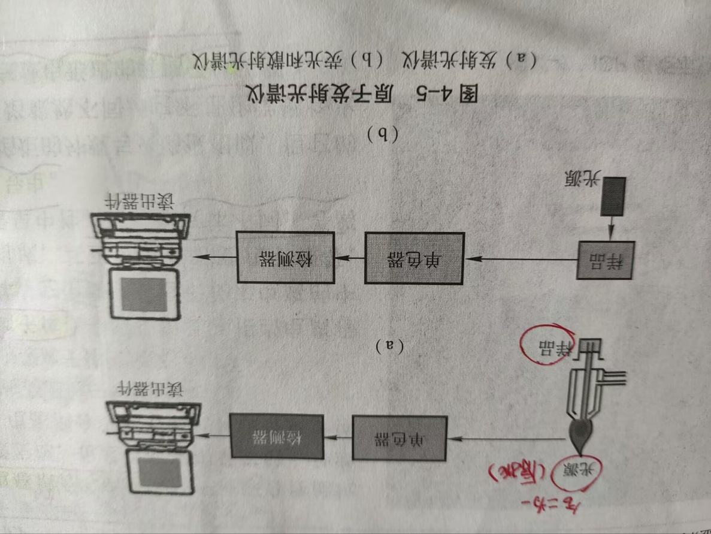

（注意到，原子发射光谱仪进样和光源是一起的，并且与后面的仪器是一条直线；荧光和散射光谱仪中，光源和样品是分开的，并且是垂直的。具体会在后面AFS中展开介绍）

原子发射光谱仪进样系统进样后，激发源（光源）开始发挥作用：

提供试样蒸发、解离、原子化、激发所需要的能量 ；同时在光源中发射出特征谱线

激发源的类型：分为经典光源（火焰、电火花、交直流电弧）和现代光源（ICP电感耦合等离子体）（这名字一听就很摩登啊）

什么是等离子：一个原子由电子和原子核组成。电子跑路了，就是带负电的自由电子，剩下那个就是带正电的离子。这时候他们俩就叫等离子态。等离子体 = 高温/高能环境下 + 大量原子被“打碎”(电离) + 正离子和电子混在一起 + 整体保持电中性。

ICP（电感耦合等离子体）的工作原理可以简述为：利用高频电流通过线圈产生强大的交变磁场（电磁感应原理）（电感），使氩气电离并形成高温、惰性的等离子体“熔炉”，（耦合），从而将引入的样品原子化、激发，使其发射出特征光谱。

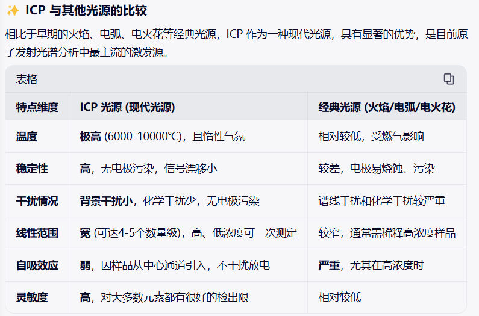 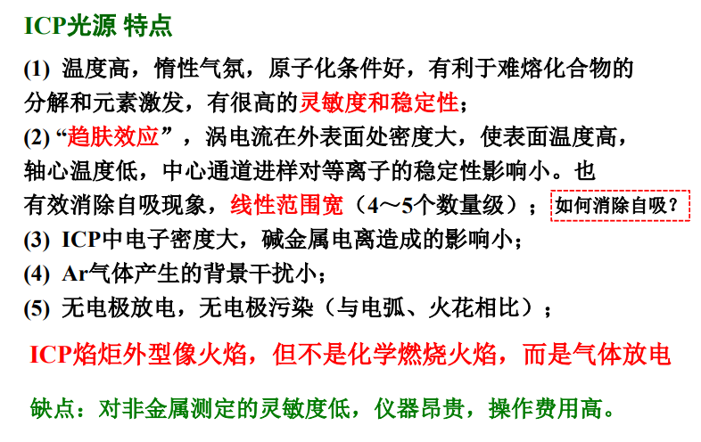

趋肤效应：趋肤效应 (Skin Effect) 趋肤效应是一种电磁学现象。

它指的是在高频交流电通过导体（或等离子体）时，电流会倾向于集中在导体的表面流动，而导体内部的电流密度反而很小。ICP利用高频发生器产生高频电流，通过感应线圈产生交变磁场。

由于频率很高，感应出的涡电流主要集中在等离子体的外表面，电流密度大意味着热量集中，因此等离子体的表面温度极高，而轴心温度相对较低。

趋肤效应给ICP带来的两大优势：

消除自吸现象：因为热量集中在外部，中心通道的温度较低，样品在这个区域主要被原子化和激发，而不会受到强烈的外部辐射干扰，从而有效避免了谱线自吸。

稳定性高：样品气溶胶是从中心通道引入的（进样），由于中心温度低且不干扰外部的放电电流，进样过程对等离子体本身的稳定性影响很小。

自吸效应 (Self-Absorption)：自吸效应是一种光谱物理现象。它指的是光源中心发出的辐射，被光源边缘的同种元素的基态原子吸收，导致谱线强度降低的现象。

等离子体中心高温区的激发态原子发射出特征光谱线。这些光线在射出光源的过程中，经过了温度较低的边缘区域。边缘区域存在大量的同种元素的基态原子（未被完全激发），这些基态原子会“吃掉”（吸收）中心发射出来的特定波长的光。自己把自己发的光吃了，就测不到了。

自吸效应在高浓度的时候会比较严重，因为更多的基态原子吃掉了激发态原子发的光。所以自吸效应会导致线性范围窄。线性范围指的是仪器的检测信号（如光谱线强度 I）与被测物质浓度（C）成正比（即呈直线关系）的那个浓度区间，也就是说测得准的范围。

趋肤效应形成了一个外热内冷的，像一个环一样的通道，样品只能在中间这个冷的通道通过，周围都是高温的激发态，没有基态了，就不会自吸了。

分光系统：将样品中待测元素的激发态原子或离子发射的特征光经分光后得到按波长顺序排列的光谱。相较于其他仪器里的分光系统，AES的分光系统发射要求最高，即分辨率要求最高，因为它发射线更多。

检测系统： 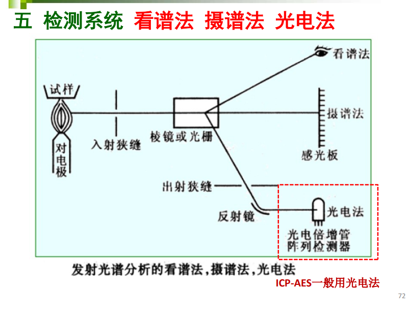

看谱法、摄谱法、光电法，是原子发射光谱分析（AES）发展史上三种不同的检测技术。它们代表了从“人眼观察”到“光学记录”再到“电子数字化”的技术演进过程。

看谱法：利用人眼直接观察经过棱镜或光栅分光后的可见光谱。样品在光源（如火焰、电弧）中激发发光，光线经过分光系统色散成光谱，分析人员通过目镜直接观察光谱图，根据“有没有某条特定颜色的谱线”来判断元素的存在。主观性强：结果依赖于分析人员的经验和视力。局限性大： 只能观察可见光范围（约400-700nm），无法检测紫外区或红外区的谱线。（瞪眼法）

摄谱法： 利用光化学原理，通过感光板记录谱线的位置和黑度。分光后的光谱投射到感光板上。

不同波长的光在板上不同位置感光，形成潜影。经过暗房冲洗（显影、定影），形成可见的黑线条（谱线）。利用映谱仪放大观察谱线位置（定性），或利用测微光度计测量谱线的黑度 (S) 来进行定量分析。全谱记录： 一张干板可以同时记录很宽波长范围内的所有谱线，便于事后回顾。

缺点： 操作繁琐（需要暗房化学处理），分析速度慢，且黑度测量的准确度有限。（胶片古法拍照）

光电法：这是现代原子发射光谱仪（如ICP-AES）采用的主流技术，实现了光信号到电信号的直接转换。利用光电效应，将光子能量直接转换为电流信号。分光后的光谱照射到光电检测器上。

检测器将光强（光子数）转化为电流强度 (I)。电流经过放大和模数转换，由计算机直接读取数值。（传感器转成数字信号，VIVO拍照手机（非广）） 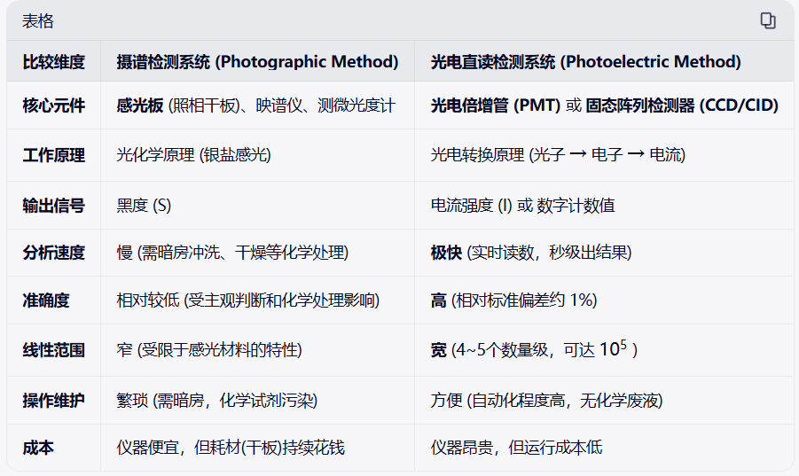

好了，我们现在把照片拍出来了，接下来要怎么定性定量呢？

定性的依据是“元素不同 → 电子结构不同 → 光谱不同”。

每种元素的原子核外电子能级结构都是独一无二的。当它们从激发态跃迁回基态时，会发射出特定波长的光（特征光谱线）。判定标准：只要在样品光谱中，发现了某元素的 2~3条特征谱线（通常是原子线或离子线的第一共振线、最灵敏线或最后线），就可以断定该元素存在。 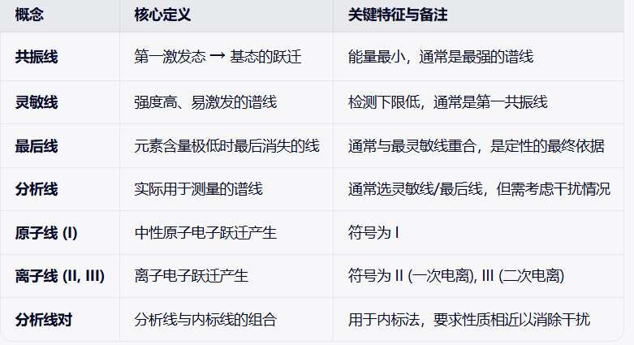

三种定性分析方法：

1. 标准试样光谱比较法（最直观）

准备标准样品（已知含有待测元素的样品）和待测样品。在完全相同的仪器条件下（光源、狭缝、感光板等），同时摄取它们的光谱。将两者的光谱图并排观察（映谱）。

如果待测样品的光谱中，出现了标准样品所含元素的 2~3条特征谱线，则证实待测样品中含有该元素。如果没出现，或者出现的谱线数量不足，则判定为不含该元素。

2. 铁谱比较法

这是光谱分析中应用最广泛的方法。为什么要选铁（Fe）作为标尺？铁的能级非常丰富，有成千上万条谱线，波长覆盖了从紫外到可见光的广泛范围，就像一把刻度极密的尺子，无论你看到哪一段波长，旁边总会有铁谱线作为参照。并且铁的每一条谱线波长都已经被科学家精确测定并收录在标准光谱表中。

利用标准铁谱图（或在摄谱时并列摄取铁谱），作为波长标尺。测量待测谱线与附近铁谱线的相对位置（距离）。

查表：根据距离，查出该谱线的波长值。

定性：将测得的波长与元素光谱表对比，确定是哪种元素的谱线。

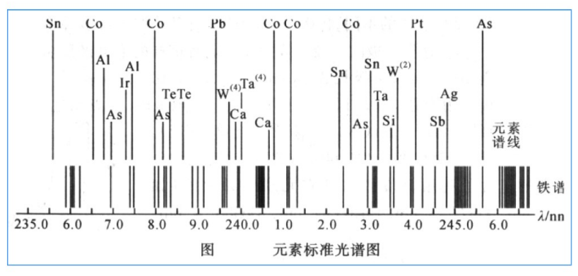

3. 波长测量鉴定法（最精确）

这种方法直接利用物理量“波长（λ）”进行数学计算和比对。

精确测量感光板上待测谱线的位置（距离基准点的毫米数）。利用内插法或仪器自带的计算公式，将位置换算成波长（nm）。将计算出的波长与理论值或标准数据库进行比对。

定性学完了，我们来学学定量：

1.理论上来说，有了下面这个公式，我们就能通过前面的ICP-AES光电法测出谱线强度I，然后就能求出浓度C了。先配标准溶液，求出标准曲线，就能代进去了。

但图片中可以看到，有两个常数a和b，而且这两个常数一直在变，每次蒸发、激发、浓度不同都不一样，所以标准溶液和标准曲线未必“标准”，得到的数据也不准。 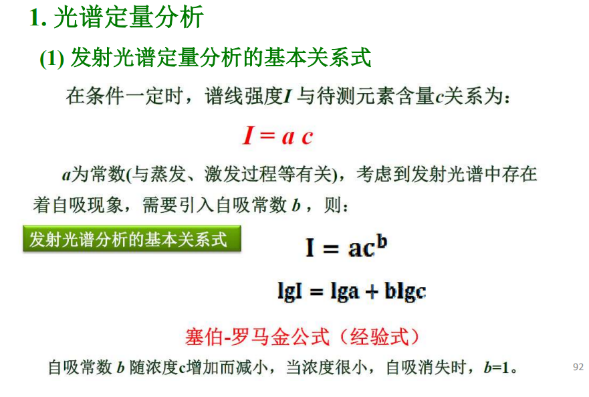

2.为了消除仪器波动和基体效应的影响，我们引入了内标法。

什么是内标法？在待测样品和标准溶液中，加入固定浓度的另一种元素（称为内标元素，如镓 Ga 或钇 Y）。这个时候我们拍照，就会测到两条线：

分析线：待测元素的谱线（如 Ca 422.67 nm）。

内标线：内标元素的谱线（如 Ga 417.20 nm）。

为什么要这么做？（核心逻辑）

假设由于仪器功率波动，导致所有元素的蒸发效率瞬间降低了 10%：

绝对强度 ( I )：钙的强度会下降，如果你只看钙，你会以为钙变少了（误判）。

相对强度 ( R )：钙的强度 / 镓的强度。因为钙和镓同时受到了同样的 10% 影响，它们的比值几乎不变！

定量依据

文档中给出了内标法的基本关系式：

R=I分析I内标=ACb

取对数后得到线性方程：

log⁡R=blog⁡C+log⁡A 如何选择内标元素？（关键条件）

根据文档要求，选择内标元素必须遵循“门当户对”原则：

物理性质相近：沸点、挥发性应与待测元素相近（确保在光源中行为一致）。

激发电位和电离电位相近：确保受温度变化的影响程度一致。

谱线无干扰：内标线附近应无其他谱线干扰，且自吸要小。

样品中不含该元素：不能引入背景干扰

在实际操作中，我们通常利用上述原理构建标准曲线。文档介绍了以下三种主流方法：

1. 内标标准曲线法（最常用、最稳健）

这是现代 ICP-AES 最常用的方法，结合了“内标法”和“标准曲线法”的优点。

操作步骤：

配制一系列已知浓度的标准溶液（如 0, 1, 2, 5, 10 ppm）。

在每份标准溶液中加入等量的内标元素。

测定每份溶液的 分析线强度 和 内标线强度，计算比值 R 。

以 logR 为纵坐标， logC 为横坐标，绘制标准曲线。

测定未知样品（同样加入内标），根据其 logR 值在曲线上查出浓度。

2. 标准曲线法（外标法，适用于简单基体）

如果不使用内标，直接利用 I=ACb 的关系。

操作步骤：

配制标准系列，测定强度 I 。

以 logI 对 logC 作图。

测定样品强度，查标准曲线得浓度。

缺点：对仪器稳定性要求极高，基体效应（如高盐分）会严重影响结果。

3. 标准加入法（适用于复杂基体或无合适内标时）

当样品基体非常复杂（如高粘度、高盐分），且无法找到合适内标元素时使用。

操作步骤：

取四份等量的待测样品溶液。

分别加入 0倍、1倍、2倍、3倍的待测元素标准溶液。

测定各溶液的响应值（强度 I 或相对强度 R ）。

以 R 对加入浓度 C 作图。

关键点：将直线反向延长，与横轴相交，交点到原点的距离即为样品中待测元素的原始浓度 Cx 。

原理：通过在样品内部建立标准曲线，抵消了基体对测定的影响。

学会了AES的定性定量方法，我们来总结一下AES的优势和劣势：

优势：多快好省：多：可以多元素同时检测；快：分析速度快，样本不需要处理，烧就完了；好：准确度高，易校正误差；省：检出限低、线性范围宽，既可以测ppm级的微量元素，也可以测百分含量的常量元素。

劣势： 非金属元素不能检测，或者换个说法，测非金属元素的灵敏度比原子吸收、原子荧光低。（非金属元素的外层电子结构稳定，要将其电子激发到高能级需要巨大的能量，很难测）

很好，既然非金属元素用AES不好测，那就可以引出下一个测非金属元素的方法了：AFS原子荧光光谱分析法

（1）原子荧光光谱是怎么产生的？有几种类型？仪的区别，并说明原因。

（2）概念解释：荧光淬灭。

（3）比较原子荧光与原子吸收光谱

（4）简述氢化物原子荧光的各种进样方式及特点。

原子荧光光谱法（Atomic Fluorescence Spectroscopy, AFS）：原子在辐射激发下发射的荧光强度来定量分析的方法。

结合了原子吸收光谱法AAS和原子发射光谱法AES的优点 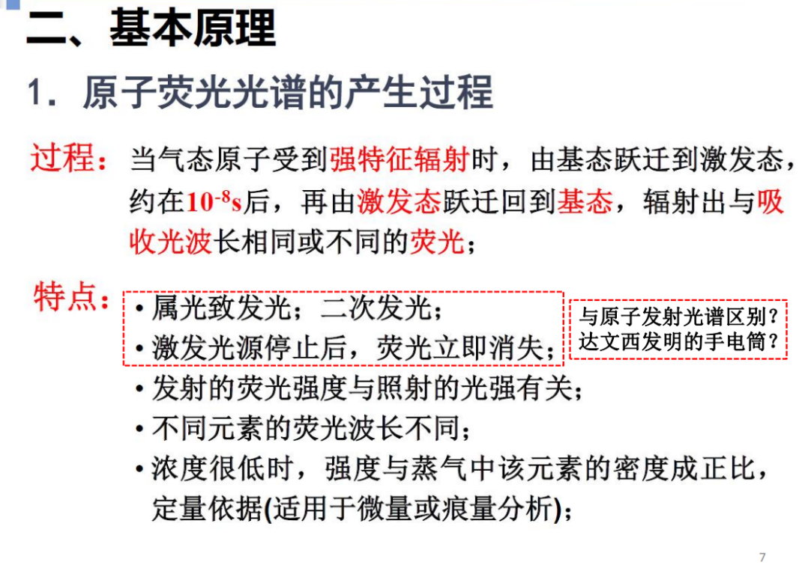

达文西的手电筒是什么：星爷电影《国产凌凌漆》里罗家英饰演的角色叫达文西（达芬奇），发明了一个手电筒，但这个手电筒是太阳能手电筒，没有内置电池，只有在有光的时候才能用这个手电筒：“有光就亮，没光绝对不亮。”

知道了原理是气态原子吃了光再吐出光之后，我们就能进一步细分类型了：

原子荧光的产生类型：三种类型:共振荧光、非共振荧光与敏化荧光。

(1)共振荧光：发射与吸收线波长相同的荧光:气态原子吸收共振线 被激发后,激发态原子再发射出与共 振线波长相同的荧光。（也就是吃的吐的都一样）

(2) 非共振荧光：当荧光与激发光的波长不相同时,产生非共振荧光。（吃的吐的不一样）；

(3) 敏化荧光 受光激发的原子与另一种原子碰撞时,把激发能传 递另一个原子使其激发,后者发射荧光;（有点像打台球？打一个球撞到另一个球，让另一个球吐）

荧光淬灭 (Quenching of fluorescence) 是指激发态原子在发射荧光之前，通过与其他粒子（如火焰气体分子）发生非辐射碰撞，将能量转化为热能而失去，导致荧光强度降低甚至消失的现象。（吃撑了还没来得及吐，被人撞了，能量转化成热能消耗掉了）

消除方法：在实验中加入惰性气体，可以有效减少火焰气体分子碰撞激发态原子，提高荧光量子效率。（惰性气体懒得撞你）

学完分类，我们来学仪器。看回之前那张图：。 

（注意到，原子发射光谱仪进样和光源是一起的，并且与后面的仪器是一条直线；荧光和散射光谱仪中，光源和样品是分开的，并且是垂直的。具体会在后面AFS中展开介绍）

特点:光源与检测器成一定角度：而避免激发光源发射的辐射对原子荧光检测信号的影响。

文档中重点介绍了氢化物发生法 (Hydride Generation)，这是原子荧光技术中最具特色的进样方式，主要用于 As、Se、Hg、Pb 等元素。

1. 氢化物原子荧光是什么意思？

简单来说，它是一种特殊的进样和原子化技术，专门用于测定那些能与还原剂（如硼氢化钾）反应生成挥发性氢化物的元素。

核心原理：在酸性介质中，待测元素（如砷、汞、铅）与还原剂发生化学反应，生成气态的氢化物（例如砷化氢 AsH3 、汞蒸气 Hg0 ）。这些气体被载气（通常是氩气或氮气）“吹”入原子化器（通常是石英炉），在高温下分解成自由原子，进而被激发产生荧光。

核心优势：它实现了“气相分离”。待测元素变成了气体，而大部分液态基体（如食物残渣、酸液）留在了反应瓶里。这极大地降低了基体干扰，提高了灵敏度，也使得检出限极低。

其他没什么好说了，让D老师总结一下AAS,AES,AFS的异同： 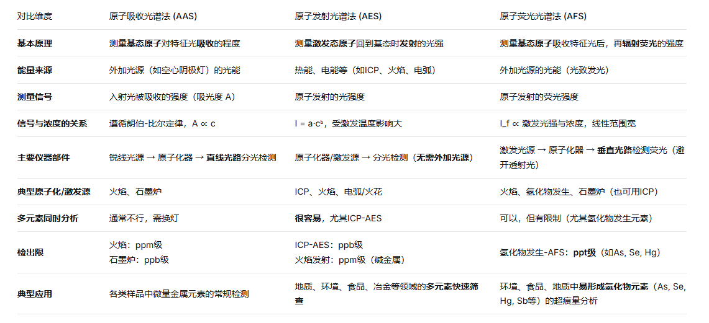

相同点

都属于原子光谱：都是利用自由原子蒸气中，外层电子能级变化产生的特征谱线。

都需要原子化：必须将样品中的待测元素转化为自由原子蒸气（基态原子或进一步激发）。

都是定量分析方法：在一定条件下，测量的信号强度与待测元素浓度成正比，通过标准曲线定量。（AES可以定性，另外两个用空心阴极灯的不好定性）

都会受到干扰：均存在光谱干扰、物理干扰、化学干扰等，需要采用扣除背景、加基体改进剂等方法消除。

⚡ 一句话区别

AAS：看透过去的光被“吃掉”了多少。

AES：看原子自己发出的光有多亮。

AFS：用光“照”原子，看它再发光的强度。

这三种方法各有优劣，通常可根据待测元素种类、浓度范围、样品通量及预算灵活选择。如果想进一步了解如何为某个具体检测项目（如测水样中的铅）选择最合适的仪器，可以告诉我。

原子荧光光度计与原子吸收光度计的主要区别是什么？

a.原子荧光仪采用的空心阴极灯强度低

b.一个有原子化系统一个没有

c.原子吸收更灵敏

d.光路垂直(避免光源射线进入检测器)

正确答案是：光路垂直(避免光源射线进入检测器)

原子荧光法测量的是溶液中原子受激发产生的荧光

选择一项：

对

错

正确答案是“错”。

原子荧光法测量的是蒸气中原子受激发产生的荧光

在原子荧光法中, 多数情况下使用的是

a.阶跃荧光

b.共振荧光

c.敏化荧光

d.直跃荧光

正确答案是：共振荧光

原子荧光的量子效率是指

a.原子化器中离子浓度与原子浓度之比

b.激发态原子数与基态原子数之比

c.入射总光强与吸收后的光强之比

d.单位时间发射的光子数与单位时间吸收激发光的光子数之比

正确答案是：单位时间发射的光子数与单位时间吸收激发光的光子数之比

原子荧光法中，原子化器的主要作用是将试样中待测元素转化为激发态原子。

选择一项：

对

错

正确答案是“错”。

原子荧光法中，原子化器的主要作用是将试样中待测元素转化为基态原子。

下列常用光源中，产生自吸现象最小的是：

a.电感耦合等离子体

b.电火花

c.交流电弧

d.直流电弧

正确答案是：电感耦合等离子体

以标准光谱比较法进行谱线检查、原子发射光谱定性分析时，通常依据的标准是：

a.氢谱

b.铁谱

c.碳谱

d.铜谱

正确答案是：铁谱

使用ICP光源时，光谱观察高度一般在电感线圈之上15 – 20 mm，原因是：

a.此位置可避免产生自吸

b.此位置便于光谱仪进行摄谱

c.此位置的线背比大，背景小

d.此位置的温度高，试样激发完全

正确答案是：此位置的线背比大，背景小

以光栅作单色器的色散元件，光栅面上单位距离内的刻痕线越少，则：

a.光谱色散率变大，分辨率增高

b.光谱色散率变大，分辨率降低

c.光谱色散率变小，分辨率增高

d.光谱色散率变小，分辨率降低

正确答案是：光谱色散率变小，分辨率降低

在用二米光栅原子发射光谱仪摄谱获得的原子光谱感光板上，其谱线的间隔距离：

a.随谱线对应的波长增大而增大

b.随谱线对应的波长减小而减小

c.几乎不随谱线波长而减小或增大

d.随谱线对应的波长减小而增大

正确答案是：几乎不随谱线波长而减小或增大

下列常用光源中，进行定量分析时，线性范围最大的是：

a.直流电弧

b.交流电弧

c.电火花

d.电感耦合等离子体

正确答案是：电感耦合等离子体

原子发射光谱仪中光源的作用是：

a.提供足够能量使试样灰化、分解

b.提供特定波长和强度的锐线光谱

c.去除试样中的杂质，消除干扰

d.使被测元素熔融、蒸发、离解和激发

正确答案是：使被测元素熔融、蒸发、离解和激发

不能采用原子发射光谱分析的物质是：

a.土壤和硅酸盐岩石中的过渡金属元素

b.有机物和大部分的非金属元素

c.碳铵复混肥料中的稀土元素

d.植物根茎中的碱金属和碱土金属

正确答案是：有机物和大部分的非金属元素

下列常用光源中，激发温度最高的是：

a.电感耦合等离子体

b.电火花

c.交流电弧

d.直流电弧

正确答案是：电感耦合等离子体

很好。原子的几个光谱法学完了。那么主播主播，这几个光谱法还是太简单了，有没有更吃操作的打法呢？有的兄弟有的，接下来向您走来的，是原子质谱→电感耦合等离子体质谱法：

第十一章 原子质谱 电感耦合等离子体质谱法

（1）比较原子质谱技术ICP-MS与原子光谱技术原理、装置的区别。

（2）比较原子质谱技术ICP-MS与原子吸收光谱、原子发射光谱、原子荧光的优劣。

很高兴为你解答。你询问的原子质谱 电感耦合等离子体质谱法，通常简称为 ICP-MS（Inductively Coupled Plasma Mass Spectrometry）。

这是一种将电感耦合等离子体（ICP）技术与质谱（MS）技术相结合的分析方法，主要用于元素分析。它被公认为目前检测无机元素最灵敏、最高效的技术之一。

电感耦合等离子体ICP：电感：电磁感应；耦合：电磁感应的能量传递给原子，原子就电离了，（所以为什么不叫耦离呢）变成带负电的电子和带正电的粒子，这一坨就叫等离子体。该技术用于AES中激发样品使其发光。

质谱MS：根据离子质量和电荷的不同，离子在磁场下分离，先后进入检测器排列成谱。

所以质谱的检测对象是离子，原子不带电荷无法分离。巧了，ICP能原子变成离子，于是ICP-MS就诞生了。

（1）ICP-MS 与原子光谱技术的原理及装置区别

这一部分主要对比 ICP-MS（质谱） 与 ICP-OES/AES（发射光谱） 的核心差异。

1. 基本原理的区别

ICP-MS (电感耦合等离子体质谱法)：

核心原理：利用电感耦合等离子体作为离子源，将样品原子离子化。

分离依据：根据离子在电场和磁场中的运动轨迹，按质荷比（m/z）进行分离。

检测对象：检测的是离子的数目（计数）。

定性/定量：通过质荷比定性，通过离子流强度（计数率）定量。

原子光谱 (如 ICP-OES/AES)：

核心原理：利用光源（如ICP、火焰等）使样品原子化，并激发原子外层电子至高能级。

分离依据：根据电子从高能级跃迁回低能级时释放的特征光谱波长（ λ ）。

检测对象：检测的是光的强度（光子）。

定性/定量：通过特征波长定性，通过光强度定量。

2. 仪器装置的区别

根据文档中的系统结构描述，两者在硬件上的主要区别在于分离系统和检测系统：

表格

| 结构部件 | ICP-MS (质谱) | ICP-OES (发射光谱) |
| --- | --- | --- |
| 光源/离子源 | 基本相同 (ICP炬管) | 基本相同 (ICP炬管) |
| 核心分离部件 | 质量分析器 (如四极杆 Quadrupole)，利用电场/磁场分离离子。 | 分光系统 (光谱仪)，利用棱镜或光栅将复合光色散成光谱。 |
| 检测器 | 电子倍增器 (检测离子流，进行计数)。 | 光电倍增管 (PMT) 或 固态检测器 (检测光强度)。 |
| 环境要求 | 需要高真空系统 (机械泵+分子涡轮泵) 来维持质谱工作环境。 | 通常在大气压下工作，无需真空系统。 |
| 接口技术 | 需要复杂的接口 (采样锥、截取锥) 将大气压下的离子引入真空系统。 | 无需特殊接口，光路直接通向分光系统。 |

| 比较项目 | ICP-MS | ICP-AES (ICP-OES) | GFAAS (石墨炉) | FAAS (火焰) | AFS (原子荧光) |
| --- | --- | --- | --- | --- | --- |
| 检测原理 | 质荷比 (m/z) 分离，检测离子数目 | 特征光谱波长，检测光强度 | 基于基态原子对特征辐射的吸收 | 基于基态原子对特征辐射的吸收 | 原子蒸气受激发产生的荧光强度 |
| 检出限 (LOD) | 极低 (ppt - ppb级) 绝大多数元素优于其他方法 | 较低 (ppb级) | 极低 (ppt级) 针对特定元素 | 较高 (ppm级) 灵敏度相对较低 | 极低 (ppt级) 仅限能形成氢化物的元素 (As, Hg, Se等) |
| 分析速度 | 极快 (1分钟可测70+种元素，多元素同时测定) | 快 (多元素同时测定) | 慢 (逐个元素测定，需升温程序) | 慢 (逐个元素测定) | 中等 (通常逐个测定，特定元素快) |
| 线性范围 | 极宽 (9个数量级) | 宽 (8个数量级) | 窄 (2个数量级) | 中等 (3个数量级) | 中等 |
| 干扰情况 | 谱图干扰少 (原子量差1即可分离) 主要干扰为质谱干扰和基体效应 | 光谱干扰常见 (谱线重叠) | 化学干扰多 (基体效应影响大) | 化学干扰多 (需加入释放剂/保护剂) | 干扰相对较少 但存在荧光猝灭等问题 |
| 同位素分析 | 支持 | 不支持 | 不支持 | 不支持 | 不支持 |
| 耐盐性/基体 | 差 (要求 TDS &lt; 0.1-0.4%) 易受基体效应抑制 | 优 (可耐受 2-15% 盐分) | 优 (可处理高基体) | 优 (可耐受 0.5-10% 盐分) | 较好 (通常配合氢化物发生，基体分离好) |
| 运行成本 | 高 (需真空泵、高纯气、维护复杂) | 高 (需高功率射频发生器) | 中等 | 低 (仪器及维护便宜) | 低 - 中等 |
| 主要优势 | 超高灵敏度、多元素快速筛查、同位素分析、形态分析联用 | 耐高盐基体、多元素分析、稳定性好 | 超高灵敏度 (针对特定金属)、样品量少 | 成本低、操作简单、技术成熟 | 针对特定元素(As/Hg)灵敏度极高、成本低 |
| 主要劣势 | 仪器昂贵、对样品前处理要求高、易受氧化物干扰 | 灵敏度不如MS和GFAAS | 分析速度慢、无法多元素同时测定 | 灵敏度低、无法多元素同时测定 | 通用性差 (仅限少数元素) |

以下是ICP-MS仪器的组成部分是：

选择一项或多项：

A.光栅

B.质量分析器

C.样品锥

D.电感耦合等离子体

E.电子倍增器（或打拿级）

正确答案是：电感耦合等离子体, 样品锥, 质量分析器, 电子倍增器（或打拿级）

关于ICP-MS的使用，正确的是：

选择一项或多项：

A.一般不采用内标法

B.仪器使用前通常先调谐

C.果冻样品可直接进样分析

D.蔬菜样品需要消解才能进样

E.主要干扰是质谱干扰和基体干扰

正确答案是：仪器使用前通常先调谐, 蔬菜样品需要消解才能进样, 主要干扰是质谱干扰和基体干扰

关于ICP-MS的说法，正确的是：

选择一项或多项：

A.线性范围很窄

B.可多元素同时检测

C.灵敏度高

D.分析成本较高

E.可测定同位素比值

正确答案是：可测定同位素比值, 灵敏度高, 可多元素同时检测, 分析成本较高

ICP-MS灵敏度低于ICP-AES（或ICP-OES）。

选择一项：

对

错

正确答案是“错”。

ICP-MS灵敏度远高于ICP-AES（或ICP-OES）。

CP-MS和原子吸收光谱法一样，可实现多元素同时分析。

选择一项：

对

错

正确答案是“错”。

原子吸收光谱法由于光源（空心阴极灯）限制，较难实现多元素同时分析。

根据ICP的原理，请判断进行ICP-MS分析时，以下哪种元素检测灵敏度最高（）

a.Cu

b.F

c.S

d.P

反馈

正确答案是：Cu

原子质谱分析时，若检测所需分辨率很高，应选择以下哪一种质量分析器（）

a.四级杆质量分析器

b.离子阱质量分析器

c.双聚焦质量分析器

d.单聚焦磁扇形质量分析器

正确答案是：双聚焦质量分析器

以下能消除ICP-MS质谱干扰的手段是（）

a.标准加入法

b.选择无干扰的同位素

c.内标法

d.稀释样品

正确答案是：选择无干扰的同位素

关于ICP-MS与ICP-AES两种技术对比，以下描述错误的是（）

a.ICP-MS和ICP-AES都可以实现多元素同时分析

b.ICP-MS方法的检出限一般低于ICP-AES

c.ICP-AES的谱图比ICP-MS的更简单

d.ICP-MS比ICP-AES分析成本更高

正确答案是：ICP-AES的谱图比ICP-MS的更简单

原子发射光谱图比质谱图更复杂

ICP-MS分析时，内标元素最好选择样品中包含的元素。

选择一项：

对

错

正确答案是“错”。

名词解释：

ICP-OES（电感耦合等离子体原子发射光谱法）

以电感耦合等离子体为激发光源，使样品中各元素原子受激发射特征光谱，根据谱线波长与强度进行多元素同时定性、定量分析的方法。

ICP（Inductively Coupled Plasma）

电感耦合等离子体，一种由高频电磁场激发产生的高温氩等离子体，常用作原子发射/质谱分析的激发/离子化源。

趋肤效应

交变电流通过导体时，电流密度由中心向表面集中，电流主要在导体表层流动，中心电流密度几乎为零的现象。频率越高，趋肤效应越显著。

很好，我们学完了光谱法S（spectrometry），顺便学了一下质谱MS。那么接下来我们学新的方法，色谱法。

第7章 色谱分析法导论

掌握色谱法的定义及分类；

掌握色谱法的基本术语：色谱柱、固定相、流动性、色谱图、色谱峰、基线、保留值（保留时间、死时间、调整保留时间、相对保留时间）、峰面积、峰高、峰宽、半峰宽、标准偏差、分配系数、分配比（容量因子）、分离度

掌握色谱法的定义及分类；

掌握色谱法的基本术语：色谱柱、固定相、流动性、色谱图、色谱峰、基线、保留值（保留时间、死时间、调整保留时间、相对保留时间）、峰面积、峰高、峰宽、半峰宽、标准偏差、分配系数、分配比（容量因子）、分离度

掌握色谱法的定义及分类；

掌握色谱法的基本术语：色谱柱、固定相、流动性、色谱图、色谱峰、基线、保留值（保留时间、死时间、调整保留时间、相对保留时间）、峰面积、峰高、峰宽、半峰宽、标准偏差、分配系数、分配比（容量因子）、分离度

塔板理论的贡献和不足

范蒂姆特方程

范蒂姆特方程各项如何影响色谱峰的展宽

塔板理论的贡献和不足

范蒂姆特方程

范蒂姆特方程各项如何影响色谱峰的展宽

塔板理论的贡献和不足

范蒂姆特方程

范蒂姆特方程各项如何影响色谱峰的展宽

掌握分离度的定义及定义式

掌握色谱分离的基本分离方程

掌握色谱分析法的定性方法

掌握色谱分析法的定量方法

放轻松。其实不是很多，基本概念也不难，看一眼就懂了。来吧

色谱法（Chromatography）：色谱法是一种利用物质在两相（固定相和流动相）之间分配平衡的差异，来实现混合物中各组分分离、分析的方法。

装固定相的容器（玻璃柱）或者管道就叫色谱柱。

注意是固定相和流动相，不是固体相和液体相。为什么？固定相不一定是固体，流动相也不一定是液体。

流动相可以是液体，这个时候就叫液相色谱法（liquid chromatography，LC），此时固定相如果是固体，那就叫液固色谱法 ( Liquid-Solid Chromatography，LSC)，此时固定相如果是液体，那就叫液液色谱法(Liquid-Liquid Chromatography ，LLC)；

流动相也可以是气体，这个时候就叫气相色谱法（gas chromatography，GC），此时固定相如果是固体，那就叫气固色谱法（GSC），固定相是液体那就叫气液色谱法（GLC）。

根据分离原理，也可以分成若干类，以下举例两类：

(1)、吸附色谱法（absorption chromatography） 依据吸附剂对样品中各组分吸附能力的不同而进行分离的 方法，包括气固色谱法（GSC）和液固色谱法（LSC） 应用：去除色素、农残分析 (2)、分配色谱法（partition chromatography） 利用组分在互不相溶的固定相和流动相中的溶解度不同 而实现分离，包括气液色谱法（GLC）和液液色谱法（ LLC）。 应用：十分广泛

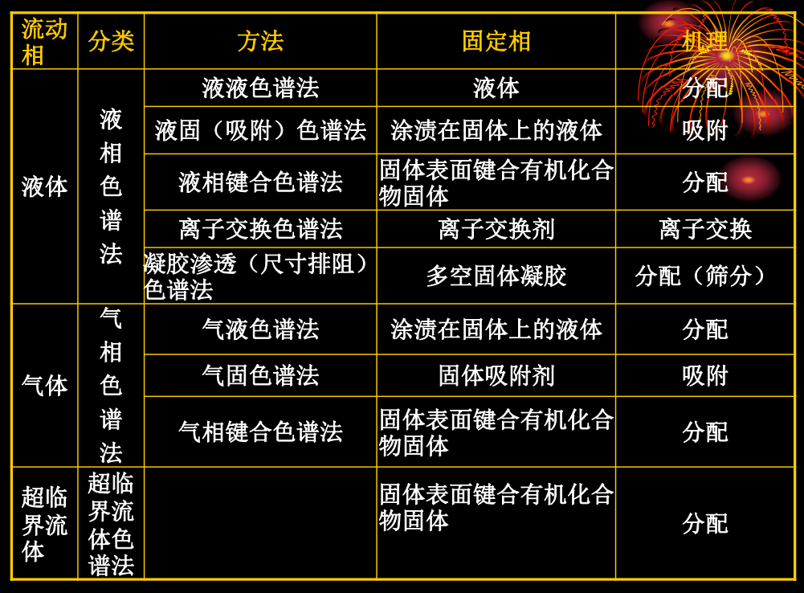

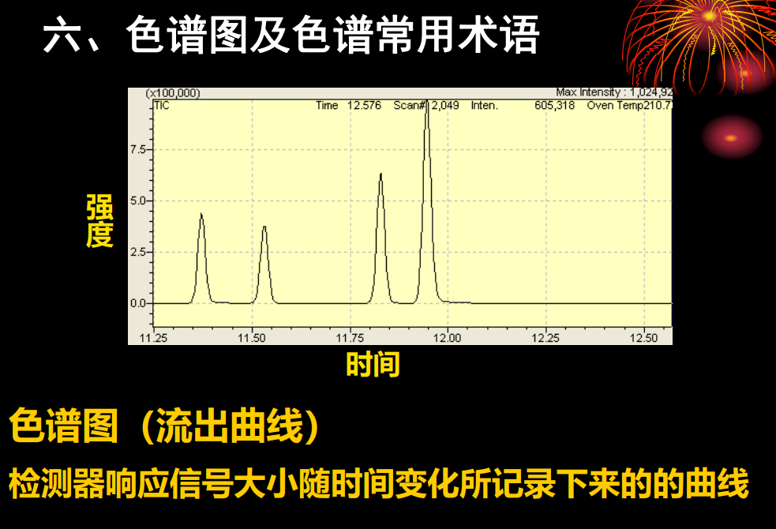

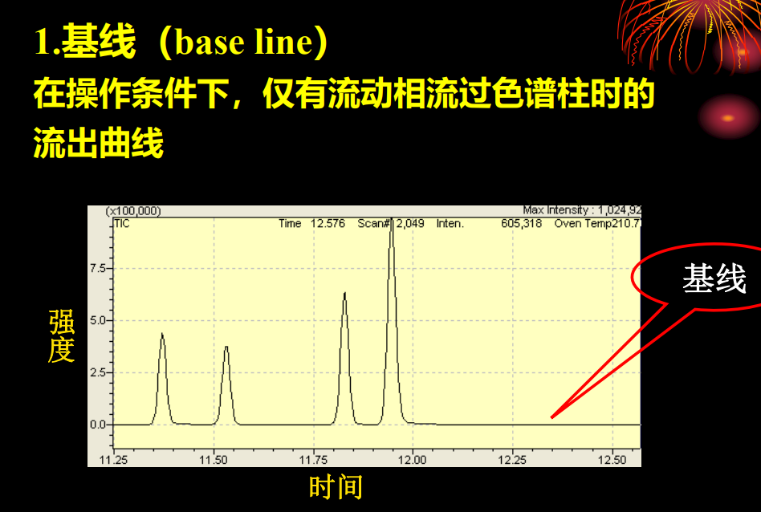

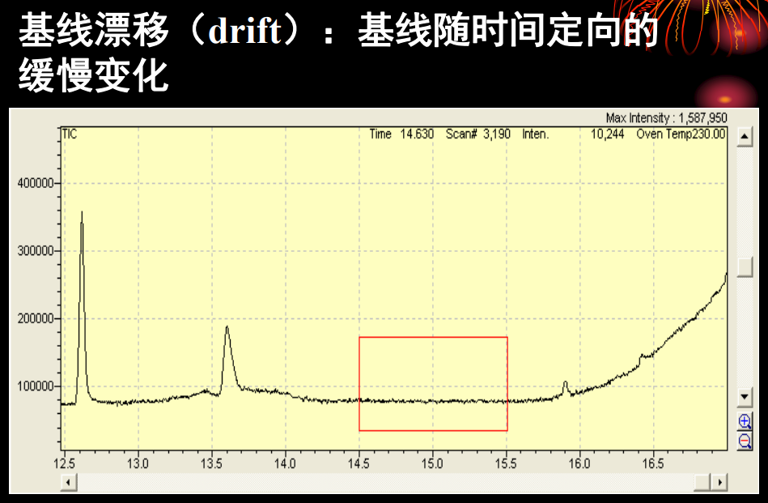

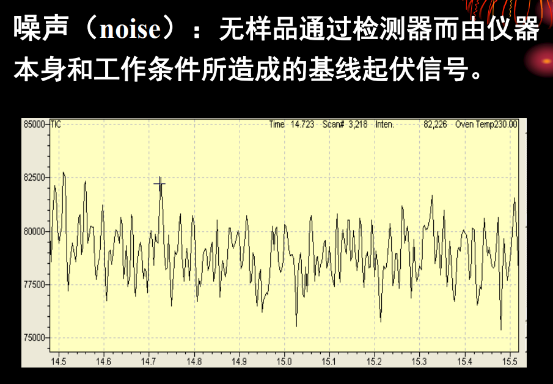

“死时间”（Dead Time, tM 或 t0 ）里的“死”字，是一个专业术语的翻译，因为没有被保留（滞留），所以被称为“死”。只有活的才能留下来，虽然活的最终也会流走

和上一张图对比，观察tR’减去了什么

上面的保留时间、保留体积都是保留值。通过测量这些数值，我们可以知道某个物质在特定色谱柱上“停留”了多久，从而判断它是什么物质。

对于一个物质或者说组分，它自己有一个调整保留值。而色谱法的目的是分离、分析物质，也就是说要把两个组分分开。第二个组分也会有一个保留值，组分2的调整保留值比上组分1的调整保留值，就叫做相对保留值。试想，如果这两个组分的保留值一样，也就意味着他们流出固定相的时间相同了，也就是说他们自始至终混在一起分不开了，比值α也就=1；如果这两个组分的保留值不一样，并且差距很大，比值α≠1，他们就容易被分开。

α只与柱温和固定相的性质有关；α 越大，相邻两组分的调整保留时间相差越 大，分离就越好

注意半峰宽的定义，是半山腰的峰宽，不是一半的峰宽。

W = 4，W0.607h=2σ

在色谱分析中，为了评价色谱柱的好坏（柱效），我们需要测量峰的宽度。虽然有三种定义（ W,W1/2,σ ），但半峰宽（ W1/2 ）因为测量方便且准确，是最常用的评价标准。

分辨率越高，看得越清晰，分辨率越低，就看得糊在一起了。

K是这个物质在固定相和流动相达到平衡的时候的浓度之比，也就是说它现在不动了（准确来说是平衡了），看它留在哪里比较多，留在固定相比较多那就说它分配系数K大，说明它喜欢留在固定相中，在固定相停留的久。你再找一个别的K小的，刷一下就流走了，把他们俩同时丢进去，就分开他们俩了，先流走的是K小的，流半天还在固定相的就是K大的。

分配比，小写字母k。 对于K（大写）：是纯粹的化学/热力学性质。它只看物质本性和固定相本性，跟柱子长短粗细无关。它是绝对的。对于k （小写）：是实际的操作参数。它既看物质本性，也受柱子里两相体积比例的影响。它是相对的。 

假设有一根色谱柱，它可以伸长缩短。无论它固定相和流动相体积怎么变，组分的大K都不变，这是组分自己的性质，因为它是浓度之比，无论在哪里浓度都是那么多；但对于小k，当固定相相对于流动相的比例变大时，组分就要有更多留在固定相里，比如从小柱子换成大柱子，固定相相对增大了，能留下更多组分了，这时候 ms 就变大了，k也会变。

这张图把我们之前零散的知识点串联起来了：

K (分配系数)：是物质的本性，由热力学决定，与色谱柱无关。

k (分配比)：是物质在特定色谱柱上的实际表现，决定了保留时间。

β (相比)：是色谱柱本身的物理属性。

它们之间的关系是：物质的实际保留行为 ( k ) = 物质的本性 ( K ) ÷ 色谱柱的物理结构 ( β )。 （由 K=k⋅β 变形而来，即 k=Kβ ）

这个公式告诉我们：一个组分在色谱柱上保留多久（ k ），既取决于它自己“喜不喜欢”固定相（ K ），也取决于这根柱子里固定相的“量”有多少（ β ）。

很好，随堂小测一下：

在色谱图中，用于衡量色谱柱对组分保留强弱的参数是：

A ：峰面积

B :保留时间

C ：峰宽

D ：理论塔板数

答案：B

A选项：峰面积主要用于定量分析，反映组分的含量，与保留强弱无关。

C选项：峰宽反映的是色谱峰的展宽程度，用于评价柱效（即分离效率），不直接衡量保留强弱。

D选项：理论塔板数是衡量色谱柱柱效的指标，表示分离效率的高低，与保留强弱无直接关系。

关于分配系数K与保留因子k，下列说法正确的是：

A K值受流动相流速影响，而k值不受流速影响。

B k值受流动相流速影响，而K值不受流速影响。

C K和k值都受流动相流速影响。

D K和k值都不受流动相流速影响。

答案：D

分配系数K是热力学参数，定义为组分在固定相与流动相中达到分配平衡时的浓度比值，其值仅取决于组分性质、固定相性质及温度，不受流动相流速影响。而保留因子k（又称容量因子）是组分在固定相与流动相中质量之比，其值与两相体积比有关，但同样不受流动相流速影响，因为流速改变的是组分在柱内的迁移速度，不改变其在两相间的分配平衡状态。

什么是柱效 (Column Efficiency)？指色谱柱对单个组分的保留能力以及峰的集中程度。关注单个峰的形状（宽窄）。

我们希望柱效越高也就是峰越窄越好，不然峰太宽，它就和另一个峰混在一起了。那么峰为什么会宽？接下来有两个理论，分别从静态热力学平衡和动态动力学两个方面进行研究：

以下是ai总结，如果你对这部分内容感兴趣可以自行翻书或看课件，由于过于复杂，这里无法展开。但还是要尽可能理解记忆，因为塔板理论之前考过。1. 塔板理论 (Plate Theory) —— “静态”的结果分析

这个理论只关心结果，不关心过程。它试图回答一个问题：“为什么色谱峰是那个形状？”

核心思想：它把一根长长的色谱柱想象成是由很多个短小的“塔板”叠起来的。它假设样品在每个塔板里都能瞬间达到平衡，然后随着流动相“跳”到下一个塔板。

它解释了什么：

它成功地解释了为什么色谱峰看起来像一个正态分布的曲线（就是那个中间高、两边低的钟形曲线）。

它提供了一套评价柱子好坏的指标：理论塔板数 (N)。简单说，N 越大，代表柱子的分离能力越强，峰就越窄、越尖。

它的局限性（不足）：

它完全忽略了流速的影响。在它的世界里，跑快点和跑慢点没有区别，这显然不符合现实。

它无法解释峰为什么会变宽。它只能描述峰的形状，但说不清为什么峰会扩散。

2. 速率理论 (Van Deemter 方程/范第姆特方程) —— “动态”的过程解释

这个理论关注的是过程。它在塔板理论的基础上，引入了最关键的因素——流速。它试图回答：“峰宽到底是怎么来的？”

它用一个著名的公式来描述这个问题：H = A + B/u + Cu （H 代表峰的宽度，u 代表流速）

这个公式告诉我们，峰宽（H）是由三部分“加”起来的，每一部分都代表一种让峰变宽的原因：

涡流扩散 (A)：

原因：色谱柱里的填料不是完全均匀的，有的地方路宽，有的地方路窄。

结果：样品分子有的走直线，有的走弯路，路程长短不一样，导致它们到达终点的时间有先有后，峰就变宽了。

怎么改善：把填料做得更小、更均匀，填充得更整齐。

分子扩散 (B/u)：

原因：样品分子会自发地向各个方向扩散（就像一滴墨水在水里散开）。

结果：分子在柱子里待的时间越长（流速 u 越慢），扩散得就越厉害，峰就越宽。

怎么改善：加快流速，或者用更“笨重”的气体做流动相，让分子不容易扩散。

传质阻力 (Cu)：

原因：样品分子要在流动相和固定相之间来回转移（分配）。这个转移过程不是瞬间完成的，是有阻力的。

结果：流速越快（u 越大），分子来不及转移，有的“拖后腿”，有的“跑太快”，峰也就变宽了。

怎么改善：减慢流速，或者把固定相的液膜做得更薄，让分子更容易转移。

总结一下

塔板理论是基础，它告诉我们峰应该是什么形状，并给出了一个评价指标 N。

速率理论是进阶，它告诉我们峰为什么会变宽，并指出了影响峰宽的三个具体因素（A, B, C），从而指导我们如何优化实验条件（比如选择合适的流速、填料）来获得更好的分离效果。

随堂小测： 

在高效液相色谱中，Van Deemter方程描述了塔板高度（H）与流动相线速度（u）之间的关系，其形式为：

H = A + B/u + C·u

其中：

A项 为涡流扩散项，与固定相颗粒粒径（dp）和填充均匀性相关，公式为 A = 2λdp。因此，减小填料粒径可直接降低A项。

B/u项 为分子扩散项，主要受流动相中组分扩散系数影响，在液相中因扩散系数极小而通常可忽略，与填料粒径无关。

C·u项 为传质阻力项，包括固定相传质阻力和流动相传质阻力。减小填料粒径可缩短组分在固定相和流动相中的扩散路径，从而降低传质阻力。

因此，使用更细粒径的填料主要有助于降低：

A项（涡流扩散项）——因粒径减小直接降低A值；

C项（传质阻力项）——因扩散路径缩短，传质速率加快，阻力减小。

综上，更细粒径填料主要降低的是A项和C项。

故正确选项为 D。

1. 塔板理论的局限性 (3点)

根据文档“塔板理论的不足”部分，它主要存在以下短板：

忽略动力学：它假设分配是瞬间平衡的，完全没考虑流速 ( u ) 对柱效的影响（无法解释为什么流速快慢会改变峰宽）。

无法解释展宽原因：它只能描述峰是正态分布，但说不清峰为什么会变宽或变形（即无法解释峰展宽的物理机制）。

过于理想化：假设柱内无数微小塔板且无纵向扩散，这与实际的物理过程有偏差。

2. 速率理论的弥补 (3点)

根据文档“速率理论（Van Deemter 方程）”部分，它通过以下方式解决了上述问题：

引入流速变量：建立了 Van Deemter 方程 ( H=A+B/u+Cu )，明确指出了塔板高度 ( H ) 与流速 ( u ) 的函数关系。

揭示展宽机制：将峰展宽分解为 A (涡流扩散)、B/u (分子扩散) 和 C (传质阻力) 三项具体物理因素，解释了峰变宽的根本原因。

指导实践：不仅解释了现象，还指明了如何提高柱效（如：选更小粒径填料、调节流速至最佳值 uopt 等）。

1. 分离度 (Resolution, R)

定义：相邻两色谱峰保留值之差与两峰底宽平均值之比。

公式： R=tR2-tR112(W1+W2)≈2(tR2-tR1)W1+W2

判据：

R=1 ：4σ 分离，峰纯度达 98%。

R=1.5 ：6σ 分离，峰纯度达 99.7%，视为基线分离（完全分离）的标准。

影响因素：

保留时间差（反映选择性，热力学性质）。

峰宽（反映柱效能，动力学因素）。

R 是柱选择性和柱效能的综合体现。

提取关键参数：

组分1保留时间： tR1=2.071 min=124.26 sec

组分2保留时间： tR2=2.58 min=154.8 sec

组分1峰宽（基线）： W1=15.8 sec

组分2峰宽（基线）： W2=23.6 sec

代入分离度公式：

R=2(tR2-tR1)W1+W2

计算结果：

时间差： tR2-tR1=30.54 sec

峰宽和： W1+W2=39.4 sec

分离度： R=2×30.5439.4≈1.55

最终，两个组分的分离度约为 1.55。

刚刚上面那个R分离度公式，需要用到色谱峰图的保留值和峰底宽，千问老师称它为“事后诸葛亮”，用公式要先做完实验得到图片才能计算R；

现在这个分离度方程； R=N4×α-1α×k21+k2

千老师称它为事前诸葛亮，当你需要改进方法、排查问题或设计实验时使用。在实际工作中，你通常会先用分离度公式计算出当前的 R 值，如果 R 值不达标，再套用色谱分离方程来分析是哪个参数（ N,α,k ）拖了后腿，进而调整实验条件。

分离条件的优化

提高理论塔板数 (N)：

适当增加柱长 L （但会延长保留时间）。

降低板高 H （提高柱效的最佳方法），如降低流速、减小填料粒径、降低液膜厚度等。

调节保留因子 (k)：

k 值控制在 2~10 范围内。

改变方法：气相色谱通过改变柱温或固定液量；液相色谱通过改变流动相组成。

提高选择性因子 (α)：

最有效的优化途径。 α 从 1.01 增至 5，分离度显著增加；当 α&gt;5 后，增加不明显。

措施：改变流动相组成（HPLC）、改变柱温（GC，通常降温可提高 α ）或改变固定相。

随堂小测：

根据基本分离方程，提高色谱分离度最有效的途径是：

大幅增加理论塔板数n

改变流动相流速

提高色谱系统的选择性α

微调保留因子k

答案：提高色谱系统的选择性α

很好，掌握了公式和方程，我们就能来用这个方法定性定量了。

保留值定性法的三种具体手段

1. 已知物对照法：在完全相同的色谱条件下，分别进样未知样品和已知标准物质。如果未知样品中某峰的保留值（如保留时间 tR ）与标准物质的保留值一致，则初步判断该峰为该标准物质。

2. 色谱峰增高法：在未知样品中加入少量已知的标准物质，然后再次进样。如果未知样品中某个峰的峰高（或峰面积）显著增加，而其他峰不变，则说明该峰对应的组分就是加入的标准物质。

（这个有点像我们之前学过的定量里用的标准加入法： 在未知样品中加入已知量的标准物质，通过观察响应值（峰面积或峰高）的增加量，来计算未知样品中该组分的含量。）

3. 双柱/多柱系统绝对保留值 tR 定性（不同操作条件或双柱/多柱定性）：利用物质在不同色谱条件下的保留值差异进行定性。（这个方法是为了避免假阳性，比如第一个方法已知物对照法，某物质和某已知物保留值一样，不一定就是同一个物质，可能他们在这个条件下比较相似而已，改变一下条件，如果他们不是同一个物质，改变环境他们的变化就不会相等）

方法：

改变操作条件：例如改变柱温、流动相组成等，观察未知峰的保留值变化规律，与标准物质的变化规律进行比对。

双柱或多柱定性：在两根（或更多）极性不同的色谱柱上分别测定未知样品和标准物质的保留值。如果未知峰在所有柱子上的保留值都与标准物质一致，则定性结果更可靠。

关键前提与注意事项

能获得标准物质：这是保留值定性法的基础。无论是哪种方法，都需要有纯的标准品作为参照。

严格控制操作条件：色谱保留值对温度、流速、固定相、流动相组成等非常敏感。任何微小的变化都可能导致保留值漂移，因此必须严格控制实验条件，确保结果的可比性。

研究完定性，我们来定量：

定量依据：检测器信号（峰面积 A 或峰高 h ）与组分量（质量m）成正比（ m=fA ）。

校正因子f：

绝对校正因子 ( fi )：单位峰面积代表的物质量，受仪器和条件影响大。

相对校正因子 ( fi,s )：组分与基准物质绝对校正因子之比，数值相对恒定，可查阅文献。

根据这个公式m=fA我们就能进行定量。但实际上f会受影响变化，我们不知道，还是要自己配标准曲线求（那你还教这个f是干嘛用的）

1外标法：配制一系列不同浓度的待测组分标准溶液，在相同条件下进样，记录峰面积，绘制标准曲线（峰面积 vs 浓度）。然后测定样品的峰面积，代入标曲计算出浓度。

优势：操作简单，适合自动化

2内标法：选择内标物（样品中不存在、与样品互溶、与待测组分性质相近、完全分离），准确称取待测组分纯品和内标物，混合溶解，配制一系列标准液，测对应峰面积，

（注意，在外标法中，测得标准液峰面积就是Y轴，但这个峰面积容易受到干扰偏差。所以我们用内标法，而在内标法，Y轴是是标准液峰面积和内标物峰面积的比值，因为是比值，他们相同的地方（就是会被干扰偏差的地方，比如体积波动仪器波动）就会被约掉，这些干扰就没了） 再用峰面积的比值做标准曲线。

然后准确称取样品，加入相同量的内标物。利用内标标准曲线计算待测组分含量。

优势：引入了参照物，抗干扰强，适合微量及复杂样品。

但需要精准测量加了多少内标和样品

如果实在没办法知道进了多少样，或者只想测样品里各组分的比例含量（配方比例）：

3.归一化法：测量各组分的峰面积 Ai ，然后查阅或测定各组分的相对校正因子 fi ，这两个都知道就代入公式： ωi=Aifi∑Aifi

分母的意思是把所有组分的峰面积乘相对校正因子之后求和，也就是说先求出所有的量有多少，看你这个组分占多少。归一化法是什么意思？你求出所有的量有多少，这个求所有的量就是归一，总量就是1,100％，然后算这个组分是这个1，这个100%里的多少，就是归一化法。

优缺点：操作简单；不需要准确称进了多少样

但所有组分必须出峰、被分离且被检测器检测到，因为你要测出来所有的A；要去查所有组分的校正因子f， 也不适合微量组分的测定。

随堂小测：现有一种中药注射液，需要测定其中两种有效 成分A和B的含量。请为你即将开发的HPLC分析方法设计一个完整的定性、定量分析方案。

针对中药注射液中成分复杂的特性，为了确保结果准确且可信，应采用双柱定性法和内标标准曲线法。以下是方案操作流程。

1. 双柱定性法

核心逻辑：如果样品在两个不同性质的色谱柱上，保留时间都和标准品一致，那基本就是它了（假阳性极低）。

操作步骤：

第一轮测试（柱1）： 选用常规 C18 反相柱。分别进样“标准品溶液（A、B纯品）”和“样品溶液”。记录下 A、B 标准品的保留时间（ tR1 ）。

第二轮测试（柱2）： 更换为不同极性的柱子（如苯基柱、氰基柱或 HILIC 柱）。在相同液相条件下，再次进样标准品和样品。记录保留时间（ tR2 ）。

样品中疑似 A 的峰，在 C18 柱上的保留时间要 等于 A 标准品；

且在第二根柱子上的保留时间也 等于 A 标准品。

只有两根柱子都“对得上”，才敢确定它是 A。

2. 内标标准曲线法

核心逻辑： 因为中药样品处理麻烦、进样量很难绝对精准，所以加入一个“内标物”作为参照，用面积比来算浓度，结果最稳。

操作步骤：

第一步：选内标物 IS

选一个样品里原本没有、性质和 A/B 相近、且能与 A/B 完全分离的纯物质（或者另一种已知的中药成分）。

第二步：建立标准曲线

配制标准液： 准确配制 5-7 个不同浓度的 A、B 混合标准溶液（覆盖你预估的样品浓度）。

加内标： 往每一个标准溶液里，加入完全相同量的内标物 (IS)。

进样测面积： 进 HPLC，测出 A、B 和 IS 的峰面积。

算比值画图：计算每个标准溶液的对应浓度的待测物峰面积和内标物面积的比值，用电脑拟合出一条线： Y=aX+b 。

第三步： 样品测定

处理样品： 准确称取中药注射液样品，加入和标准曲线中一样多的内标物。

进样分析： 测出样品中 A、B 的峰面积和内标物的峰面积。

计算结果：算出样品的面积比 ( ASample/AIS )。代入刚才画好的标准曲线公式 ( Y=aX+b )，反算出样品的浓度。

名词解释：

Resolution（分离度）

相邻两组分色谱峰的分离程度，反映色谱柱对两组分的实际分离效果，是衡量色谱分离效能的重要指标。

5.retention time（保留时间）

从进样到组分在色谱柱中被洗脱、出现最大峰信号所经过的时间，用于组分定性。

10.分配比

分配比（k）

又称容量因子，指组分在固定相与流动相中的质量之比，反映组分在色谱柱中的保留能力。

14.程序升温

色谱分析中，柱温随时间由低到高线性或阶梯式升高的操作，可改善宽沸程样品的分离度、缩短分析时间。

1.给出三个有机物(苯环)，分析色谱柱的选择条件和原因

1. 苯（非极性，芳烃）2. 苯酚（弱极性，含-OH）3. 硝基苯（中等极性，含-NO₂）

色谱柱选择：非极性/弱极性毛细管柱。常用：SE-30、OV-1、HP-5、DB-5 等聚二甲基硅氧烷类固定相

选择原因

1. 按极性匹配

苯、苯酚、硝基苯均为中等及以下极性，非极性柱对芳烃类保留适中，分离效果好。

2. 按沸点与挥发性

均为挥发性芳香化合物，非极性柱按沸点顺序分离，沸点相近时靠极性差异实现分离。

3. 通用性强

此类柱子对芳香族化合物选择性好、峰形对称、柱效高，适合含苯环的常见有机物分析。

3.塔板理论 + 范第姆特方程的贡献

1. 塔板理论贡献

- 把色谱分离过程形象化，提出理论塔板、理论塔板高度概念，定量评价柱效。

- 解释了色谱峰呈正态分布，说明组分在两相间反复分配实现分离。

- 给出柱效计算公式，指导选择柱长、固定相用量等条件。

2. 范第姆特方程（速率理论）贡献

- 揭示影响峰展宽的三大因素：涡流扩散、分子扩散、传质阻力。

- 解释了载气流速对柱效的影响，指出存在最佳流速。

- 为色谱柱制备、操作条件优化提供理论依据，指导改善分离效率。

3. 两者共同意义

- 完整解释色谱分离机理与峰形变宽原因，奠定色谱动力学与热力学基础。

- 指导实际分离条件选择，实现高效、快速分离。

11.The composition of gas chromatography气相色谱仪的组成

1. 气路系统：载气供给、净化、稳压稳流

2. 进样系统：进样器、气化室

3. 分离系统：色谱柱、柱温箱

4. 检测系统：检测器

5. 记录与数据处理系统：工作站、记录仪

6.液相色谱减小背景效应的方法

1. 选用高纯流动相与合格溶剂，降低杂质吸收。

2. 流动相使用前超声脱气/真空脱气，消除气泡干扰。

3. 色谱柱使用前充分平衡，基线稳定后再进样。

4. 采用匹配溶剂溶解样品，减小溶剂峰与背景干扰。

5. 样品经过滤/离心/固相萃取净化，除去基质杂质。

6. 选择合适检测波长，避开流动相、溶剂的最大吸收。

7. 使用参比池/双光束检测，补偿流动相背景变化。

计算题  1题5分 给出W1、W2、Tr1、Tm、k2 。

①求构成比k1

②求保留时间Tr2

③求相对保留值

④求分离度R，是否能完全分离

① 求构比 k1

构比 k 是指组分在固定相和流动相之间的分配比，计算公式为： k=tR-t0t0 其中 tR 是组分的保留时间， t0 是死时间（即不被固定相保留的组分的保留时间）。

② 求保留时间 Tr2

保留时间 tR 是指组分从进样到检测器出现峰的时间。对于组分2，其保留时间为 Tr2 ，具体数值需要根据实验数据确定。

③ 求相对保留值

相对保留值 r 是指两个组分的保留时间之比，计算公式为： r=tR2-t0tR1-t0 其中 tR1 和 tR2 分别是组分1和组分2的保留时间。

④ 求分离度 R ，是否能完全分离

分离度 R 是衡量两个相邻峰分离程度的指标，计算公式为： R=2(tR2-tR1)W1+W2 其中 W1 和 W2 分别是组分1和组分2的峰宽。

判断是否能完全分离：

当 R&lt;1.0 时，两峰部分重叠；

当 R=1.0 时，两峰刚好分离；

当 R&gt;1.5 时，两峰完全分离。

计算示例

假设已知以下数据：

t0=1.0 min

tR1=3.0 min

tR2=5.0 min

W1=0.5 min

W2=0.6 min

① 计算构比 k1

k1=tR1-t0t0=3.0-1.01.0=2.0

② 保留时间 Tr2

Tr2=tR2=5.0 min

③ 计算相对保留值

r=tR2-t0tR1-t0=5.0-1.03.0-1.0=2.0

④ 计算分离度 R

R=2(tR2-tR1)W1+W2=2(5.0-3.0)0.5+0.6=4.01.1≈3.64

结论： 由于 R≈3.64&gt;1.5 ，因此两峰能够完全分离。

8.内标法标准曲线法的优缺点

优点

- 抵消进样量、仪器波动、前处理损失等误差

- 定量准确度高，适合少量、复杂样品

- 无需严格控制进样体积

缺点

- 难以找到合适内标物

- 需额外配制内标溶液，操作繁琐

标准曲线法（外标法）

优点

- 操作简单，无需内标物

- 计算方便，适合大批量同类型样品

- 适合含量范围较宽的样品

缺点

- 受进样误差、仪器稳定性影响大

- 对前处理损失无法校正

- 基线、基质干扰大时准确度差

导论学完了，我们学会了色谱法是什么，理论基础是什么，是怎么定量定性的，接下来我们来学具体的方法和仪器。

第8章 气相色谱法

掌握气相色谱仪的结构及各个部件的主要作用

掌握FID、ECD的结构及工作原理及其应用

掌握气相色谱法分离的两种模式（恒温模式、程 序升温模式）的定义、优缺点及其适用场景

气相色谱法 Gas Chromatography：气相色谱法是以气体为流动相（载气）的色谱分析方法。可以分为气液色谱法（固定相为液体）、气固色谱法（固定相为固体）。

气相色谱仪主要由以下 六大部件 组成，每个部件的作用如下：

1. 载气系统（气路系统）

作用：为仪器提供纯净、稳定的“流动相”（即载气），负责将样品带入仪器。

包含：气源（如氮气、氢气瓶）、减压阀、净化器（除去杂质）、稳流阀和流量计。

2. 进样系统

作用：将样品（气体、液体或固体）快速、定量地引入仪器，并在进入色谱柱前瞬间气化。

包含：进样口（如六通阀）和气化室（高温使样品气化）。

3. 分离系统（色谱柱）

作用：这是仪器的“心脏”。利用不同物质在固定相和流动相之间的分配差异，将混合样品中的各组分分离开。

类型：填充柱和毛细管柱。

4. 检测系统（检测器）

作用：将从色谱柱流出的各组分浓度变化，转化为可测量的电信号（色谱图）。

常见类型：

FID（氢火焰离子化检测器）：通用，测含碳有机物。

ECD（电子捕获检测器）：测电负性强的物质（如农药残留）。

5. 温控系统

作用：精确控制气化室、色谱柱箱和检测器的温度。

模式：恒温（简单样品）或程序升温（复杂、宽沸程样品）。

6. 记录和数据系统

作用：接收检测器的信号，通过工作站（电脑软件）记录并生成色谱图，用于定性和定量分析。

检测系统里有FID（氢火焰离子化检测器）和ECD（电子捕获检测器），我们来深入研究一下。

1. 氢火焰离子化检测器 (FID)

一句话理解：利用氢气燃烧的火焰把样品烧出离子，然后检测这些离子产生的电流。

结构： 主要由离子室（包含喷嘴、极化极和收集极）和电路组成。样品从色谱柱出来后，进入离子室，在喷嘴处与氢气混合燃烧。

工作原理： 含碳有机物在氢火焰中会燃烧，产生离子。这些离子在电场（极化极和收集极之间）的作用下形成微弱的电流。样品浓度越高，产生的离子越多，电流就越强，仪器就据此检测出物质的含量。

主要应用： FID是“万金油”检测器，对绝大多数含碳有机化合物都有很高的灵敏度。常用于环境监测（如空气污染物）、石油化工、食品中有机物的分析等。它对水和无机气体没响应，所以也适合分析水样里的有机污染物。

它的工作方式是烧，很显然如果不是含碳有机化合物烧不动的话就用不了。

2. 电子捕获检测器 (ECD)

一句话理解：利用放射源制造基流，当有“抓电子”的物质进来时，基流会下降，通过这个下降来检测物质。

结构： 核心是一个带有放射源（如镍Ni-63）的离子室。载气（通常是氮气或氩气）在放射源的照射下被电离，产生自由电子和正离子，形成稳定的基流。

工作原理： 某些物质（如含卤素、硝基的化合物）有很强的捕获电子的能力。当这些物质进入检测器时，它们会“抓走”自由电子，导致基流降低，产生一个负向的信号峰（倒峰）。物质浓度越高，基流下降得越厉害。

主要应用： ECD是“抓坏人”专家，专门用于检测具有强电负性的物质。最典型的应用就是检测农药残留（如有机氯农药）、含氟/氯的制冷剂、以及一些环境中的有毒污染物。

（之前原子吸收光谱法AAS是吃光子，这个电子捕获检测器ECD是吃电子，有点像）

学完了检测系统，我们来学控温系统：

气相色谱法的分离就像开车通过一条复杂的隧道（色谱柱），恒温模式和程序升温模式就是两种不同的“车速控制策略”。

恒温模式：在整个分析周期内，色谱柱的温度始终保持在一个固定的数值不变。（限速。路上管你是沸点低跑得快先分离的赛车还是沸点高起步慢后分离的大货车，都只能跑某个速度。一刀切方便管理，但这不就塞车堵死了）

优缺点：

优点：操作最简单，仪器稳定性最好，保留时间重现性极佳。

缺点：对于复杂的混合物，很难找到一个完美的温度。通常会导致分析时间很长，或者前面的峰挤在一起，后面的峰拖得很长（峰形拖尾）。

适用场景：适合分析组成比较简单的样品，或者样品中各组分的沸点比较接近（比如只有几种物质，且性质相似）。

程序升温模式 (温度逐渐升高)：在一个分析周期内，柱温按照预设的程序，随时间呈线性或非线性逐渐增加（例如：起始 50°C，以 10°C/min 的速度升到 250°C）。

（低温先让沸点低的跑，跑完了就不会堵住后面的大运了）

优缺点：

优点：它能让所有组分都在最佳温度下流出，既保证了分离效果（峰分得开），又大大缩短了分析时间，峰形也更漂亮（尖锐对称）。

缺点：操作相对复杂，需要优化升温程序；由于温度在变，基线可能会有漂移。

适用场景：主要适用于宽沸程的复杂混合物（比如汽油、香精、农药残留等），也就是样品里既有很容易挥发的物质，又有很难挥发的物质。

一些术语：

| 术语 | 核心含义 | 关键点 |
| --- | --- | --- |
| Sensitivity | 灵敏度 | 单位量的物质通过检测器时所产生的信号大小。 “放大倍数”，越大越好，决定了能看见多小的物质。 |
| Detection Limit | 检测限 | 检测器恰好产生3倍于噪声（3NR）的信号时，每秒进 入检测器的组分的质量（g/s），或每毫升载气中所含组 分的量（mg/ml）。D=3NR /S “视力底线”，  D  越小越好，由灵敏度和噪声共同决定。 |
| Linearity Range | 线性范围 | “量程”，FID 宽（好定量），ECD 窄（需小心定量）。 |
| Baseline Drift | 基线漂移 | 基线漂移（drift）：基线随时间定向的 缓慢变化。（请看上面导论的图片） “指针跑偏”，通常由温度或载气不稳引起，影响积分准确性。 |
| Response Time | 响应时间 | 通常指检测器跟随组分浓度变化的快慢。具体来说，它是指信号从 0 上升到稳定值的 63% 所需的时间（或反之）。 “反应速度”，越快越好，能捕捉尖锐的色谱峰。 |
| Detector | 检测器 | “眼睛”，把化学信号转为电信号，分为通用型和选择型。 |

FID检测器对所有化合物均有响应，属于通用型检测器。

a.错误

b.正确

正确答案是：错误

它只对含碳的有机化合物具有响应，尤其对碳氢化合物响应良好。其工作原理是基于有机物在氢火焰中燃烧产生离子，从而形成电流信号。因此，它属于选择性检测器，而非通用型检测器。

GC的分离原理是基于分配系数K 的大小，对于气-固色谱法而言，各组分之间的分离是依据于

a.熔点的高低

b.吸附能力大小

c.溶解能力大小

d.沸点的高低

正确答案是：吸附能力大小

（可以看回导论的分类）

一般气相色谱法适用于

a.无腐蚀性气体与在气化温度下可以气化的液体的分离与测定

b.任何有机和无机化合物的分离测定

c.无腐蚀性气体与易挥发的液体和固体的分离与测定

d.任何气体的测定

正确答案是：无腐蚀性气体与在气化温度下可以气化的液体的分离与测定

其适用对象需满足两个关键条件：无腐蚀性和在气化温度下可气化且不分解。

依据待测组分的导热系数不同而进行检测的气相色谱检测器是

a.火焰光度检测器

b.热导检测器

c.电子捕获检测器

d.火焰离子化检测器

正确答案是：热导检测器

分析混合烷烃试样时，可选择极性固定相，按沸点大小顺序出峰。

a.错误

b.正确

正确答案是：错误

混合烷烃属于非极性化合物，其分离应遵循“相似相溶”原则，即选择非极性固定相进行分析。在非极性固定相上，各组分的保留行为主要取决于其沸点差异：沸点越低的组分，挥发性越强，在气相中分配比例越高，因此先流出色谱柱；沸点越高的组分，保留时间越长，后流出。

因此，分析混合烷烃试样时，不应选择极性固定相，而应选择非极性固定相，并按沸点由低到高的顺序出峰。

分离有机胺时，最好选用的气相色谱柱固定液为

a.非极性固定液

b.混合固定液

c.氢键型固定液

d.高沸点固定液

正确答案是：氢键型固定液

有机胺分子结构中含有氨基（-NH₂），具有形成氢键的能力，属于极性或氢键型化合物。在气相色谱中，固定液的选择需遵循“相似相溶”原则，即固定液与待分离组分在极性或相互作用类型上应匹配，以实现有效分离。

氢键型固定液能够与有机胺分子中的氨基形成氢键，从而增强固定液对有机胺的保留作用，提高选择性，使不同有机胺组分在色谱柱中具有不同的保留时间，从而实现分离。

在气-液色谱分析中, 色谱柱中的固定相为

a.一般固体物质

b.载体及固定液

c.载体

d.固体吸附剂

正确答案是：载体及固定液

在气相色谱分析中，影响组分之间分离程度的最大因素是

a.柱温

b.进样量

c.载体粒度

d.气化室温度

正确答案是：柱温

在气相色谱分析中，柱温是影响组分之间分离程度的最关键操作参数。其核心原因在于：柱温直接调控组分在固定相与流动相之间的分配系数，进而影响其在色谱柱中的保留行为和选择性。温度升高时，组分挥发性增强，保留时间缩短，分析速度加快，但分离选择性可能下降；温度降低则增强组分在固定相中的溶解度，提高分离选择性，使相邻峰更易分开，但分析时间延长。因此，柱温需根据样品沸点范围、固定液性质及检测灵敏度进行优化，以实现最佳分离效果。

相比之下：

进样量：主要影响峰形和柱效，过量会导致峰展宽、拖尾或柱超载，但并非决定分离程度的首要因素。

载体粒度：影响柱效和理论塔板数，粒度越小分离效率越高，但其影响通常次于柱温对选择性的调控。

气化室温度：主要确保样品瞬间完全汽化，避免峰形畸变，对分离度影响较小。

综上，在所列选项中，柱温是影响组分分离程度的最大因素。

在气相色谱法中，对乙醇有很高灵敏度的检测器是

a.电子捕获检测器

b.氢火焰离子化检测器

c.氮磷检测器

d.火焰光度检测器

正确答案是：氢火焰离子化检测器

在气相色谱法中，调整保留值实际上反映出了（ ）的分子间的相互作用

a.组分与固定相

b.载气与固定相

c.组分与载气

d.组分与组分

正确答案是：组分与固定相

在气相谱法中，对大多数有机化合物有很高灵敏度的检测器是

a.氢火焰离子化检测器

b.电子捕获检测器

c.氮磷检测器

d.火焰光度检测器

正确答案是：氢火焰离子化检测器

在没有纯标准品时采用哪种方法进行定性分析

a.保留值对照法

b.增加峰高法

c.标准曲线法

d.归一化法

e.直接比较法

正确答案是：保留值对照法

c选项“标准曲线法”：属于定量分析方法，必须依赖标准品绘制曲线，不适用于定性。

d选项“归一化法”：也是定量方法，且要求所有组分都出峰，与定性无关。

如果试样中各组分无法全部出峰或只要定量测量试样中的某几个组分，应采用下列定量分析方法中哪个为宜？

a.单点外标法

b.无法定量

c.面积归一化法

d.标准工作曲线法

正确答案是：标准工作曲线法

当试样中各组分无法全部出峰，或仅需对其中某几个特定组分进行定量分析时，内标法和外标法（即标准工作曲线法）是适用的。而面积归一化法要求所有组分都必须出峰并能被检测，因此不适用于本题情境。

对所有物质均有响应的气相色谱检测器是

a.紫外检测器

b.FID检测器

c.热导检测器

d.电导检测器

正确答案是：热导检测器

在气相色谱技术中，热导检测器（TCD） 是唯一一种对几乎所有物质都能产生响应信号的通用型检测器。其工作原理基于不同物质具有不同的热导率，当载气中混入待测组分时，检测器热丝的温度和电阻会因热导率变化而改变，从而产生可测量的电信号。

相比之下：

FID检测器（火焰离子化检测器）仅对含碳有机物有响应，对无机气体、水、二氧化碳等无响应；

紫外检测器主要用于液相色谱，不适用于常规气相色谱；

电导检测器多用于离子色谱，不用于气相色谱。

将纯苯与组分i配成混合液进行气相色谱分析，测得当纯苯注入量为0.435μg时的峰面积为4.00平方厘米，组分i注入量为0.653μg时的峰面积为6.50平方厘米，当组分i以纯苯为标准时，相对定量校正因子是

a.1.08

b.2.44

c.0.924

d.0.462

正确答案是：0.924

1. 关键概念与公式

相对定量校正因子（ fi&#x27; ）是组分 i 的校正因子与标准物质（纯苯）的校正因子的比值，用于消除不同物质在检测器上响应差异的影响。 校正因子（ f ）的定义为：单位峰面积对应的物质质量，即 f=mA （ m 为质量， A 为峰面积）。 因此，相对定量校正因子的公式为：（我个人比较喜欢直接理解记忆红色那一步就完了） fi&#x27;=fifs=mi/Aims/As=mi⋅Asms⋅Ai 其中：

mi ：组分 i 的质量（0.653μg）；

Ai ：组分 i 的峰面积（6.50 cm²）；

ms ：标准物质（纯苯）的质量（0.435μg）；

As ：标准物质的峰面积（4.00 cm²）。

2. 代入数据计算

将题目中的数据代入公式： 因此： fi&#x27;=2.6122.8275≈0.924

结论：相对定量校正因子为0.924，对应选项c。

有机物在氢火焰中燃烧生成的离子，在电场作用下能产生电讯号的部件是

a.火焰离子化检测器

b.热导检测器

c.火焰光度检测器

d.电子捕获检测器

正确答案是：火焰离子化检测器

题干描述的是有机物在氢火焰中燃烧生成离子，并在电场作用下产生电信号的检测部件。其核心机制是化学电离与离子定向移动形成电流。

火焰离子化检测器（FID）：正是基于这一原理设计的。当含碳有机物进入氢-氧火焰时，在高温下发生裂解和化学电离，产生大量正离子和电子。在电场作用下，这些带电粒子向两极定向移动，形成微弱的离子流（约10⁻¹²～10⁻⁸ A），经高阻放大后可被检测，其信号强度与进入火焰的有机物质量成正比。因此，FID是专门用于检测有机物在氢焰中电离产生电信号的部件。

热导检测器：基于不同气体导热系数差异工作，不涉及离子化和电场作用。

火焰光度检测器：基于特定元素（如S、P）在火焰中激发发光，检测的是光信号而非离子电流。

电子捕获检测器：依赖电负性物质捕获电子形成电流变化，与氢焰中有机物电离无关。

校正因子f与下列哪个因素无关

a.检测器类型

b.载气流速

c.基准物

d.被测试样

正确答案是：载气流速

校正因子是气相色谱定量分析中的重要参数，其本质是被测组分与标准物质在检测器上的响应值之比。根据定义与实验规律，校正因子主要取决于以下三类因素：

检测器类型：不同检测器对同一物质的响应灵敏度不同，因此校正因子随检测器种类变化。

基准物质（标准物质）：校正因子是相对值，必须相对于一个选定的标准物质（如正庚烷、苯等）进行计算，其数值依赖于所选标准物。

被测试样：不同组分的物理化学性质不同，其在检测器上的响应行为也不同，因此校正因子与具体被测组分相关。

而载气流速属于操作条件，它影响的是峰形、保留时间及分离效率，但不改变检测器对物质的相对响应比例，因此不影响校正因子的数值。

综上，在所列选项中，载气流速与校正因子无关。

气相色谱法中，调整保留值反映了哪些分子间的相互作用？

a.组分与组分

b.组分与固定相

c.组分与载气和固定相

d.组分与载气

正确答案是：组分与固定相

程序升温色谱法主要是通过选择适当温度，而获得良好的分离和峰形，且总分析时间比恒温色谱要短。

a.正确

b.错误

正确答案是：正确

采用色谱归一化法定量的基础是试样中所有组分都出峰

a.错

b.对

正确答案是：对

气相讲完了，我们来学液相

第9章 液相色谱法

掌握高效液相色谱仪的基本组成及各个组成的作用

熟悉HPLC分析中的两种洗脱模式：等梯度洗脱、梯度洗脱

掌握反相色谱、正相色谱的定义、两者的区别 以及它们常用的流动性、固定性、应用场景

熟悉正、反相色谱的色谱分离规律

高效液相色谱法（High Performance Liquid Chromatography）：以高压输出的液体为流动相的 色谱技术。

1. 高效液相色谱仪的基本组成及作用

HPLC 仪器主要由高压输液系统、进样系统、色谱柱系统和检测系统四大部分组成。

高压输液系统：高压输液泵、贮液器、梯度洗脱装置。泵：将流动相在高压下连续送入液路系统，保证流速稳定。（这是“高效”之一）梯度装置：按程序改变流动相配比（如极性、pH），改善复杂样品分离。

进样系统：六通阀。作用：在高压下将样品准确、重现性好地引入色谱柱。优点是耐高压、自动化程度高；缺点是连接处死体积可能引起峰展宽。

色谱柱系统：色谱柱 (含“高效”固定相)	核心：分离发生的场所。使用时需注意避免压力/温度剧变，建议使用保护柱。

检测系统：检测器 (如UV, FLD)	作用：连续检测流出液的成分。要求灵敏度高、死体积小、对温度/流速不敏感。常见的有紫外检测器（应用最广）、荧光检测器（灵敏度极高）等。

掌握了仪器构造和作用后，我们来深入研究一下它的“核心”，色谱柱系统。

色谱分类主要是两部分，一个是流动相，一个是固定相，所以我们分开来看看，这两个相有什么重点。

流动相：在高效液相色谱法里，这个流动相是可以变的。如果它不变，一直都是恒定的，那就叫它等度洗脱；如果它的配比不断改变，从而改变流动相的性质而改进复杂样品的分离，就叫梯度洗脱。（这个和我们上面气相色谱法里学到的恒温模式和程序升温模式很像，只不过气相色谱改变温度，作用于样品，让样品先后达到沸点；液相色谱改变配比，作用于流动相，方便不同样品流动。就像大运怎么都跑不快，把公路换成高铁就跑得快了） 

固定相：HPLC，液相色谱法，它的固定相可以是固体也可以是液体。当它的固定相是液体的时候就是液液色谱法，这种色谱法的原理是物质因为具有不同的分配系数，所以迁移速度不同,从而产生色谱分离。关键是分配系数不同，所以它就叫液-液分配色谱法（LLPC） Liquid –liquid partition chromatography。（导论里有区别吸附色谱法和分配色谱法。）

固定相是液体，并不是指色谱柱里全是液体，要不然分离样品的时候就全倒出来了。它的固定相有载体和固定液，简单来说就是通过化学反应将官能团键合在载体表面形成固定相。把什么样的官能团键合上去呢？有极性和非极性两种官能团，那么固定相也就分为极性键合相和非极性键合相两种相。极性键合相，顾名思义它是极性的，（如氰基 -CN、氨基 -NH₂、二醇基）；非极性键合相，非极性的，（如 C18 (ODS)、C8、苯基）。根据相似相溶原理，样品如果是极性的，它流过极性键合相就会更容易留下来，反之亦然。

我们把固定相是极性键合相（极性强的）同时流动相是低极性的（比如有机溶剂），也就是说固定相极性 &gt; 流动相极性，这个搭配叫做正相键合相色谱法，简称正相色谱法（normal phase，NP）；

把固定相是非极性键合相（极性弱的）同时流动相是极性的（比如水），也就是说固定相极性 ＜流动相极性，这个搭配叫做反相键合相色谱法，简称反向色谱法（reversed phase，RP）；

 

色谱行为（保留与洗脱规律）

这是实验中最重要的部分，决定了物质出峰的顺序和如何调节分离效果。

(1) 正相色谱的色谱行为

出峰顺序：

极性弱的组分：与极性固定相作用力弱，先流出柱子（保留时间 tR 小）。

极性强的组分：与极性固定相形成强氢键，后流出柱子（保留时间 tR 大）。

流动相调节：

流动相极性增加 → 洗脱能力增强 → 组分保留时间 缩短 ( tR↓ )。

通俗理解：流动相极性越强，越能把极性物质从固定相上“抢”下来。

(2) 反相色谱的色谱行为

出峰顺序：

极性强（亲水性强）的组分：与非极性固定相作用弱，先流出柱子。

非极性（疏水性强）的组分：与非极性固定相（如 C18 ）作用强，后流出柱子。

流动相调节：

有机相（如甲醇、乙腈）比例增加 → 流动相极性降低 → 洗脱能力增强 → 组分保留时间 缩短 ( tR↓ )。

pH值的影响（针对离子型物质）：

弱酸性物质：降低 pH 值（酸性环境），分子态比例增加，保留时间 增加 ( tR↑ )。

弱碱性物质：升高 pH 值（碱性环境），分子态比例增加，保留时间 增加 ( tR↑ )。

学会了正相色谱和反向色谱法，我们就能根据样品来选择不同的方法了：

高效液相色谱的固定相及流动相的选择：高效液相色谱（HPLC）中固定相和流动相的选择主要取决于样品的性质和分离模式（正相或反相）。

1. 固定相选择

固定相的选择决定了色谱的分离模式。

反相色谱 (RP, 最常用)

固定相类型：非极性键合相。

首选：C18 (ODS)。

备选：C8、苯基等。

适用样品：非极性至中等极性、水溶性或脂溶性样品（如有机酸、碱、抗生素、水溶性维生素）。

正相色谱 (NP)

固定相类型：极性键合相。

常用：氰基 (-CN)、氨基 (-NH2)。

适用样品：溶于有机溶剂的极性样品（如脂溶性色素、维生素、甾醇、芳香胺）。

2. 流动相选择

流动相必须与固定相性质互补，并根据分离效果进行调节。

反相色谱

组成：水相（水/缓冲液）+ 有机相（甲醇、乙腈）。

调节规律：增加有机相比例，洗脱能力增强，保留时间 tR 缩短。

pH调节：对离子型物质有效（如降低pH值可增强弱酸性物质的保留）。

正相色谱

组成：低极性有机溶剂（如正己烷）+ 极性调节剂（如甲醇、异丙醇）。

调节规律：增加极性调节剂比例，洗脱能力增强，保留时间 tR 缩短。

HPLC与GC相比，可以忽略纵向扩散项，这是由于

a.流动相的黏度比较大

b.柱前压力高

c.流速比GC快

d.柱温低

正确答案是：流动相的黏度比较大

回色谱法导论看范蒂姆特方程：纵向扩散项是色谱理论中范第姆特方程（Van Deemter equation）里的一个重要组成部分，通常用 B/u 来表示。

它描述的是：由于色谱柱内存在浓度梯度，被分析的组分分子会自发地从高浓度区域向低浓度区域扩散，这种沿着流动方向的扩散会导致色谱峰变宽，从而降低分离效率。

HPLC可以忽略纵向扩散项，根本原因在于其流动相是液体，黏度远大于GC中的气体流动相。

根据分子扩散的物理原理，物质在介质中的扩散系数（Dm）与该介质的黏度（η）成反比。简单来说，介质越“粘稠”，分子在里面就越难移动和扩散。

HPLC（液相色谱）： 流动相是液体，黏度很高。因此，溶质分子在液体中的扩散系数非常小（大约是气体中的十万分之一）。这导致由纵向扩散引起的峰展宽效应微乎其微，可以被忽略。

GC（气相色谱）： 流动相是气体，黏度极低。溶质分子在气体中可以非常自由和快速地扩散，因此纵向扩散是导致色谱峰展宽的一个主要因素，绝对不能忽略。

下列不是高效液相色谱仪组成的是

a.氢火焰离子化检测器

b.色谱柱

c.紫外检测器

d.六通阀

正确答案是：氢火焰离子化检测器

不是高液相色谱仪中的检测器是

a.差示折光检测

b.电导检测器

c.紫外吸收检测器

d.红外检测器

正确答案是：红外检测器

红外检测器并非高效液相色谱仪的标准或常用检测器。其原理依赖于分子对红外光的特征吸收，通常用于气相或固相红外光谱分析，不适用于常规HPLC系统，因为流动相（尤其是水）在红外区有强吸收，会严重干扰检测，且HPLC流出物难以直接进行红外光谱采集。

在液相色谱中, 某组分的保留值大小实际反映了哪些部分的分子间作用力

a.组分与流动相

b.组分与组分

c.组分与流动相和固定相

d.组分与固定相

正确答案是：组分与流动相和固定相

保留值（包括保留时间和保留体积）是组分在色谱柱中滞留程度的体现，其大小取决于组分在两相间的分配行为。

组分与固定相的作用力：若组分在固定相中的溶解性或吸附性越强，其在柱内滞留时间越长，保留值越大。

组分与流动相的作用力：流动相的极性或溶剂化能力会影响组分在两相间的分配。若流动相对组分的溶解能力强，则组分更倾向于留在流动相中，保留值减小。

因此，保留值反映的是组分与流动相和固定相两者共同作用的平衡结果，而非仅与其中一相作用。

在液相色谱中，不会显著影响分离效果的是

a.改变固定相种类

b.改变流动相配比

c.改变流动相流速

d.改变流动相种类

正确答案是：改变流动相流速

柱长和填料粒度主要影响的是柱效（即峰的宽度和分离度），并不改变组分的相对保留顺序，因此不能有效改变选择性。

在液相色谱分析中，提高色谱柱柱效的最有效的途径是

a.降低流动相的粘度

b.降低流动相的流速

c.减小填料粒度

d.适当升高柱温

正确答案是：减小填料粒度

在液相色谱分析中，提高色谱柱柱效的核心在于优化固定相的物理特性。减小填料粒度是最有效的手段，因为更小的颗粒能显著增加单位长度色谱柱内的理论塔板数，从而提升分离效率。其原理是：小颗粒填料缩短了溶质在固定相和流动相之间的扩散路径，降低了传质阻力，使峰形更窄、更尖锐，从而提高柱效。

其他选项虽然也影响柱效，但效果不如减小填料粒度显著：

降低流动相粘度：可降低扩散阻力，但需配合流动相组成调整，效果有限；

降低流动相流速：可增加保留时间，提高分离度，但会延长分析时间，且并非“最有效”途径；

适当升高柱温：可降低粘度、加快传质，但温度过高可能导致选择性下降或固定相不稳定。

因此，在所有选项中，减小填料粒度是提升柱效最直接、最有效的方法。

在液相色谱法中，按分离原理分类，液固色谱法属于

a.排阻色谱法

b.离子交换色谱法

c.吸附色谱法

d.分配色谱法

正确答案是：吸附色谱法

导论里有区别吸附色谱法和分配色谱法。

在环保分析中，常常要监测水中多环芳烃，如用高效液相色谱分析，应选用下述哪种检波器最好

a.电导检测器

b.荧光检测器

c.示差折光检测器

d.紫外吸收检测器

正确答案是：荧光检测器

电导检测器主要用于离子色谱，对多环芳烃无响应，不适用。

示差折光检测器是通用型检测器，灵敏度低，且对环境温度敏感，无法胜任痕量多环芳烃的检测。

紫外吸收检测器虽可对多环芳烃进行检测，但其灵敏度远低于荧光检测器，不适合痕量分析。

因此，在高效液相色谱分析水中多环芳烃时，荧光检测器是最佳选择，它能提供高灵敏度、高选择性的检测信号，满足环保监测中对痕量致癌物的精准定量需求。

在高效液相色谱法中，反相色谱的固定相与流动相的关系是

a.固定相的极性小于流动相的极性

b.固定相的极性大于流动相的极性

c.固定相的极性等于流动相的极性

d.没法比较

正确答案是：固定相的极性小于流动相的极性

在高效液相色谱流程中，试样混合物在（ ）中被分离。

a.记录器

b.进样器

c.色谱柱

d.检测器

正确答案是：色谱柱

正相分配色谱的流动相为

a.酸性水溶液

b.碱性水溶液

c.亲水性试剂

d.亲脂性试剂

正确答案是：亲脂性试剂

液相色谱中通用型检测器是

a.热导池检测器

b.荧光检测器

c.紫外吸收检测器

d.示差折光检测器

正确答案是：示差折光检测器

液相色谱中通用型检测器是

a.热导池检测器

b.紫外吸收检测器

c.示差折光检测器

d.氢焰检测器

正确答案是：示差折光检测器

液相色谱流动相过滤必须使用何种粒径的过滤膜？

a.0.55μm

b.0.6μm

c.0.5μm

d.0.45μm

正确答案是：0.45μm

液相色谱流动相过滤必须使用0.45 μm粒径的过滤膜。这是标准操作规范，目的是去除流动相中的微小颗粒，防止其堵塞色谱柱或污染系统，从而保障分离效率和仪器稳定性。

采用反相分配色谱分离混合物时化合物出柱的顺序是

a.极性大的先流出

b.分子量大的先流出

c.分子量小的先流出

d.极性小的先流出

正确答案是：极性大的先流出

反相分配色谱的固定相为非极性，流动相为极性。其分离机制基于化合物在固定相与流动相之间的分配平衡。由于固定相是非极性的，极性大的化合物与非极性固定相的相互作用较弱，更倾向于留在极性流动相中，因此先被洗脱出色谱柱；而极性小的化合物与非极性固定相的亲和力较强，保留时间更长，后流出。

高效液相色谱与气相色谱相比，不同的是

a.色谱的基本理论

b.定性定量原理

c.使用范围

d.自动化程度高

正确答案是：使用范围

高效液相色谱（HPLC）与气相色谱（GC）在色谱的基本理论和定性定量原理上是完全一致的，二者均基于组分在流动相与固定相之间分配行为的差异实现分离，并通过保留时间进行定性、峰面积或峰高进行定量。同时，现代高效液相色谱仪也具备高度自动化能力，与气相色谱仪类似。

二者最本质的区别在于使用范围：

气相色谱要求样品必须具有挥发性或可被衍生化为挥发性物质，且需热稳定，因此主要适用于沸点较低、热稳定性好的化合物，这类物质仅占有机化合物的15%~20%。

高效液相色谱则无需样品气化，适用于高沸点、大分子、强极性、热不稳定以及离子型化合物，只要样品能溶解于流动相中即可分析，因此其应用范围远广于气相色谱。

综上，高效液相色谱与气相色谱相比，不同之处在于使用范围。

高效液相色谱中，常用作固定相又可用作键合相载体的是

a.分子筛

b.氧化铝

c.硅胶

d.活性炭

正确答案是：硅胶

在高效液相色谱中，硅胶是应用最广泛的一种固定相材料，同时它也是制备键合相最常用的载体。其表面含有大量硅羟基（Si-OH），可通过化学反应与各种有机官能团键合，形成如C18、C8、苯基、氨基、氰基等不同类型的键合固定相，从而满足反相、正相、离子交换等多种分离模式的需求。

高效液相色谱仪与普通紫外－可见分光光度计完全不同的部件是

a.流通池

b.分光系统

c.光源

d.检测系统

正确答案是：流通池

流通池：是高效液相色谱仪检测器的一部分，其作用是让从色谱柱流出的流动相携带待测组分连续通过检测区域，从而实现对分离后各组分的实时检测。而普通紫外-可见分光光度计使用的是固定的吸收池（或称比色皿），样品静止不动，仅测量其吸光度。

高效液相色谱仪与气相色谱仪比较增加了

a.梯度淋洗装置

b.进样装置

c.程序升温

d.恒温箱

正确答案是：梯度淋洗装置

液相色谱中，流动相是液体，其组成可以通过梯度淋洗程序在分析过程中连续改变，从而优化分离效果，尤其适用于组分复杂、保留特性差异大的样品。而气相色谱仪中流动相是气体，其组成基本恒定，分离效果主要通过程序升温来调节。

名词解释：

正相色谱（normal phase, NP）

正相色谱：固定相极性大于流动相极性的液-液分配色谱，极性小的组分先流出，极性大的后流出。

OKOK，色谱法是一种伟大的分离技术，不过它的定性定量能力还是比较局限。聪明的你一定想到了，既然它擅长分离，那把分离出来的东西交给其他仪器定性定量不就好了。

太棒了，接下来我们将学习气相色谱-质谱联用技术（GC-MS）和高效液相色谱-质谱联用技术（HPLC-MS）。

第十六章 气相色谱-质谱法（GC-MS）

• 掌握质谱的定义和表示形式

• 熟悉质谱仪的原理

• 熟悉质谱仪的基本结构

• 掌握常见离子源（EI、CI）的特点

• 掌握GC-MS的两种数据采集模式

• 熟悉GC-MS的应用

首先先学一下嘛是质谱。我们之前学完了原子光谱之后学了一个ICP-MS电感耦合等离子体质谱法（利用电感耦合等离子体作为离子源，将样品原子离子化，根据质荷比（m/z）进行分离，通过质荷比定性，通过离子流强度定量）。在高中物理我们也略微学了一下。现在我们深入学习一下：

分子质谱法(mass spectroscopy,MS),是利用电离技 术将待测物质离子化成运动的气态离子，利用离子在电 场/磁场中的运行性质，并按照其质量与电荷的比值(简 称质荷比，m/z)大小对生产的离子进行分离的方法。

质谱图（mass spectrum）,简称质谱，以相 对离子流强度为纵坐标，质荷比(m/z)为横坐 标，将离子按m/z从小到大依次排列得到的图 谱，常用棒状图表示。

 

以下是对质谱定义、谱图表示形式以及分子离子峰和碎片离子峰意义的详细总结：

1. 分子质谱法的定义

分子质谱法 (Mass Spectroscopy, MS) 是一种利用电离技术将待测物质离子化成运动的气态离子，然后利用离子在电场/磁场中的运动性质，按照其质量与电荷的比值（简称质荷比， m/z ）大小对离子进行分离和检测的分析方法。

2. 质谱图的表示形式

质谱图是质谱法的数据输出形式，其坐标轴定义如下：

横坐标 ( m/z )：标明离子的质荷比（质量与电荷的比值）。

纵坐标：标明各离子的相对强度（也称为相对丰度）。

基峰 (Base Peak)：质谱图中最强的一个峰，其强度被定为 100%。

相对强度：其他离子的响应信号与基峰强度的比值。

3. 分子离子峰与碎片离子峰的意义

在质谱分析中，不同类型的离子峰提供了不同的结构和质量信息：

(1) 分子离子峰 (Molecular Ion Peak)

定义：由组分分子失去一个电子而生成的带一个正电荷的离子（ M+⋅ ）所对应的峰。

特征：通常位于质谱图的最右侧（高质荷比端）。

核心意义：

测定分子量：分子离子峰的质荷比（ m/z ）即为该分子的分子量（这是质谱法最基本的作用）。

确定分子式：结合高分辨质谱数据，可推算分子式。

(2) 碎片离子峰 (Fragment Ion Peak)

定义：分子离子在特定离子化条件下，某些化学键发生断裂而产生的离子所对应的峰。

特征：由分子离子进一步裂解产生，包括初级碎片离子和次级碎片离子。

核心意义：

推测结构：通过分析碎片离子的质荷比，可以反推分子的断裂方式，从而推测未知物的化学结构。

定性鉴定：不同化合物具有特定的质谱图（“指纹图谱”），碎片离子峰提供了丰富的结构特征信息，用于化合物的定性分析（如标准谱库检索）。

接下来，熟悉质谱仪的原理、熟悉质谱仪的基本结构。

1. 质谱仪的基本工作原理

质谱法的核心原理是利用电离技术将待测物质转化为运动的气态离子，并根据离子在电场或磁场中的运动性质，按照其质荷比（ m/z ）的大小进行分离和检测。

具体的物理过程如下：

电离：样品分子在离子源中失去电子或发生离子-分子反应，形成带电离子。

加速：离子在电场作用下被加速，获得动能。

偏转与分离：加速后的离子进入磁场（或电场），受到洛伦兹力作用做圆周运动。根据质谱基本公式 R=(2U/B2⋅m/z)1/2 ：

当加速电压（ U ）和磁场强度（ B ）固定时，质荷比（ m/z ）越大，离子运动的轨道半径（ R ）越大。

通过改变磁场强度或电场，不同 m/z 的离子会依次沿着弯曲的轨道到达检测器。

检测：检测器接收分离后的离子，将其转换为电信号并放大。

有点眼熟？但看不懂？因为高中学的是荷质比（q/M），但现在用的是质荷比（ m/z ）。

（洛伦兹力是什么？距离高考仅有一个月了我却不知道什么是向心力）（做实验的时候老师说质荷比，我总是疑惑为什么我老是读成荷质比，原来不是我忘了是它真的倒过来）

在质谱图中，为了直观读取分子量信息，使用 mz 。横坐标一定是 质荷比 ( m/z )。例如文档中提到的分子离子峰 m/z=58 ，表示该离子的质量是电荷数的58倍。

2. 质谱仪的基本结构

质谱仪主要由进样系统、离子源、质量分析器、检测器、真空系统和计算机系统构成。以下是核心部件的详细解读：

(1) 离子源 (Ion Source)

离子源的作用是提供能量使样品分子离子化。根据文档，主要分为以下几种类型：

表格

| 离子源类型 | 原理与特点 | 优缺点及适用范围 |
| --- | --- | --- |
| 电子轰击源 (EI) | 利用70eV高能电子束轰击气态分子，使其失去电子形成分子离子，化学键断裂产生碎片离子。（碎尸万段） | 优点：电离效率高、重现性好、碎片信息丰富（利于定性），有标准谱库可检索。 缺点：属于“硬电离”，分子离子峰弱或不出现，难测分子量；仅适用于易挥发、热稳定的小分子。 |
| 化学电离源 (CI) | 利用反应气（如 CH4 ）离子与样品分子发生离子-分子反应（质子交换），生成 M+1+ 等准分子离子。 （它不会直接去撞样品分子，而是先让一些“反应气”比如CH4带上电荷变成CH5+，然后让这些带电的气体分子去轻轻推一下样品分子M，通过“质子交换”， CH5++M→MH++CH4。 MH+ 就是 M+1+ 离子（因为加了一个质子 H+ ，质子质量约为1）。 | 优点：属于“软电离”，分子离子峰（准分子离子峰）强度大，利于测定分子量；定量准确度高。 缺点：结构信息较少，图谱难以进行标准库检索，需要反应气。 |
| 其他离子源 | 包括场电离(FI)、场解吸(FD)、快原子轰击(FAB)、激光解吸(LD)等。 | 针对不同性质的样品（如难挥发、热不稳定物质）提供特定的电离方式。 |

也就是说要定性，看它什么结构，就EI电子轰击源打烂它，要定量，就要完完整整地，CI化学电离源碰碰它，给它一个质子带电，就能测了。

(2) 质量分析器 (Mass Analyzer)

质量分析器位于离子源和检测器之间，负责将离子按质荷比（ m/z ）进行分离。

(3) 离子检测器 (Ion Detector)

作用：接收由质量分析器分离出的离子，将离子信号转换为电压信号并放大输出。

（4）辅助系统

真空系统：质谱仪必须在高真空（10-5∼10-7 mbar）下工作。目的是减少离子-分子碰撞（避免离子反应或偏离轨道）、防止高压下产生电弧以及减少污染。

进样系统：包括加热进样、直接探针进样和色谱进样（用于复杂混合物分离后引入）。

学会质谱MS了，我们来学GC-MS（气相色谱-质谱联用技术）：是一种将气相色谱的分离能力与质谱的鉴定能力结合在一起的分析方法。先利用气相色谱（GC）将混合物中的不同成分分开，然后利用质谱（MS）对每一个分离出来的成分进行分析，从而实现对复杂样品中各组分的准确定性和定量分析。

GC-MS的两种模式：

主要用途：定性分析和未知物鉴定。

总离子流色谱图 (TIC)：将每次扫描的所有离子强度相加，得到一张类似普通色谱图的TIC图。图上的每一个峰代表一个被分离出来的化合物。

结构分析：因为保留了完整的质谱图信息，可以通过与标准谱库（如NIST库）进行比对，来确定化合物的结构。

典型应用场景：分析芫荽（香菜）中的香味成分、鉴定中毒样品中的未知毒物等。

主要用途：高灵敏度定量分析。

优势：由于过滤掉了背景噪音，信噪比大大提高，检测灵敏度远高于全扫描模式，能够测定出极低浓度的物质。

典型应用场景：检测工厂废水中微量的挥发性有机物、测定葡萄酒中痕量的三氯苯甲醚、血液中乙醇含量的精确测定等。

上面全扫描里有一个总离子流色谱图 (TIC)，与之对应的是选择性离子监测里的质量色谱图MC (Mass Chromatogram)。

请看上面这张质量色谱图MC，最下面这条有三个黑色峰，对应的三个（所有）黑色线就是TIC；而如果只看第一个峰，也就是红色峰，对应第一个红色线，就是MC；同样的，只看第三个峰也就是蓝色峰，对应第三个蓝色的线就是MC

OK下一个。学完气相和质谱的结合，下一个就是液相和质谱联用了。

第十一章 HPLC-MS

1、掌握液质联用仪的基本构成；

2、掌握API的分类；ESI和APCI的电离过程；

3、熟悉ESI和APCI的优缺点和应用范围；

4、掌握母离子、子离子的概念；

5、掌握全扫描（Scan）、选择离子监测（SIM）、母离子扫描、子离子扫描、多反 应监测（MRM）的扫描模式的工作原理；

液相色谱-质谱联用 Liquid chromatography– mass spectrometry

这是一种将液相色谱（LC）的分离能力与质谱（MS）的检测能力结合起来的分析技术。它主要用于解决高效液相色谱（HPLC）灵敏度低、专属性差的问题，特别适合分析那些难挥发、热不稳定、大分子量（如蛋白质、多肽）以及极性化合物。

1. LC-MS 联用的关键技术：接口

LC-MS 联用最大的难点在于如何将液相的流动相与质谱的高真空环境匹配。文档重点介绍了大气压电离源（API），这是目前的主流接口技术：利用待测样品与溶剂电离能力的不同，将分析物首先在大气压或略低于大气压条件下电离， 然后利用电场导引，将带电样品“萃取”进入质谱高真空系统。

主要包括 ESI 和 APCI 两种：

1. 电喷雾电离 (ESI)

原理：分为三个阶段。首先形成带电液滴，随后溶剂蒸发导致液滴碎裂（库仑爆炸），最终形成气相离子。

优缺点：

优点：软电离技术，适合热不稳定、难挥发及大分子（如蛋白质、多肽）；可产生多电荷离子，扩展了质量分析范围；灵敏度高。

缺点：要求样品在溶液中必须形成离子；对流动相中缓冲盐的种类、浓度敏感；存在基质抑制现象；不适合非极性化合物。

2. 大气压化学电离 (APCI)

原理：溶剂和目标物气化形成气溶胶，通过电晕放电使溶剂分子电离，再通过电荷转移使样品分子离子化（[M+H]+ 或 [M-H]-）。（这个有点像我们刚刚学的化学电离源CI）

优缺点：

优点：对流动相流速和添加物的依赖性较小，适合流速较高（0.2-2 mL/min）的情况；适合有一定挥发性的弱极性或中等极性小分子。

缺点：可能发生热裂解；不适合分析大分子（无法生成多电荷离子）；样品需具备一定挥发性。

（AI生成）（好怪哦）

串联质谱 (MS/MS) 的扫描模式

为了提高分析的专属性和灵敏度，文档详细介绍了串联四极杆质谱（MS/MS）的各种扫描方式。

（丧心病狂啊，没人和你联了你要自己联自己，自恋狂魔）

1. 基本概念

母离子与子离子：任何一离子进一步产生了某离子，前者称为母离子，后者称为子离子。

结构：Q1（质量过滤）- Q2（碰撞池，打碎离子）- Q3（质量分析）。

2. 主要扫描方式

全扫描 (Scan)：获取一段质量范围内的所有离子，用于未知物的定性分析。

选择离子监测 (SIM/SIR)：只监测特定的离子，提高灵敏度，用于目标化合物的跟踪。

母离子扫描：寻找能产生特定碎片的所有母离子，适合“家族筛查”。

子离子扫描：固定母离子，分析其产生的碎片，用于结构推导。

多反应监测 (MRM)：监测特定母离子→特定子离子的反应。这是灵敏度最高的定量模式，特别适合复杂基质中的痕量目标物定量。

中性丢失扫描：检测丢失特定中性分子（如水、二氧化碳）的化合物，用于特定官能团或代谢物家族的筛查。

HPLC-MS分析中，用于分析极性分子的常用离子源是（ ）

a.EI

b.MALDI

c.ESI

d.APCI

正确答案是：ESI

下列离子源与离子化方式中，电离能量最大的是:

a.EI

b.ESI

c.MALDI

d.APCI

正确答案是：EI

下列离子源与离子化方式中，获得碎片信息最多的是:

a.MALDI

b.ESI

c.APCI

d.EI

正确答案是：EI

下列说法正确的是:

a.强度最大的峰是分子离子峰

b.质量数最大的峰是分子离子峰

c.相对丰度最大的峰是分子离子峰

d.强度最大的峰是称为基峰

正确答案是：强度最大的峰是称为基峰

不需要在真空中工作的离子源是

a.CI

b.FAD

c.ESI

d.EI

正确答案是：ESI

以相对离子流强度为纵坐标，质荷比(m/z)为横坐标，将离子按m/z从小到大依次排列得到的图谱，称为

a.色谱

b.质谱

c.标准曲线

d.光谱

正确答案是：质谱

单位时间采集到的所有离子碎片产生的信号强度随时间变化的色谱图，称为

a.总离子流色谱图

b.质量色谱图

c.光谱图

d.质谱图

正确答案是：总离子流色谱图

在HPLC-MS/MS分析中，MRM是指

a.多反应监测

b.母离子扫描

c.全扫描

d.子离子扫描

正确答案是：多反应监测

对某个特征离子（一定的m/z）进行扫描得到的色谱图，或者从总离子流色谱图中对某个特征离子（一定的m/z）进行计算机数据处理而获得的色谱图，称为

a.质量色谱图

b.光谱图

c.TIC

d.质谱图

正确答案是：质量色谱图

将离子源中所形成的各种离子按质荷比（m/z）进行分离的装置，称为

a.检测器

b.放大器

c.质量分析器

d.离子源

正确答案是：质量分析器

选择质谱图中能表征待测组分的一个或几个离子（m/z）（特征离子）进行检测的方法，称为

a.色谱检测模式

b.Scan模式

c.全扫描检测模式

d.选择性离子监测模式

正确答案是：选择性离子监测模式

